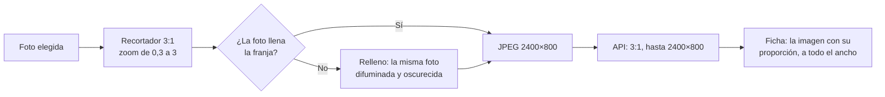

# Plan: la portada se encuadra más fácil (3:1 y se puede alejar)

> Planeación original. Estado: **aprobado por Daniel el 2026-11-15** («aplica lo que propones, pero por ahora solo para el banner del perfil para ver cómo sale»).

Pedido por Daniel el 2026-11-15: la portada del perfil es «muy poco usable». Con una foto real, por ejemplo la de una persona, solo entra una parte de la cara.

## Lo que pasa hoy

- **La franja es muy delgada.** La portada se recorta en 4:1 (`features/shop/CoverCard.tsx`, 2400×600). De una foto vertical de celular (3:4) solo entra el 19 % del alto, y de una horizontal (4:3), el 33 %.
- **No se puede alejar.** El recortador (`AvatarCropDialog.tsx`) tiene zoom mínimo 1 y `objectFit="cover"`: la foto siempre tiene que llenar la franja, así que una foto vertical nunca entra entera.
- **Lo que se encuadra es lo que se ve:** eso ya está desde el 2026-11-14 ([`2026-11-14-portada-calidad-y-staff`](../2026-11-14-portada-calidad-y-staff/)). La ficha la muestra siempre en 4:1.

El banner de los torneos y la imagen del MVP tienen los mismos problemas, pero por ahora no se tocan: primero se prueba con la portada.

## Decisiones tomadas

| Tema | Decisión | Por qué |
|---|---|---|
| Proporción | 3:1, guardada a 2400×800 (la API acepta entre 900×300 y 2400×800) | Entra una cara entera sin que deje de ser una franja |
| Alejar | En el recortador de la portada, el zoom baja hasta 0,3: la foto puede quedar más chica que la franja | Una foto vertical entra completa |
| El espacio que sobra | Se rellena con la misma foto agrandada, difuminada y oscurecida (si el navegador no difumina el canvas, solo oscurecida) | Queda como un fondo, sin bandas negras |
| Peso | Hasta 1 MB, como hoy: si pesa más, la web baja la calidad del JPEG de a poco, ahora hasta 0,6 | 2400×800 pesa un tercio más que 2400×600 |
| Portadas ya subidas (4:1) | No se tocan. La ficha muestra la imagen con su proporción, así que una vieja se sigue viendo entera en 4:1 y una nueva en 3:1 | No se le corta nada a nadie |
| Banner de torneos e imagen del MVP | Sin cambios por ahora | Daniel quiere ver primero cómo sale con la portada |

## 1. El flujo

## 2. Web

- `AvatarCropDialog.tsx`: prop nueva `minZoom` (por defecto 1). Si es menor a 1, el recortador deja mover la foto fuera de la franja (`restrictPosition={false}`).
- `lib/image.ts`: `cropImage` con la opción `fill`. Si el área elegida se sale de la foto, primero pinta la foto agrandada para cubrir todo, difuminada y oscurecida, y encima la parte elegida. Calidad del JPEG hasta 0,6.
- `CoverCard.tsx`: aspecto 3, `minZoom` 0,3, `fill`, 2400×800, y la vista previa en 3:1.
- `PlayerProfile.tsx`: la portada pasa a ser un `` a todo el ancho con su alto natural, en lugar de una caja fija en 4:1.

## 3. API

- `routes/shop.ts`: `COVER_SHAPE` en 3:1, de 900×300 a 2400×800. `COVER_HELP` y las descripciones de `cover_url` dicen 3:1.
- Prueba de integración `shop.test.ts` con una portada 3:1, y una 4:1 que ahora se rechaza.
- `schema.d.ts` regenerado.

## 4. Manual, términos y privacidad

- **Manual:** `jugador/tienda-y-cosmeticos.md` (3:1, 2400×800 y que se puede alejar).
- **Términos y privacidad:** sin cambios (no cambia qué se guarda ni quién lo ve).
- **Changelog:** `CHANGELOG_DISCORD.txt` en esta carpeta.

## 5. Requisitos

Ninguno. No hay cambios en la base.

## 6. Orden

1. Web y API, con typecheck y pruebas.
2. Probarlo en local con Daniel.
3. Si le gusta: manual, changelog, bitácora, commit y despliegue (API y web juntas, porque la web vieja manda 4:1 y la API nueva lo rechazaría). Después se decide si se aplica igual al banner de torneos y a la imagen del MVP.
