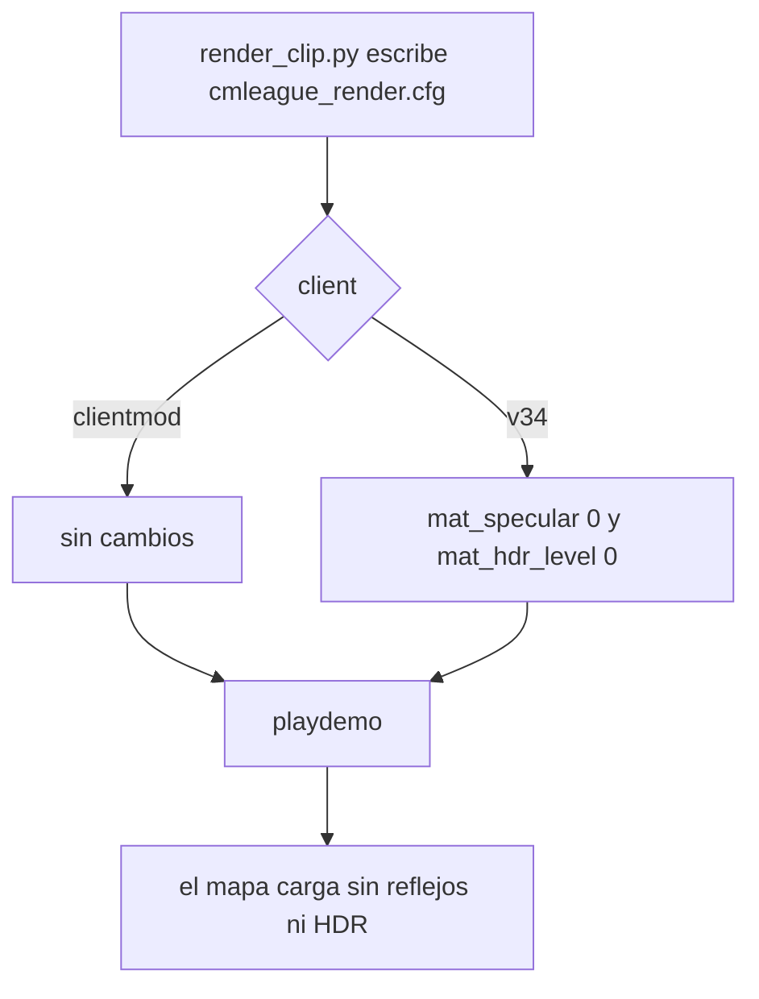

# Los mapas del CSS nuevo en los clips grabados con el v34: documentación

## Qué hace

Algunos mapas de la liga se compilaron con las herramientas del CSS nuevo (`de_tuscan_ob`, `de_strike_mirage`, `de_ancient_css`, `de_train_t5`). Al grabarlos con el CS:S v34 normal (`"client": "v34"`), salían con:

- texturas rotas (el cuadriculado morado) en pisos, vidrios y metales;
- un tono morado en el arma y el cuchillo en algunas zonas;
- todo demasiado brillante.

Desde el 2026-11-15, con `"client": "v34"` el render apaga los reflejos y el HDR (`mat_specular 0; mat_hdr_level 0`) en el cfg que ejecuta al abrir el juego. Vale para todos los mapas. Con ClientMod no cambia nada.

Además, `render/revisar_mapas.py` lista lo que le falta a un mapa en el v34 (materiales, texturas y modelos), para revisar los mapas nuevos antes de que entren a la rotación.



## Por qué se ven mal

| Síntoma | Causa | Arreglo |
|---|---|---|
| Texturas con el cuadriculado morado | Los cubemaps (las imágenes que usan los reflejos) vienen dentro del `.bsp` en VTF 7.4. El v34 lee hasta la 7.2 (`MaterialSystem.dll`: `Encountered VTF file with an invalid version!`) y los reflejos usan la textura de error | `mat_specular 0` |
| Tono morado en el arma y el cuchillo en algunas zonas | El arma refleja el cubemap más cercano: donde es uno de los 7.4, refleja la textura de error | `mat_specular 0` |
| Demasiado brillante | `de_tuscan_ob`, `de_strike_mirage` y `de_ancient_css` traen iluminación HDR hecha con las herramientas nuevas, que el v34 expone de más | `mat_hdr_level 0`: el juego usa la iluminación normal |

Los mapas del v34 traen sus cubemaps en 7.1 o 7.2 (`de_dust2`, `de_inferno`, `de_nuke`), y `de_cache`, `de_season` y `de_dust2` no traen HDR: por eso se veían bien. `de_inferno_classic` también.

**Lo que costó:** en todos los mapas, las armas y algunas superficies pierden el brillo de los reflejos, y `de_nuke` pierde el bloom del HDR. Los clips quedan con el mismo aspecto en todos los mapas.

**Lo que no sirvió:** pasar los cubemaps de `de_tuscan_ob` a 7.2 (reescribiendo la cabecera, con la imagen igual) no quitó el tono morado del arma. El script está en `pruebas/vtf_a_72.py`.

## Lo que queda guardado en la instalación

`mat_specular` y `mat_hdr_level` se guardan en la configuración del juego, igual que `voice_scale` y la K de la consola. Después de una grabación, esa instalación del v34 queda sin reflejos ni HDR también al jugar con ella. Para volver a prenderlos a mano: `mat_specular 1` y `mat_hdr_level 2`, y volver a cargar el mapa.

## `revisar_mapas.py`

```
python -I revisar_mapas.py <v34_dir> <mapa> [<mapa> ...] [--fuente <dir_clientmod>] [--exportar <dir>]
```

- Lee del `.bsp` las texturas de las caras, los modelos de los props estáticos, las entidades (modelos, decals, sprites, cielo, materiales de detalle) y el pakfile.
- Sigue cada `.vmt` (las texturas que nombra y el `include` de los `patch`) y cada `.mdl` (sus materiales, `.vvd` y `.dx90.vtx`).
- Busca cada archivo donde lo busca el juego: el pakfile, `cstrike/` y `hl2/` del v34.
- Informa las versiones de VTF y MDL que usa, avisa si el pakfile trae texturas 7.3 o más nuevas (y cuántas son cubemaps), y lista lo que falta.
- `--fuente`: una instalación de ClientMod; busca ahí (sus `.vpk` y sus carpetas) lo que falte.
- `--exportar`: copia a una carpeta, con sus rutas, lo que falta y está en la fuente.

Solo usa la biblioteca estándar.

### Lo que falta hoy (en la PC, 2026-11-15)

| Mapa | Falta | ¿Está en ClientMod? |
|---|---|---|
| `de_ancient_css` | El agua (`nature/water_coast02`, `nature/water_coast01_beneath`), `nature/blendsandsand008c`, `perftest/blendrockdirt001a`, `stone/blendstonefloor003asphalt` y los modelos `models/effects/vol_light128x384` y `vol_light64x128` | No |
| `de_cache` | `nature/blendprodasphaltgrass` | No |
| `de_tuscan_ob`, `de_strike_mirage`, `de_train_t5`, `de_dust2` | Nada | — |

Tampoco están en el servidor local. En `de_ancient_css` el agua y esas partes del suelo se siguen viendo mal.

## Qué cambia para cada rol

Nada para los usuarios. Solo cambia cómo se ven los clips grabados con el v34.

## Términos y privacidad

Sin cambios.

## Dónde está cada cosa

| Qué | Dónde |
|---|---|
| Los reflejos y el HDR apagados | `render/render_clip.py`, `Game.prepare` |
| El script de revisión | `render/revisar_mapas.py` |
| La guía del portátil | `render/CONFIGURAR_PORTATIL.md`: paso 3b, punto 7, y "Texturas o modelos que le faltan a un mapa" en el paso 9 |
| La conversión a 7.2 que no sirvió | `pruebas/vtf_a_72.py` |
