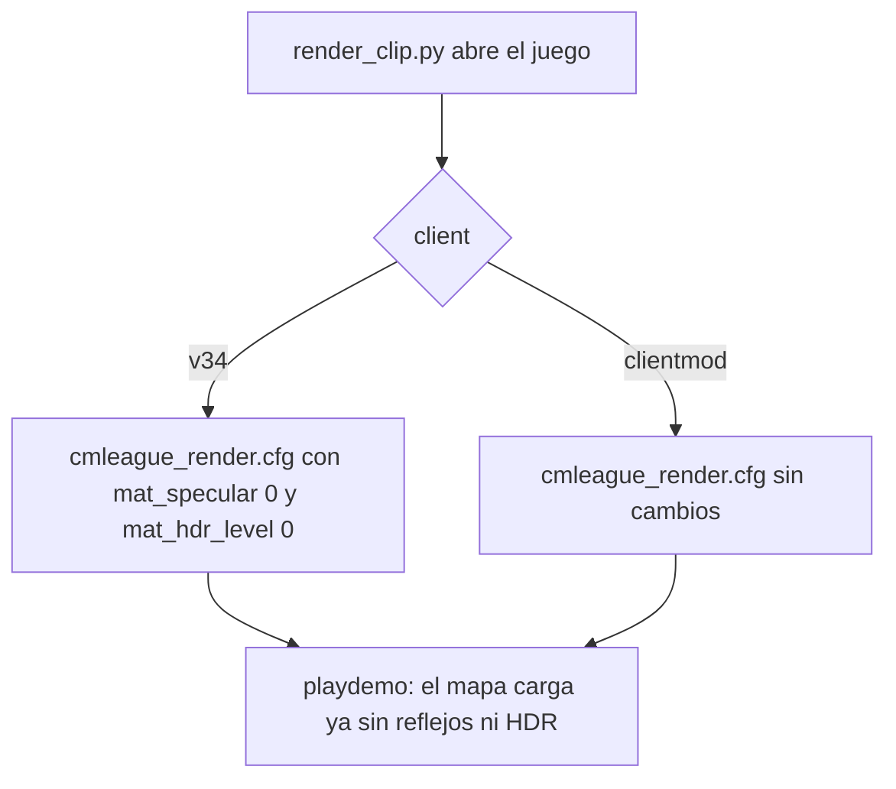

# Plan: los mapas del CSS nuevo en los clips grabados con el v34

> Planeación original. Estado: **aprobada** por Daniel el 2026-11-15 ("implementalo global para el v34").

Pedido por Daniel (2026-11-15): con el CS:S v34 normal (`"client": "v34"`), algunos mapas salen con texturas rotas (el cuadriculado morado), demasiado brillantes y con un tono morado en el arma y el cuchillo en algunas zonas. Los vio en `de_tuscan_ob`, `de_strike_mirage`, `de_ancient_css` y `de_train_t5`.

## Decisiones tomadas

| Tema | Decisión | Por qué |
|---|---|---|
| Causa | Los mapas se compilaron con las herramientas del CSS nuevo: cubemaps en VTF 7.4 (el v34 lee hasta 7.2) e iluminación HDR | Medido en los `.bsp` (ver "Lo que se probó antes del plan") |
| Arreglo | `mat_specular 0` y `mat_hdr_level 0` en `cmleague_render.cfg` | Daniel lo probó a mano en el v34: "ya mejora bastante". Convertir los cubemaps a 7.2 no quitó el tono morado |
| Alcance | Solo con `"client": "v34"`, en **todos** los mapas | ClientMod no tiene el problema. El cfg se carga una vez por sesión y una sesión puede grabar varios mapas: por mapa sería más complicado. Decisión de Daniel |
| Costo aceptado | En los mapas que se veían bien, armas y superficies pierden el brillo de los reflejos, y `de_nuke` pierde el bloom del HDR | Todos los clips quedan con el mismo aspecto |
| Texturas que faltan | Un script nuevo, `render/revisar_mapas.py`, que lista por mapa los materiales, texturas y modelos que el v34 no encuentra | Para revisar los mapas nuevos antes de que entren a la rotación, en vez de bajar paquetes de texturas a ciegas |
| Paquetes de texturas de internet | No se usan | En los cuatro mapas casi no faltan archivos: el problema era el formato, no la falta |

## 1. El flujo completo

`mat_hdr_level` solo se aplica al cargar un mapa: como el cfg se ejecuta antes de `playdemo`, el mapa de la demo ya carga con el HDR apagado.

## 2. Lo que se probó antes del plan

Con un script en el scratchpad (el que pasa a `render/revisar_mapas.py`), sobre el v34 de la PC (`E:\CSS v34 eXpandedCS`) y el ClientMod del render como fuente:

- **Archivos que faltan:** casi ninguno. Solo `de_ancient_css` tiene faltantes de verdad: el agua (`nature/water_coast02`, `water_coast01_beneath`), tres materiales de mezcla del suelo y dos modelos `models/effects/vol_light…`. No están en el v34, ni en el ClientMod del render, ni en el servidor local.
- **Cubemaps:** los cuatro mapas traen en el pakfile entre 86 y 130 cubemaps en VTF 7.4. Los mapas del v34 los traen en 7.1 o 7.2 (`de_dust2`, `de_inferno`, `de_nuke`). `MaterialSystem.dll` del v34 tiene el mensaje `Encountered VTF file with an invalid version!`.
- **Daniel, en el juego:** con `mat_specular 0` desaparecen las texturas rotas.
- **Iluminación:** `de_tuscan_ob`, `de_strike_mirage` y `de_ancient_css` traen iluminación HDR además de la normal; `de_cache`, `de_season` y `de_dust2` no. **Daniel, en el juego:** con `mat_hdr_level 0` "mejora", pero sigue el tono morado en el arma y el cuchillo en algunas zonas.
- **Cubemaps pasados a 7.2:** una copia de `de_tuscan_ob` con los 86 cubemaps reescritos con la cabecera 7.2 (la imagen tiene la misma forma que los de `de_nuke`: 32×32, 7 caras, sin imagen chica). **Daniel, en el juego:** "sigue pasando lo mismo". Se descarta.

## 3. El cambio en el render

`render/render_clip.py`, en `Game.prepare`: con `"client": "v34"`, la línea `mat_specular 0; mat_hdr_level 0` en `cmleague_render.cfg`, con un comentario que explique por qué.

Ojo: igual que `voice_scale`, el juego guarda estos valores en su `config.cfg` (o en el registro), así que la instalación del v34 queda sin reflejos ni HDR también al jugar con ella.

## 4. El script de revisión

`render/revisar_mapas.py <v34_dir> <mapa> [<mapa> …] [--fuente <dir_clientmod>] [--exportar <dir>]`:

- Lee cada `.bsp`: las texturas de las caras, los modelos de los props estáticos, las entidades (modelos, decals, sprites, cielo, materiales de detalle) y el pakfile.
- Sigue cada `.vmt` (texturas que nombra, `include` de los `patch`) y cada `.mdl` (sus materiales, `.vvd` y `.dx90.vtx`).
- Busca cada archivo en el pakfile, `cstrike/` y `hl2/` del v34.
- Informa por mapa: lo que falta (y si está en la fuente), las versiones de VTF y de MDL, y si trae cubemaps 7.3 o más nuevos.
- Con `--exportar`, copia a una carpeta lo que falta y está en la fuente, con sus rutas, para pegarlo en `cstrike/`.

## 5. Documentación

- `render/CONFIGURAR_PORTATIL.md`: el paso 3b (los reflejos y el HDR apagados) y, en "Si algo falla", el script de revisión.
- Esta carpeta, con la documentación, la guía y el script de conversión a 7.2 en `pruebas/` (lo que se probó y no sirvió).
- Una fila en `docs/bitacora/README.md` y una entrada en `docs/PENDIENTES.md` (falta el portátil).
- Manual de usuario, `/terminos` y `/privacidad`: sin cambios (solo cambia cómo se graban los clips).

## 6. Requisitos antes de empezar

Ninguno.

## 7. Orden de implementación

1. El cambio en `render_clip.py`.
2. `render/revisar_mapas.py`, y correrlo con los cuatro mapas.
3. La guía del portátil, la documentación, la guía de implementación, el README y `PENDIENTES.md`.
4. Commit solo cuando Daniel lo pida.
