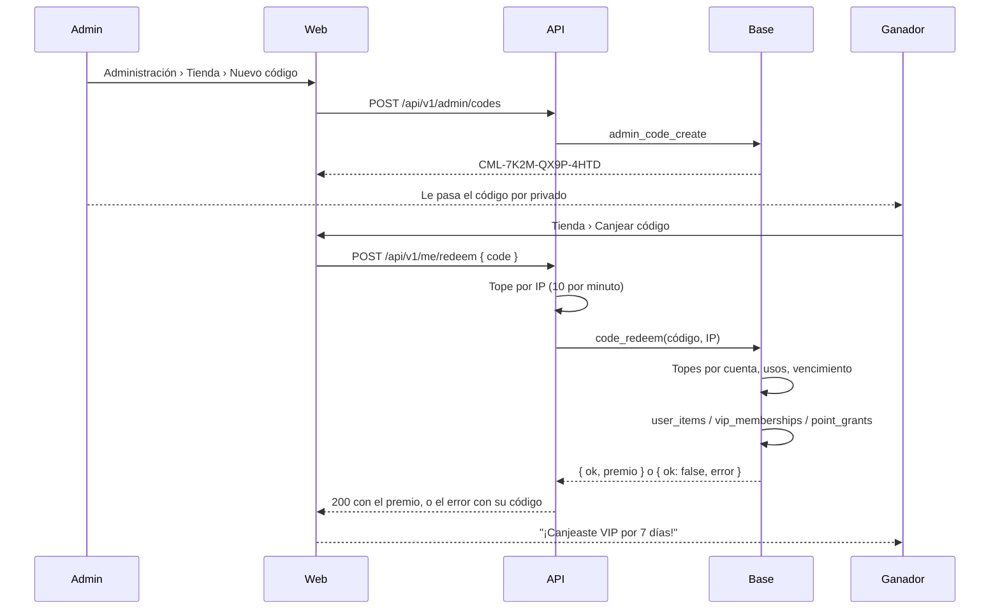
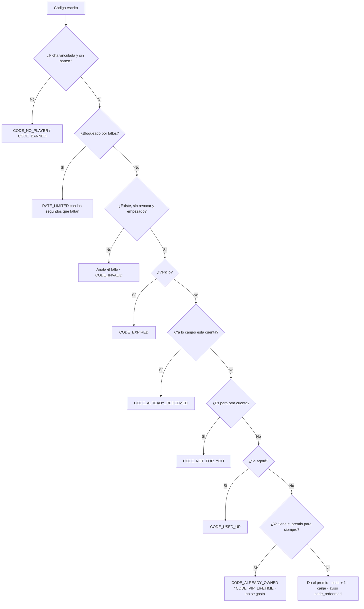
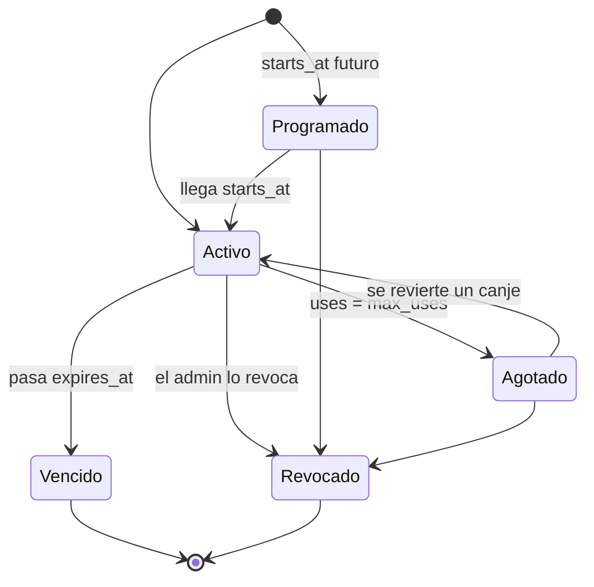
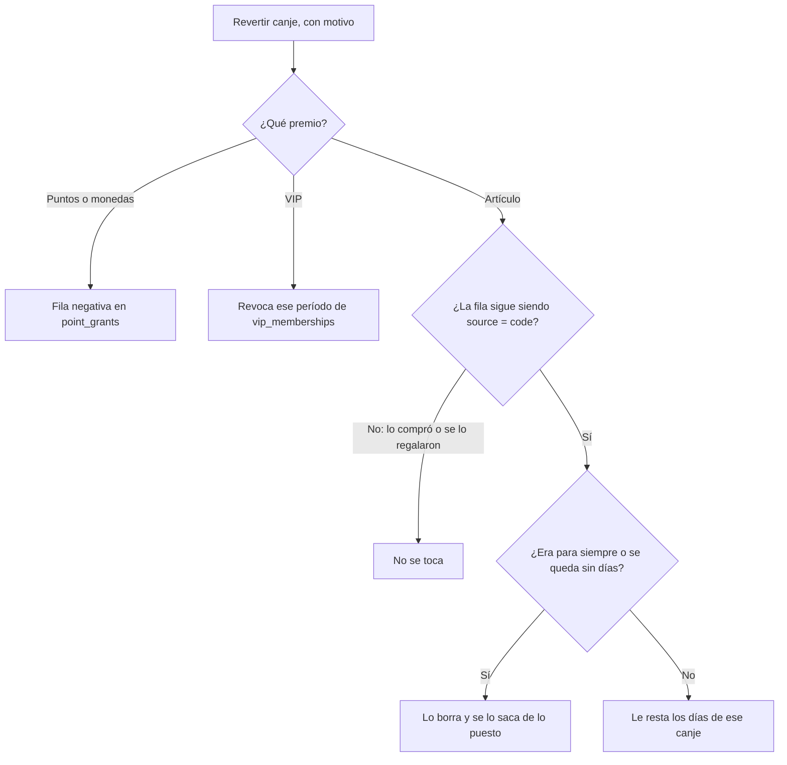

# Códigos canjeables para sorteos: documentación

## Qué hace

Un admin genera **códigos** para los sorteos de la liga y se los pasa a los ganadores (Discord, stream, mensaje). Cada código da un premio: un **artículo de la tienda** (para siempre o por unos días), **puntos**, **monedas VIP** o **días de VIP**. El ganador lo escribe en la Tienda y lo recibe al instante.

Un código puede tener varios usos, una fecha desde y hasta la que sirve, y puede ser **solo para una cuenta**. Cada cuenta lo canjea una vez. Se generan de a uno o en lotes de hasta 100 con el mismo premio, al azar (`CML-XXXX-XXXX-XXXX`) o con un texto elegido por el admin (`NAVIDAD-2026`).

El admin puede revocar un código (deja de servir) y revertir un canje (le quita el premio a esa cuenta). La base frena a quien prueba códigos al azar: 5 códigos inexistentes en 15 minutos o 20 en 24 horas bloquean el canje de esa cuenta un rato, y la API corta a más de 10 canjes por minuto desde la misma IP.

Se monta sobre la tienda de la `119`: los puntos de un código son regalos de `point_grants`, lo temporal es `user_items.expires_at` y el VIP es un período más de `vip_memberships`. Pedido por Kyan (propuesta en `kyan/guia`, `3a5b7102`), adaptado a `main` y aprobado por Daniel el 2026-11-16.

## Qué pasa al canjear

`code_redeem` revisa en este orden y se detiene en el primero que falla:

- **"No válido" agrupa tres casos:** un código que no existe, uno revocado y uno que todavía no empieza responden lo mismo ("Ese código no es válido"), para no revelar qué códigos existen. Son los únicos que cuentan como fallo.
- **"Ya lo canjeaste" va antes que "se agotó":** a quien canjeó un código de 1 uso le dice que ya lo canjeó, no que se agotó.
- **No se gasta** si la cuenta ya tiene el artículo para siempre o ya es VIP de por vida: puede pasárselo a otro.

### Cada premio

| Premio | Qué recibe la cuenta |
|---|---|
| Artículo para siempre | Una fila en `user_items` con `source = 'code'`, como uno regalado. Si lo tenía por unos días, pasa a ser para siempre |
| Artículo por días | La fila con `expires_at`. Si ya lo tenía por unos días, se suman a partir del vencimiento (o desde ahora, si ya venció) |
| Puntos o monedas VIP | Una fila en `point_grants` con `redemption_id` y el motivo "Código: <sorteo>". El saldo se recalcula solo |
| VIP por días | Un período en `vip_memberships` con `source = 'code'` que empieza donde termina el último vigente, como `admin_vip_grant` |

### Lo VIP de un código

Un artículo VIP que la cuenta tiene **por un código** (`user_items.source = 'code'`) se usa aunque no sea VIP, mientras esté encendido `points_config.code_vip_free`. Viene encendido y se cambia en Administración › Tienda › Puntos y monedas VIP, con **Lo VIP de un código se usa sin ser VIP**. Decisión de Daniel del 2026-11-17, al ver que un sticker VIP ganado en un sorteo no se podía poner.

- **Apagado:** ese artículo queda congelado hasta que la cuenta sea VIP, como lo VIP comprado. El cambio vale al instante para todo lo ya canjeado, porque `can_use_item` lee la configuración cada vez.
- **Compra o regalo posterior:** si la cuenta lo compra después o un admin se lo regala, la fila deja de ser del código y sigue la regla de siempre.
- **Dónde se aplica:** en la base, en `can_use_item`, y por lo tanto en `player_cosmetics_public` y `set_my_cosmetics`. En la API, el catálogo calcula `usable` con la misma regla.
- **En la web:** si está apagado y la cuenta no es VIP, la ventana de canje avisa que el artículo se va a poder usar siendo VIP.

### Lo temporal

- `can_use_item` no deja usar un artículo vencido. Con eso, `player_cosmetics_public` deja de mostrarlo puesto y `set_my_cosmetics` no deja ponérselo, sin cambios en esos dos.
- La fila vencida queda en `user_items` para que la web muestre "Venció el…". En el catálogo (`GET /api/v1/shop/items`) un artículo vencido sale con `owned: false` y su `expires_at`, así que vuelve a estar a la venta.
- Comprarlo (`shop_buy`) o que un admin lo regale (`admin_item_grant`) lo vuelve para siempre, en vez de responder "Ya lo tienes".

## Estados de un código

El estado no se guarda: se calcula con `code_state` cada vez.

## Topes contra la fuerza bruta

| Dónde | Tope | Qué pasa |
|---|---|---|
| API, por IP | 10 canjes por minuto (regla `redeem`, binding `RL_REDEEM` en Workers) | `429 RATE_LIMITED` sin llegar a la base |
| Base, por cuenta | 5 fallos en 15 minutos | Bloqueada 15 minutos desde el último fallo |
| Base, por cuenta | 20 fallos en 24 horas | Bloqueada hasta que el más viejo de esos 20 cumpla 24 horas |

Un código al azar tiene 60 bits: con 20 intentos por día no se adivina nunca. Los topes sirven sobre todo para los personalizados. `redeem_attempts` guarda la cuenta, la fecha, la IP y los primeros 4 caracteres de lo escrito, y `code_redeem` borra los de más de 30 días cada vez que anota uno.

`code_redeem` no lanza errores: devuelve `{ok: false, error, message[, retry_after]}`. Si lanzara un error, el rollback se llevaría el fallo que acaba de anotar y los topes nunca contarían nada. La API pasa `error` al código HTTP.

## Revertir un canje

- El código recupera el uso (`uses - 1`) y la cuenta recibe el aviso `code_reverted` con el motivo.
- El canje queda registrado como revertido: esa cuenta no puede volver a canjear el mismo código.
- Revocar un período VIP que tenía otro a continuación deja un hueco entre los dos. Es raro, y el admin lo arregla con `admin_vip_grant`.

## Datos (replanteo `126`)

| Tabla | Qué guarda |
|---|---|
| `redeem_codes` | El código normalizado (`code`, único) y como se muestra (`display`), si es personalizado, el lote (`batch_id`), el premio (`reward`, `item_id`, `amount`, `duration_days`), los usos (`max_uses`, `uses`), `for_user`, `starts_at`, `expires_at`, el sorteo (`label`), la nota interna, quién lo creó y la revocación |
| `code_redemptions` | Cada canje: código, cuenta, fecha, lo que recibió, el período VIP que creó (`vip_membership_id`), hasta cuándo (`until`) y la reversión. `unique (code_id, user_id)` |
| `redeem_attempts` | Cada fallo: cuenta, fecha, IP y 4 caracteres. Se borran a los 30 días |

Las tres tienen RLS sin políticas y ningún permiso para `anon` ni `authenticated`: todo pasa por funciones `security definer`.

Cambios en lo que ya existía: `points_config.code_vip_free` (con `set_points_config`, que acepta ese booleano), `user_items.expires_at` y `source` con `code`, `vip_memberships.source` con `code`, `point_grants.redemption_id` (índice único donde `amount > 0`), `user_items_of` devuelve `expires_at`, `points_history` saca los regalos de un código con `kind = 'code'`, y `notification_category` suma `code_redeemed` y `code_reverted` a `account`.

**Normalización** (`code_normalize`): mayúsculas, sin espacios ni guiones, y `O`→`0`, `I`/`L`→`1`, igual al guardar y al canjear. Por eso un código se puede dictar sin confusiones. Los códigos al azar usan el alfabeto Crockford base32 (sin `I`, `L`, `O` ni `U`) y salen de `gen_random_uuid()`.

### Funciones

| Función | Quién | Qué hace |
|---|---|---|
| `code_redeem(p_code, p_ip)` | cuenta | El canje completo (diagrama de arriba) |
| `my_redemptions()` | cuenta | Sus canjes, con los últimos 4 caracteres del código |
| `admin_code_create(...)` | admin | Uno o un lote de hasta 100. Personalizado y "solo para una cuenta", de a uno y con 1 uso |
| `admin_codes(p_q, p_state, p_limit, p_offset)` | admin | Lista con el estado, buscando en el código, el sorteo y la nota |
| `admin_code_redemptions(p_code)` | admin | Quién lo canjeó |
| `admin_code_revoke(p_code, p_reason)` | admin | Deja de servir |
| `admin_redemption_revert(p_redemption, p_reason)` | admin | Revierte un canje |
| `admin_redeem_attempts(p_limit)` | admin | Fallos de la última hora y del día, los últimos fallos y las cuentas bloqueadas |
| `code_normalize`, `code_random12`, `code_state`, `redeem_blocked_until`, `code_account`, `code_reward_json` | internas | Sin permiso para nadie más que las funciones |

## API

| Ruta | Quién | Respuesta |
|---|---|---|
| `POST /api/v1/me/redeem` `{ code }` | cuenta | `200 { reward, item, amount, days, until, label }` |
| `GET /api/v1/me/redemptions` | cuenta | `{ items }` |
| `GET /api/v1/admin/codes` | admin | Lista paginada (`page`, `per`, `q`, `state`) |
| `POST /api/v1/admin/codes` | admin | `201 { batch_id, codes: [{ id, code }] }` |
| `GET /api/v1/admin/codes/attempts` | admin | Fallos y bloqueadas |
| `GET /api/v1/admin/codes/{id}/redemptions` | admin | `{ items }` |
| `POST /api/v1/admin/codes/{id}/revoke` `{ reason }` | admin | `204` |
| `POST /api/v1/admin/redemptions/{id}/revert` `{ reason }` | admin | `204` |

Errores del canje (`error.code`): `CODE_INVALID` (404), `CODE_EXPIRED`, `CODE_USED_UP`, `CODE_ALREADY_REDEEMED`, `CODE_ALREADY_OWNED` y `CODE_VIP_LIFETIME` (409), `CODE_NOT_FOR_YOU`, `CODE_NO_PLAYER` y `CODE_BANNED` (403), y `RATE_LIMITED` (429, con `Retry-After` y `details.retry_after`). El mensaje lo escribe la base para el jugador.

El código va siempre en el cuerpo del pedido, nunca en la URL, y no queda en los registros de la API (`requestLog` no guarda cuerpos).

## Web

- **Tienda:** botón **Canjear código** junto a **Historial**, que abre la ventana de canje (`RedeemDialog`). La ruta la abre con `/shop?canjear=true`; el código nunca va en la URL. La ventana:
  - da formato al escribir o pegar (`formatCode`);
  - muestra el premio, o el error según `error.code`;
  - si la cuenta está bloqueada, dice cuánto falta y apaga el botón;
  - lista **Tus canjes**.
- **Tarjetas del catálogo:** lo temporal dice "Vence en N días" y lo vencido, "Venció el…", y vuelve a estar a la venta.
- **Historial:** los puntos y monedas de un código salen como "Código · <sorteo>".
- **Mi perfil:** tarjeta "¿Ganaste un sorteo?" con **Canjear un código**.
- **Administración › Tienda › Puntos y monedas VIP:** el interruptor **Lo VIP de un código se usa sin ser VIP**.
- **Administración › Tienda:** sección **Códigos y sorteos** (`AdminCodesSection`):
  - contadores de fallos y cuentas bloqueadas, con **Ver intentos**;
  - la lista con búsqueda, filtro por estado, copiar, **Canjes** y **Revocar**;
  - **Nuevo código**, con el resumen antes de generar;
  - la ventana con los códigos generados, **Copiar** y **Bajar CSV**;
  - **Revertir** cada canje.

## Qué cambia para cada rol

| Rol | Qué cambia | Página del manual |
|---|---|---|
| Jugador | Canjea códigos de sorteos en la Tienda o desde Mi perfil, y ve sus canjes y cuánto le queda a lo temporal | `jugador/tienda-y-cosmeticos.md` (Canjear un código) |
| Admin | Crea códigos y lotes, los revoca, revierte canjes, ve los intentos fallidos y decide si lo VIP de un código se usa sin ser VIP | `admin/tienda-y-puntos.md` (Cuánto se gana; Códigos y sorteos) |
| Capitán, organizador, soporte, moderador, streamer y dueño de un servidor externo | Nada | — |

No hay comandos nuevos en el servidor.

## Términos y privacidad

Hasta el despliegue, todo esto lleva la marca "En preparación" (`Wip` en la web, `` en los `.html`). Se quita al desplegar.

- **`/terminos`, "Puntos, tienda y misiones":** un punto nuevo, "Sorteos y códigos":
  - los sorteos son gratis y sin compra;
  - un código se canjea una vez por cuenta, puede vencer y tener un límite de usos, y no vale dinero ni se vende;
  - lo temporal se saca al vencer;
  - un artículo VIP de un código se usa sin ser VIP mientras esa opción esté encendida, y si se apaga queda congelado;
  - el VIP de un código no tiene arrepentimiento ni reembolso;
  - podemos revertir un canje con trampa, vendido o por error;
  - probar códigos para adivinarlos bloquea el canje y puede llevar a una sanción.
- **`/privacidad`, "VIP, puntos y tienda":** guardamos los canjes (código, fecha y premio) mientras tengas la cuenta, y los intentos fallidos (fecha, IP y los primeros 4 caracteres) durante 30 días. Dos filas nuevas en la tabla de plazos.

## Dónde está cada cosa

| Qué | Archivo / ubicación |
|---|---|
| Replanteo | `supabase/replanteo/126_codigos_canjeables.sql` |
| Inversa | `docs/bitacora/2026-10-14-replanteo-modelo-datos/reversas/126_codigos_canjeables.sql` |
| Prueba SQL | `docs/bitacora/2026-11-16-codigos-canjeables/pruebas/probar_126.sh` y `probar_126.sql` |
| Rutas de la API | `web/backend/src/routes/codes.ts`, esquemas en `web/backend/src/schemas/codes.ts` |
| Tope por IP | `web/backend/src/lib/ratelimit.ts` (regla `redeem`) y `web/backend/wrangler.toml` (`RL_REDEEM`) |
| Errores de la API | `web/backend/src/lib/errors.ts` y `web/frontend/src/api/errors.ts` (`CODE_*`) |
| Tienda (vencimiento y origen `code`) | `web/backend/src/routes/shop.ts`, `web/backend/src/schemas/shop.ts` |
| Pruebas de la API | `web/backend/test/unit/codes-routes.test.ts`, `web/backend/test/integration/codes.test.ts` |
| Ventana de canje y acceso de Mi perfil | `web/frontend/src/features/shop/RedeemDialog.tsx` |
| Sección del admin | `web/frontend/src/features/shop/AdminCodesSection.tsx` |
| Formato y textos | `web/frontend/src/features/shop/codeFormat.ts` |
| Consultas de la web | `web/frontend/src/features/shop/codes.ts` |
| Ruta de la Tienda (`?canjear`) | `web/frontend/src/routes/_app/shop.tsx` |
| Manual | `docs/manual/jugador/tienda-y-cosmeticos.md`, `docs/manual/admin/tienda-y-puntos.md` |
| Legales | `web/frontend/src/features/legal/pages/TermsPage.tsx` y `PrivacyPage.tsx`, `terms/terminos.html` y `terms/privacidad.html` |
| Propuesta original de Kyan y prototipo | Rama `kyan/guia`, commit `3a5b7102` (`/demo/codigos`) |
