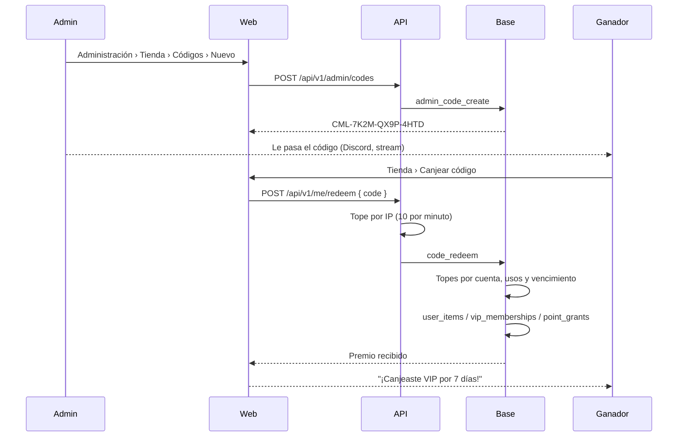
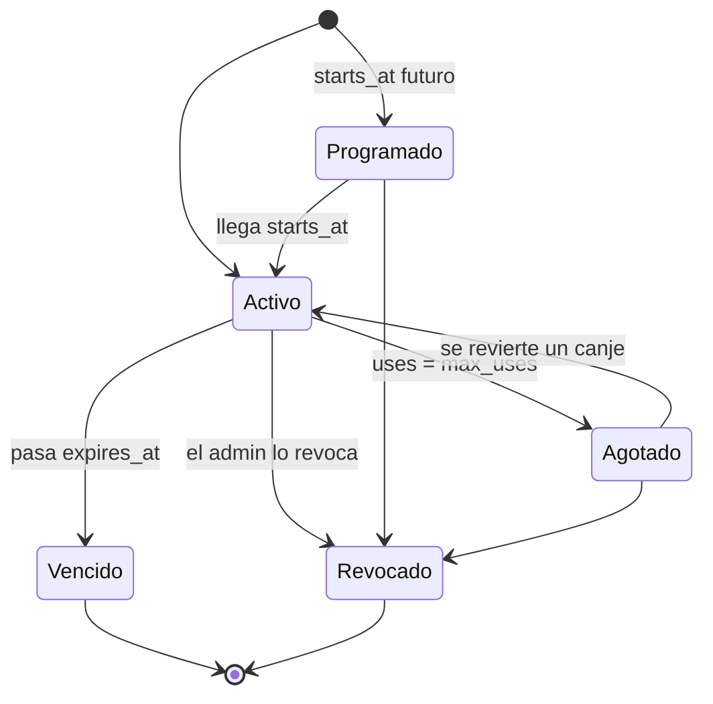
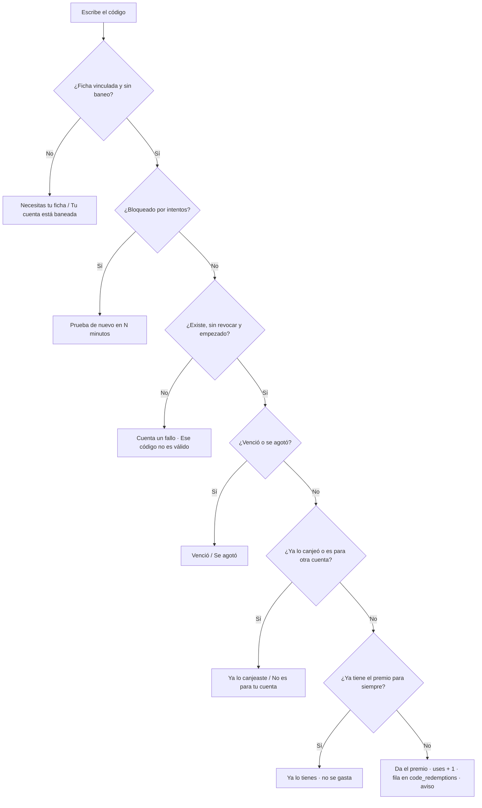
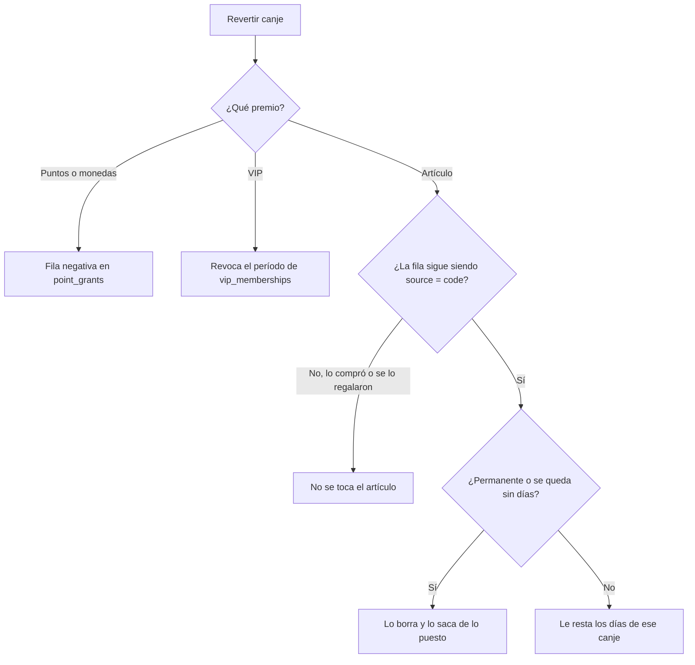

# Plan: códigos canjeables para sorteos

> Planeación original. Estado: **propuesta**, pendiente de aprobación.
> Pedido por Kyan (propuesta del 2026-11-17 en la rama `kyan/guia`: `docs/bitacora/2026-11-17-codigos-canjeables/PLAN.md`,
> commit `3a5b7102`, con prototipo en `/demo/codigos`). Daniel (2026-11-16) pidió adaptarla a `main` como requerimiento
> nuevo, con el replanteo **`126`**.

Kyan quiere sortear cosas de la tienda y el VIP. Un admin genera un **código** con un premio (un artículo de la tienda,
puntos, monedas VIP o días de VIP), se lo pasa al ganador (Discord, stream, mensaje) y el ganador lo escribe en la web
para recibirlo.

La propuesta de Kyan se escribió sobre la tienda de `kyan/pruebas` (replanteo `110`, con `point_ledger`,
`points_award`, `my_inventory`, `shop_buy_bundle` y `tg_award_vip_welcome`), que no es la de producción. Este plan
mantiene lo que Kyan pidió y lo monta sobre lo que hay en `main`:

- **Tienda** del replanteo `119_tienda.sql` ([`2026-11-11-tienda-de-puntos`](../2026-11-11-tienda-de-puntos/)), en
  producción desde el 2026-11-14. Los saldos no se anotan: se **calculan** (`points_totals`) a partir de los mixes,
  los regalos (`point_grants`) y lo gastado (`user_items.price_paid` y `custom_cosmetics`).
- **VIP** de la migración `20261028120000_vip.sql` y el replanteo `32`: `vip_memberships` y la regla de "el período
  nuevo empieza donde termina el último" de `admin_vip_grant`.
- **Avisos** (`notify`, `notification_category`) y **Administración › Tienda** (`AdminShopPage.tsx`).

## Qué cambia respecto de la propuesta de Kyan

| Propuesta de Kyan (`kyan/pruebas`) | En este plan (`main`) |
|---|---|
| Replanteo `119` | `119` ya es la tienda en producción. Este es el **`126`** |
| Puntos con `point_ledger` (origen `code`, `ref` único) | Puntos y monedas como filas de **`point_grants`** con la columna nueva `redemption_id`. Así `points_totals` y `points_history` los cuentan sin cambios de fondo |
| `my_inventory`, `shop_buy_bundle` | No existen en `main`. Se cambian `user_items_of`, `shop_buy` y `admin_item_grant` |
| Sin monedas de bienvenida para un VIP corto (`tg_award_vip_welcome`) | No aplica: en `main` no hay bienvenida, y las monedas VIP solo salen de los mixes jugados siendo VIP. Una semana de VIP da las monedas de esa semana y nada más |
| Limpieza de intentos con `pg_cron` | Los replanteos no usan `pg_cron`. Los intentos viejos se borran en el mismo `code_redeem` |
| Bloqueo diario según el día de Bogotá | Ventana móvil de 24 horas, sin zona horaria |
| `O`→`0` e `I`/`L`→`1` "después del prefijo" en un lado y siempre en el otro | Una sola regla: siempre, al guardar y al canjear. El código personalizado se muestra como lo escribió el admin (`display`) |
| Pestaña Canjear en la tienda | La tienda de `main` no tiene pestañas: botón **Canjear código** junto al saldo, que abre una ventana |
| Manual `jugador/tienda-y-puntos.md` y `admin/tienda.md` | En `main` son `jugador/tienda-y-cosmeticos.md` y `admin/tienda-y-puntos.md` |
| Mensajes con voseo ("Ya lo tenés") | Tuteo, como el resto de la web ("Ya lo tienes") |
| Prototipo `/demo/codigos` | Se queda en `kyan/guia` como referencia. Importa `Amount` y `Thumb` de `features/shop/parts`, que en `main` no existe, y la rama arrastra `kyan/pruebas`. La pantalla real se hace directo |

## Decisiones tomadas

| Tema | Decisión | Por qué |
|---|---|---|
| Qué se premia | Un premio por código: **artículo**, **puntos**, **monedas VIP** o **VIP por días** | Lo que pidió Kyan. Un sorteo con varios premios son varios códigos |
| Artículos | Cualquiera de `shop_items` menos el premio del VIP (`vip_reward`), igual que `admin_item_grant`. Incluye lo VIP y lo inactivo (un artículo "exclusivo de sorteo") | Lo exclusivo es lo que hace atractivo un sorteo. Lo VIP se usa mientras la cuenta sea VIP, como cuando lo regala un admin |
| Duración del artículo | **Para siempre** o **N días** (1 a 365; atajos 7 y 30). Columna nueva `user_items.expires_at` | Lo que pidió Kyan |
| Artículo que ya tiene | Para siempre (comprado, regalado o de un código permanente): no se gasta el código y le dice "Ya lo tienes". Temporal: se suman los días desde el vencimiento (o desde ahora, si ya venció). Un código permanente sobre uno temporal lo vuelve permanente | Que el ganador no pierda el premio |
| Comprar o regalar lo temporal | `shop_buy` y `admin_item_grant`, si la fila existe y es temporal (vigente o vencida), la vuelven permanente (`source`, `price_paid` y `expires_at = null`) en vez de decir "Ya lo tienes" | Hoy dirían "Ya lo tienes" y no se podría comprar |
| Lo temporal vencido | La fila queda en `user_items` (para mostrar "Venció") pero `can_use_item` da `false`, así que `player_cosmetics_public` ya no lo muestra puesto | `can_use_item` es el único lugar que decide qué se puede usar |
| Duración del VIP | **Días** (1 a 365; atajos 7, 30 y 90). Sin VIP de por vida por código | Lo de por vida lo sigue dando un admin a mano |
| VIP vigente | El período nuevo empieza donde termina el último, como `admin_vip_grant`. Si es VIP de por vida: no se gasta y le dice que ya lo tiene | La misma regla del VIP |
| Puntos y monedas | Una fila en `point_grants` por canje (`redemption_id`, motivo "Código: <sorteo>"). Al revertir, otra fila con el monto en negativo | Es la tabla de regalos y correcciones; el saldo se recalcula solo |
| Quién genera | Solo el **admin** (`is_admin()`) | Un código es un regalo de la liga |
| Quién canjea | Una cuenta con sesión, con su **ficha de jugador vinculada** y sin baneo vigente | La tienda ya exige la ficha (`shop_buy`): lo cosmético se ve en la ficha y los puntos se ganan con ella |
| Usos | Cada código tiene **usos** (1 a 10.000) y se canjea **una vez por cuenta**. Opcional: **solo para una cuenta** | Un código de 1 uso para un ganador; uno de 50 para "los primeros 50 del stream" |
| Lote | Hasta **100 códigos** de una vez, con el mismo premio (`batch_id`), para copiar o bajar como CSV | Sorteos con muchos ganadores |
| Vencimiento | Opcional (atajos 7 y 30 días), y aparte de la duración del premio. También **desde cuándo** sirve (`starts_at`) | "Canjéalo antes del domingo" no es lo mismo que "VIP por 7 días" |
| Formato | `CML-XXXX-XXXX-XXXX`: 12 caracteres de Crockford base32 (sin `I`, `L`, `O` ni `U`), 60 bits, con `gen_random_bytes` | Imposible de adivinar y fácil de dictar |
| Normalización | Mayúsculas, sin espacios ni guiones, y `O`→`0` e `I`/`L`→`1`, siempre, al guardar y al canjear | Una sola regla para los dos tipos de código |
| Código personalizado | De 8 a 24 letras y números (`NAVIDAD2026`), solo de a uno. Se guarda normalizado en `code` y como lo escribió el admin en `display`. La pantalla avisa que se adivina más fácil | Para streams; el admin decide el riesgo |
| Fuerza bruta | Por cuenta: **5 fallos en 15 minutos** bloquean 15 minutos y **20 fallos en 24 horas** bloquean hasta que el más viejo cumpla 24 horas. Por IP: **10 por minuto** en la API. Solo cuenta como fallo un código que no existe (o revocado o sin empezar) | Con 60 bits no se adivina nunca; los topes frenan los personalizados |
| Mensajes | "No existe", "revocado" y "todavía no empezó" dicen lo mismo: **"Ese código no es válido"**. "Venció", "se agotó", "ya lo canjeaste" y "no es para tu cuenta" se dicen tal cual | No revelar qué códigos existen |
| Dónde | **Tienda › Canjear código** (ventana) y un acceso en **Mi perfil**. Nunca por URL (`?code=`) | Los códigos no van en URLs |
| Historial del jugador | Sus canjes en la ventana de canje, y los puntos y monedas en el Historial de la tienda con el tipo nuevo `code` | Que sepa qué recibió y hasta cuándo |
| Historial del admin | Por código: usos, quién lo canjeó y cuándo. Global: intentos fallidos y cuentas bloqueadas | Control de los sorteos y de abusos |
| Revertir | El admin **revoca un código** (deja de servir; lo canjeado sigue) y **revierte un canje** (detalle en la sección 2) | Premios dados por error o canjes con trampa |
| Avisos | `code_redeemed` al canjear (para el historial de la campana) y `code_reverted` al revertir, en `account` | Como `vip_granted` y `item_revoked` |
| Permisos | Toda tabla y función nueva lleva su `revoke` explícito de `public`, `anon` y `authenticated` y solo el `grant` que necesita | En el VPS, los objetos nuevos nacen con permisos para `anon` y `authenticated` (replanteo `118`) |

## 1. El flujo completo

Estados de un código (se calculan, no se guardan):

Qué pasa al canjear:

## 2. Base de datos (replanteo `126`)

`supabase/replanteo/126_codigos_canjeables.sql`, con la inversa en
`docs/bitacora/2026-10-14-replanteo-modelo-datos/reversas/126_codigos_canjeables.sql` y pruebas SQL en
`docs/bitacora/2026-11-16-codigos-canjeables/pruebas/`. Aborta si falta la `119` (`shop_items`, `point_grants`) o el
VIP (`vip_memberships`), o si ya existe `redeem_codes`. Guarda la definición de las funciones que reemplaza en
`replanteo126_funciones`, como la `119`, para la inversa. No toca datos y se puede aplicar con mixes en curso.

### Tablas nuevas

`redeem_codes`: un código.

| Columna | Tipo | Nota |
|---|---|---|
| `id` | `uuid` | |
| `code` | `text unique` | Normalizado. Solo lo ven los admins |
| `display` | `text` | Como se muestra: `CML-XXXX-XXXX-XXXX` o el personalizado tal cual |
| `custom` | `boolean` | |
| `batch_id` | `uuid` | Los del mismo lote |
| `reward` | `text` | `item`, `points`, `vip_coins` o `vip` |
| `item_id` | `text` → `shop_items` | Solo con `item` |
| `amount` | `int` | Puntos o monedas VIP (1 a 100.000) |
| `duration_days` | `int` | Días del artículo o del VIP (1 a 365). `null` = para siempre (solo artículos) |
| `max_uses`, `uses` | `int` | 1 a 10.000; `uses` cuenta los canjes sin revertir |
| `for_user` | `uuid` → `profiles` | Solo para esa cuenta (opcional) |
| `starts_at`, `expires_at` | `timestamptz` | `expires_at` opcional y mayor que `starts_at` |
| `label` | `text` | El sorteo: "Sorteo Discord 17/11" (hasta 80) |
| `note` | `text` | Nota interna (hasta 200) |
| `created_by`, `created_at` | | |
| `revoked_at`, `revoked_by`, `revoke_reason` | | |

Con `check` de que cada premio tenga lo suyo: `item` con `item_id`, `vip` con `duration_days` y sin `amount`,
`points` y `vip_coins` con `amount` y sin `item_id` ni `duration_days`, y `uses between 0 and max_uses`.

`code_redemptions`: un canje.

| Columna | Nota |
|---|---|
| `id`, `code_id`, `user_id`, `redeemed_at` | `unique (code_id, user_id)`: una vez por cuenta, aunque se revierta |
| `reward`, `item_id`, `amount`, `days` | Lo que recibió, copiado del código |
| `vip_membership_id` | El período VIP que creó |
| `until` | Hasta cuándo le dura (artículo temporal o VIP) |
| `reverted_at`, `reverted_by`, `revert_reason` | Si un admin lo revirtió |

`redeem_attempts`: cada fallo (`user_id`, `at`, `ip` si la pasa la API, y lo escrito **truncado a 4 caracteres**),
con índice por `(user_id, at)` y por `at`. `code_redeem` borra los de más de **30 días** cada vez que anota un fallo.

Las tres con RLS activada, sin políticas y con `revoke all` para `anon` y `authenticated`: todo pasa por funciones
`security definer`.

### Cambios en lo que ya existe

| Objeto | Cambio |
|---|---|
| `user_items` | Columna `expires_at timestamptz` (null = para siempre). `source` acepta `code` |
| `can_use_item` | Además: `u.expires_at is null or u.expires_at > now()`. Con eso `player_cosmetics_public` y `set_my_cosmetics` ya dejan de usar lo vencido |
| `user_items_of` | Devuelve `expires_at` (cambia el tipo de retorno: `drop` y `create`, con sus permisos) |
| `shop_buy` | Si la fila existe y `expires_at` no es null, la actualiza a compra permanente en vez de decir "Ya lo tienes" |
| `admin_item_grant` | Igual: lo temporal pasa a regalo permanente |
| `point_grants` | Columna `redemption_id uuid` → `code_redemptions`, con índice único parcial `where amount > 0` (no se paga dos veces un canje) |
| `points_history` | Las filas de `point_grants` con `redemption_id` salen con `kind = 'code'` y el nombre del sorteo |
| `vip_memberships` | `source` acepta `code` |
| `notification_category` | `code_redeemed` y `code_reverted` en `account`, con el mismo `replace` que usó la `119` |

### Funciones nuevas

| Función | Quién | Qué hace |
|---|---|---|
| `code_normalize(text)` | interna | Mayúsculas, sin espacios ni guiones, `O`→`0`, `I`/`L`→`1` |
| `code_generate()` | interna | `CML` + 12 de Crockford base32 con `gen_random_bytes`; reintenta si choca |
| `code_redeem(p_code text, p_ip inet default null)` | cuenta | Bloqueo `pg_advisory_xact_lock(hashtext('shop:' \|\| uid))` (el mismo de la tienda), ficha y baneo, topes, `select … for update` del código, validación del diagrama, da el premio, `uses + 1`, fila en `code_redemptions`, aviso. Devuelve `{reward, item, amount, days, until}` |
| `my_redemptions()` | cuenta | Sus canjes: fecha, sorteo, premio, hasta cuándo y si se revirtió. Sin el código entero (últimos 4) |
| `admin_code_create(p_reward, p_item, p_amount, p_days, p_max_uses, p_count, p_starts_at, p_expires_at, p_for_user, p_custom, p_label, p_note)` | admin | Crea uno o un lote (hasta 100). Personalizado solo con `p_count = 1`. Devuelve los códigos |
| `admin_codes(p_q, p_state, p_limit, p_offset)` | admin | Lista con el estado calculado y el total |
| `admin_code_redemptions(p_code uuid)` | admin | Quién lo canjeó, cuándo y si se revirtió |
| `admin_code_revoke(p_code uuid, p_reason text)` | admin | Deja de servir; lo canjeado sigue |
| `admin_redemption_revert(p_redemption uuid, p_reason text)` | admin | Ver abajo; `uses - 1` y aviso `code_reverted` |
| `admin_redeem_attempts(p_limit int)` | admin | Fallos recientes, cuentas bloqueadas ahora y contadores |

Errores de `code_redeem`: `raise exception` con el texto para el jugador y `using hint = '<código>'`, que la API
pasa a `error.code`: `code_invalid`, `code_expired`, `code_used_up`, `code_already_redeemed`, `code_not_for_you`,
`code_already_owned`, `code_vip_lifetime`, `code_no_player`, `code_banned` y `code_rate_limited` (con los segundos que
faltan en `detail`).

Qué deshace `admin_redemption_revert`:

- Revocar un período VIP que tenía otro a continuación deja un hueco entre los dos: no se corre el siguiente. Es raro
  y el admin lo puede arreglar con `admin_vip_grant`.
- La fila de `code_redemptions` queda, así que esa cuenta no puede volver a canjear ese código.
- La fila negativa de puntos puede dejar el saldo en negativo, como `admin_item_revoke`.

## 3. API (`web/backend`, `routes/codes.ts`)

| Método y ruta | Quién | Respuesta |
|---|---|---|
| `POST /api/v1/me/redeem` `{ code }` | cuenta | `200 { reward, item, amount, days, until }` |
| `GET /api/v1/me/redemptions` | cuenta | Sus canjes |
| `GET /api/v1/admin/codes` | admin | Lista con `q`, `state`, `limit` y `offset` |
| `POST /api/v1/admin/codes` | admin | Crea uno o un lote: `201 { codes: [...] }` |
| `GET /api/v1/admin/codes/{id}/redemptions` | admin | Canjes de un código |
| `POST /api/v1/admin/codes/{id}/revoke` `{ reason }` | admin | `204` |
| `POST /api/v1/admin/redemptions/{id}/revert` `{ reason }` | admin | `204` |
| `GET /api/v1/admin/codes/attempts` | admin | Fallos y cuentas bloqueadas |

- Middlewares como en `routes/shop.ts`: `requireUser` y, en lo de admin, `requireAdmin`.
- Regla nueva `redeem` en `RATE_RULES` (`lib/ratelimit.ts`): 10 por minuto por IP, binding `RL_REDEEM`.
- `error.code` según el `hint` de la base; `code_rate_limited` responde `429` con `retry_after`.
- El código no va en la URL ni en los logs: se registra solo la cuenta y el resultado. La IP se pasa a `code_redeem`.
- Las funciones nuevas se llaman con `as never` hasta regenerar `db/types.ts`, como en `shop.ts`.
- Pruebas de integración contra la copia local: canje de cada premio, duplicado, agotado, vencido, para otra cuenta,
  topes, revertir y permisos (una cuenta que no es admin recibe `403`).

## 4. Web (`web/frontend`)

### Jugador

- **Tienda (`ShopPage.tsx`):** botón **Canjear código** junto al saldo, que abre una ventana con:
  - un campo que da formato solo (`CML-XXXX-XXXX-XXXX`, en mayúsculas) y acepta pegar con o sin guiones (si no empieza
    con `CML`, no le da formato: es un personalizado);
  - al canjear, el premio: la vista del artículo (`ItemPreview`), la cantidad o el VIP con hasta cuándo, y un botón
    para ponérselo o ir a lo suyo;
  - los errores según `error.code`; con bloqueo, cuánto falta y el botón desactivado;
  - **Tus canjes**: fecha, sorteo, premio y cuánto le queda si es temporal.
- **Historial de la tienda:** las filas `code` con un ícono de regalo y el nombre del sorteo.
- **Lo mío:** lo temporal muestra "Vence en N días" y, vencido, "Venció" (y "Comprar" si está a la venta).
- **Mi perfil:** un acceso "¿Ganaste un sorteo? Canjea tu código" que abre la misma ventana en la tienda.

### Admin

Sección nueva **Códigos** en **Administración › Tienda** (`AdminShopPage.tsx`):

- **Nuevo código:** premio (artículo con buscador y vista previa, puntos, monedas VIP o VIP), duración, usos, cantidad,
  desde y hasta cuándo sirve, solo para una cuenta (buscador de cuentas), personalizado (con aviso), sorteo y nota. Al
  generar, los códigos en una ventana con **Copiar** y **Bajar CSV**, y un aviso de no publicarlos en un canal abierto.
- **Lista:** código (copiar), sorteo, premio, usos `x / y`, vence, estado y acciones (ver canjes, revocar con motivo).
- **Canjes de un código:** cuenta, fecha y **Revertir** (con motivo, `ConfirmDialog`).
- **Intentos fallidos:** contadores arriba (`StatTile`), últimos fallos y cuentas bloqueadas.

Pruebas con Vitest del formato del campo, los mensajes por `error.code` y la sección del admin.

## 5. Manual de usuario

| Rol | Página | Qué cambia |
|---|---|---|
| Jugador | `jugador/tienda-y-cosmeticos.md` | Sección "Canjear un código": dónde, el formato, los premios, lo temporal, los topes de intentos y que no se vende |
| Admin | `admin/tienda-y-puntos.md` | Sección "Códigos y sorteos": crear, lotes, personalizados, revocar, revertir e intentos fallidos |

Capitán, organizador, moderador, streamer y dueño de un servidor externo: sin cambios. No hay comandos nuevos en el
servidor.

## 6. Términos y privacidad

En la web (`TermsPage.tsx`, `PrivacyPage.tsx`) y en `terms/terminos.html` y `terms/privacidad.html`, en el mismo
commit, con la marca **"En preparación"** (`Wip` y ``) hasta que esté desplegado:

- **`/terminos`, "Puntos, tienda y misiones"**, un punto "Sorteos y códigos":
  - los sorteos son gratis y sin obligación de compra;
  - un código se canjea una vez por cuenta, puede vencer y no vale dinero: no se vende ni se cambia por plata;
  - lo que da un código puede durar un tiempo, que se ve al canjearlo;
  - el VIP de un código no es un VIP pagado: no tiene derecho de arrepentimiento ni reembolso y sigue las demás reglas
    del VIP;
  - si un código se obtuvo con trampa, se vendió o se dio por error, podemos revertir el canje;
  - intentar adivinar códigos bloquea el canje por un tiempo y puede llevar a una sanción.
- **`/privacidad`, "VIP, puntos y tienda"**: guardamos los canjes (cuenta, código, fecha y premio) mientras tengas la
  cuenta, y los intentos fallidos (cuenta, fecha, IP y los primeros 4 caracteres de lo que escribiste) durante 30
  días, para frenar abusos. Una fila nueva en la tabla de plazos.

## 7. Requisitos antes de empezar

- Que Kyan y Daniel aprueben este plan.
- Una copia local de producción con la `119` y la `125` aplicadas.
- `pgcrypto` (`gen_random_bytes`) en la base del VPS: comprobarlo con `select * from pg_extension`.
- El binding `RL_REDEEM` en `wrangler.toml`, si el backend se sigue publicando también como Worker (en el VPS usa el
  limitador en memoria).

## 8. Orden de implementación

1. Replanteo `126` con sus pruebas SQL y la inversa, en la copia local.
2. `routes/codes.ts` y la regla `redeem`, con pruebas de integración.
3. Web: ventana de canje, historial, lo mío con vencimiento, acceso en Mi perfil y la sección Códigos del admin.
4. Manual, términos y privacidad, `DOCUMENTACION.md`, `GUIA_IMPLEMENTACION.md` y `CHANGELOG_DISCORD.txt`.
5. Despliegue: respaldo de la base, la `126`, la API y la web. Sin cambios en los servidores de juego.
6. Probar en producción con un código de 1 uso para una cuenta de prueba y revertirlo.
