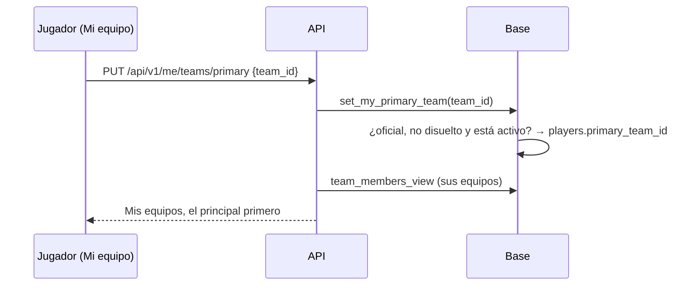
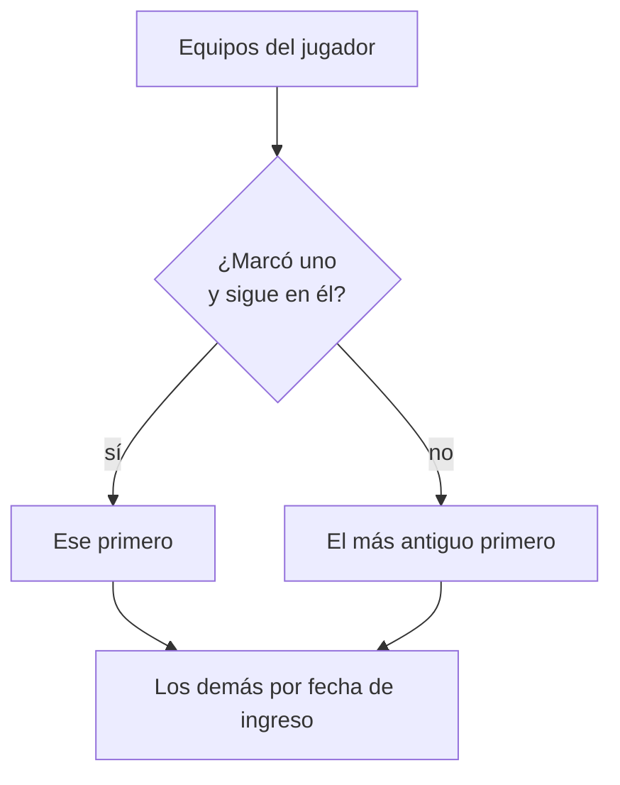

# Equipo principal: documentación

## Qué hace

Un jugador puede estar en varios equipos oficiales a la vez y ser capitán de hasta `team_config.max_led`. Desde este requerimiento, también elige cuál es su **equipo principal**: el que se muestra primero en todas las listas de sus equipos.

Si no eligió ninguno, el principal es **el más antiguo**: el equipo al que entró primero (`team_members.joined_at`). Si sale del equipo que había marcado, vuelve a ser el más antiguo de los que le quedan.

El principal se marca en **Mi equipo** con la estrella "Marcar como principal". Se ve en el perfil público (estrella junto al primer equipo), en el ranking de jugadores ("Equipo +n"), en el menú lateral y en Mi equipo, que abre en ese equipo. No cambia ninguna regla de torneos, PCW, ranking de equipos ni topes.

## El orden de los equipos

Una sola regla en todos lados: primero el principal y después por fecha de ingreso (sin fecha, antes) y por nombre.

| Dónde | Cómo |
|---|---|
| `player_overview.teams` (ranking de jugadores, `player_ranking`, buscador, perfil público, comparador, portada, widgets) | `ORDER BY (team_primary_order(tm.player_id, tm.team_id)), tm.joined_at NULLS FIRST, t.name` |
| `season_standings_list.teams` (ranking de una temporada) | Igual |
| `GET /api/v1/me/teams` | `sortByPrimary` en la API, con `is_primary` |
| `GET /api/v1/me/profile` (`teams`) | `sortByPrimary` para los equipos donde está; al final, por nombre, los que solo capitanea o creó sin estar en el plantel. `is_primary` en el primero donde está |

## Base (replanteo `124`)

| Qué | Detalle |
|---|---|
| `players.primary_team_id` | `uuid`, FK a `teams` con `on delete set null`. `null` = el más antiguo |
| `set_my_primary_team(p_team uuid)` | `security definer`, para `authenticated`. Solo acepta un equipo oficial, no disuelto, donde el jugador de la sesión está activo. `null` limpia. Sin jugador vinculado o con otro equipo: `V3901` (409) |
| Trigger `team_members_primary_clear` | Al poner `left_at` (salir, que lo saquen, equipo disuelto) o al borrar la fila, si ese era el principal lo pone en `null`. Así no revive si vuelve a entrar |
| `team_primary_order(jugador, equipo)` | 0 si es el principal, 1 si no. Lo usan las dos vistas |

## API

| Ruta | Qué hace |
|---|---|
| `PUT /api/v1/me/teams/primary` | Cuerpo `{ team_id: uuid \| null }`. Devuelve Mis equipos ya ordenados. 401 sin sesión, 409 si el equipo no vale |
| `GET /api/v1/me/teams` | Suma `is_primary` y el orden de arriba |
| `GET /api/v1/me/profile` | `teams[].is_primary` y el orden de arriba. Además `team_lead: { led, max }`: de cuántos equipos oficiales activos es capitán y el tope `team_config.max_led` (mismo conteo que `teams_lead_limit`) |

## Web

- **Mi equipo** (`TeamSwitcher`): con dos o más equipos, al lado del selector aparece "Marcar como principal" (estrella) sobre el equipo que se está viendo, o "Equipo principal" si ya lo es. El principal lleva una estrella en el selector. Sin `?team`, Mi equipo abre el principal (antes, el primero que capitaneaba).
- **Crear otro equipo** (agregado el mismo día): con equipo, Mi equipo muestra **Crear equipo** junto a **Buscar equipo** mientras `team_lead.led < team_lead.max`. Antes solo aparecía sin ningún equipo, aunque el admin hubiera subido `max_led`.
- **Perfil público**: el primer equipo lleva una estrella ("Equipo principal") cuando el jugador tiene más de uno.
- **Menú lateral**: el equipo que muestra es el principal (antes, el que capitaneaba).
- Ranking, comparador, portada y el diálogo de inscripción no cambiaron de código: toman el primero de la lista, que ahora es el principal.

## Qué cambia para cada rol

| Rol | Qué cambia | Página del manual |
|---|---|---|
| Jugador | Marca su equipo principal en Mi equipo; se ve primero en su perfil, en el ranking y en Mi equipo | `jugador/equipo.md` ("Tu equipo principal") |
| Capitán | Lo mismo que el jugador. Mi equipo ya no abre primero el que capitanea, sino el principal. Si el admin subió el tope de equipos por capitán, puede crear otro desde Mi equipo | `jugador/equipo.md` ("Crear tu equipo") |
| Organizador, moderador, admin, streamer, dueño de un servidor externo | Nada | — |

## Términos y privacidad

- `/privacidad` (web y `terms/privacidad.html`): "Qué guardamos" dice "Tus equipos y cuál marcaste como principal", y "Público para cualquiera" dice "tus equipos (el principal primero)".
- `/terminos`: sin cambios.
- Fecha de la última versión: 16 de noviembre de 2026 (`LEGAL_UPDATED` y los dos `.html`).

## Dónde está cada cosa

| Qué | Archivo / ubicación |
|---|---|
| Replanteo y su reversa | `supabase/replanteo/124_equipo_principal.sql`, `docs/bitacora/2026-10-14-replanteo-modelo-datos/reversas/124_equipo_principal.sql` |
| Orden en la API | `web/backend/src/lib/db.ts` (`sortByPrimary`) |
| Rutas | `web/backend/src/routes/teams.ts` (`loadMyTeams`, `setPrimary`), `web/backend/src/routes/me.ts` |
| Esquemas | `web/backend/src/schemas/teams.ts` (`MyTeam.is_primary`, `PrimaryTeamBody`), `web/backend/src/schemas/profile.ts` |
| Mutación | `web/frontend/src/features/teams/api/queries.ts` (`useSetPrimaryTeam`) |
| Estrella | `web/frontend/src/features/teams/components/TeamSwitcher.tsx` (`PrimaryStar`) |
| Perfil público | `web/frontend/src/features/player/pages/PlayerProfile.tsx` |
| Menú lateral | `web/frontend/src/features/shell/api/queries.ts` (`useShellIdentity`) |
| Manual | `docs/manual/jugador/equipo.md` |
