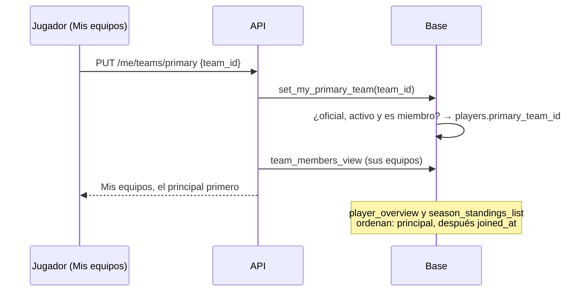
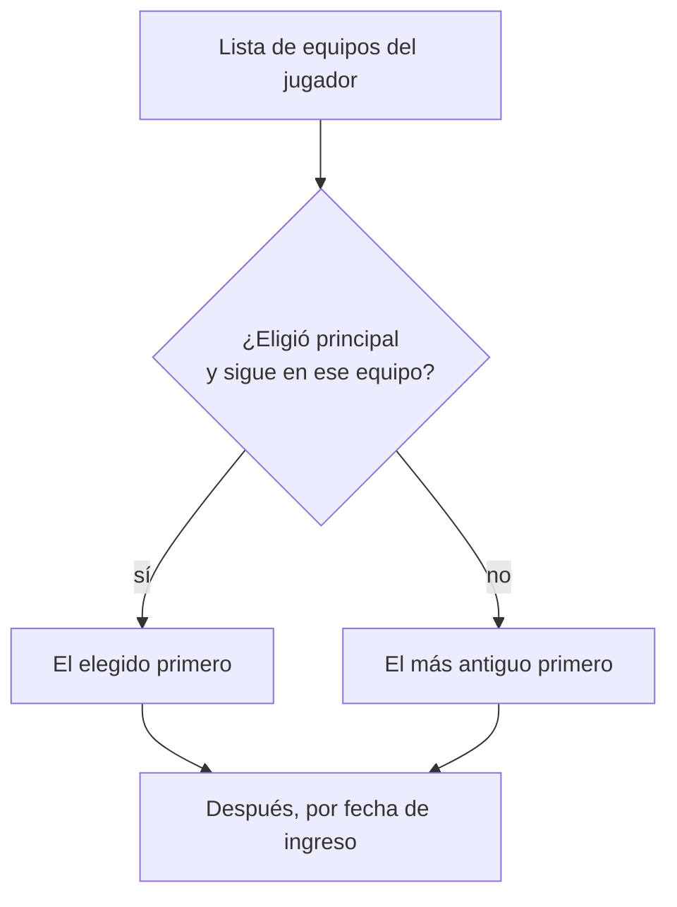

# Plan: equipo principal

> Planeación original. Estado: **aprobado** por Daniel el 2026-11-16, en la conversación donde se pidió.

Pedido de Daniel (2026-11-16): un jugador puede estar en varios equipos oficiales (y ser capitán de hasta `team_config.max_led`), pero no puede decir cuál es "el suyo". Hoy cada pantalla toma el primero de una lista, y las listas no siguen el mismo orden.

## Lo que hay hoy

| Dónde | De dónde sale | Orden |
|---|---|---|
| Ranking de jugadores, buscador, comparador, portada, widget | `player_overview.teams` (y `player_ranking`, que la lee) | Fecha de ingreso (`tm.joined_at nulls first, t.name`) |
| Ranking de una temporada | `season_standings_list.teams` | Fecha de ingreso |
| Perfil público (`GET /players/{id}`) | `player_overview.teams` | Fecha de ingreso |
| `GET /me/profile` (menú lateral, Cuenta, "TU EQUIPO") | `teams` filtrado en `me.ts` | Alfabético |
| `GET /me/teams` (Mis equipos) | `team_members_view` | Alfabético, y la web pone primero los que capitanea |

Un jugador puede ver un equipo en el ranking y otro al abrir Mis equipos.

## Decisiones tomadas

| Tema | Decisión | Por qué |
|---|---|---|
| Dónde se guarda | Columna `players.primary_team_id` (null = sin elegir), con FK a `teams` y `on delete set null` | Es del jugador, no de la cuenta: el ranking y el perfil público muestran fichas |
| Sin elegir | El principal es **el más antiguo** (el de `joined_at` más viejo), como hoy en el ranking | Daniel, 2026-11-16 |
| Qué equipos valen | Solo un equipo **oficial, no disuelto, donde está activo** en `team_members` | No tiene sentido un principal del que ya saliste o donde solo sos dueño |
| Al salir del equipo | Trigger en `team_members`: si se pone `left_at` en el principal, `primary_team_id` vuelve a null (vuelve al más antiguo) | Que no reviva si vuelve a entrar años después |
| Una sola regla de orden | En todos lados: primero el principal y después por fecha de ingreso (`joined_at nulls first`, nombre) | Que el primero de la lista sea siempre el principal, en cualquier pantalla |
| Cómo se cambian las vistas | Replanteo `124` reescribe el `ORDER BY` de `player_overview` y `season_standings_list` con `pg_get_viewdef` + `replace`, como la `69`. Mismas columnas | `player_ranking` y los widgets las leen; no hace falta recrearlas |
| Función | `set_my_primary_team(p_team uuid)`, `security definer`, para `authenticated`. `null` limpia. Error `V3901` (409) sin jugador vinculado, `P0001` si el equipo no vale | Mismo estilo que `set_my_bio` |
| API | `PUT /api/v1/me/teams/primary` con `{ team_id: uuid \| null }`, devuelve Mis equipos. `GET /me/teams` suma `is_primary` y ordena como arriba. `GET /me/profile` también ordena así sus `teams` (los que solo capitanea o creó sin estar en el plantel, al final) y suma `is_primary` | La web ya tiene Mis equipos en caché; con la respuesta lo actualiza sin otra consulta |
| Dónde se elige | Solo en **Mis equipos**: una estrella junto al selector, "Marcar como principal" sobre el equipo que estás viendo. Si ya es el principal, la estrella llena y el texto "Equipo principal" | Daniel, 2026-11-16: "la estrella en Mis equipos basta" |
| Con un solo equipo | No se muestra la estrella | No hay nada que elegir |
| Mis equipos al abrir | Abre el principal (antes, el primero que capitanea o el primero por nombre). El selector sigue el mismo orden | El principal es "tu equipo" |
| Perfil público | El primero (el principal) se destaca con una estrella y el título "Equipo principal"; los demás siguen al lado | Daniel, 2026-11-16: "mostrarlo en el perfil también" |
| Otros lugares | Ranking (`TeamsCell`, "Equipo +n"), comparador, portada, menú lateral (equipo del atajo) y el diálogo de inscripción abren o muestran el principal sin cambios de código, porque toman el primero de la lista. El menú lateral hoy prefiere el que capitanea: pasa a tomar el principal | Una sola regla |
| Reglas de juego | El principal **no** cambia nada de torneos, PCW, ranking de equipos ni topes | Es solo cómo se presenta el jugador |
| Términos y privacidad | `/privacidad`: se suma que el jugador puede marcar un equipo principal y que se muestra en su perfil y en el ranking (ya se publican sus equipos). `/terminos`: sin cambios | Es un dato nuevo que se guarda y se publica |
| Manual | `jugador/equipo.md`: cómo marcar el principal y dónde se ve | Lo hace el jugador |
| Número | Replanteo **`124`** | `main` llega a la `123` |
| Rama | `main` (base, API y web). No es matchmaking | |

## 1. El flujo completo

## 2. Base (replanteo `124_equipo_principal.sql`)

1. Chequeos: existen `player_overview` y `season_standings_list` con `tm.joined_at NULLS FIRST` en su definición, y `players` no tiene `primary_team_id`.
2. `alter table players add column primary_team_id uuid references teams(id) on delete set null`.
3. Trigger `team_members_primary_clear` (after update of `left_at`, y after delete): si el jugador tenía ese equipo de principal, lo pone en null.
4. `set_my_primary_team(p_team uuid)`.
5. Las dos vistas: el `ORDER BY tm.joined_at NULLS FIRST` pasa a `ORDER BY (tm.team_id = (SELECT pp.primary_team_id FROM players pp WHERE pp.id = tm.player_id)) IS TRUE DESC, tm.joined_at NULLS FIRST`.
6. `notify pgrst, 'reload schema'`.
7. Reversa en `docs/bitacora/2026-10-14-replanteo-modelo-datos/reversas/124_equipo_principal.sql` y fila en `supabase/replanteo/README.md`.

## 3. API (`web/backend`)

- `schemas/teams.ts`: `MyTeam` suma `is_primary`; `PrimaryTeamBody`.
- `routes/teams.ts`: `GET /me/teams` ordena principal → `joined_at` → nombre; `PUT /me/teams/primary`.
- `routes/me.ts` y `schemas/profile.ts`: `teams` ordenados igual, con `is_primary`.
- Tipos de la base regenerados, `openapi.json` y `schema.d.ts` del frontend.
- Prueba de integración: marcar, el orden en `/me/teams` y en `/players`, rechazar un equipo ajeno, salir del equipo limpia.

## 4. Web (`web/frontend`)

- `TeamSwitcher`: estrella "Marcar como principal" / "Equipo principal" sobre el equipo que se ve (solo con 2 o más). Mutación que actualiza `teamKeys.mine` y vuelve a pedir `/me/profile`, el ranking y el perfil.
- `myteam.tsx`: sin el orden "capitán primero"; usa el de la API.
- `shell/api/queries.ts`: el equipo del menú es el principal (`teams[0]` de los que es miembro).
- `PlayerProfile.tsx`: el primero con estrella y "Equipo principal".

## 5. Requisitos antes de empezar

- Túnel a la base de producción (`ssh -L 5433:…`) para aplicar la `124` y regenerar tipos. Lo abre Daniel.

## 6. Orden de implementación

1. Replanteo `124` y su reversa.
2. API, tipos y prueba.
3. Web.
4. Manual (`jugador/equipo.md`) y `/privacidad` (web y `terms/privacidad.html`).
5. `DOCUMENTACION.md`, `GUIA_IMPLEMENTACION.md`, `CHANGELOG_DISCORD.txt` y fila en `docs/bitacora/README.md`.
6. Despliegue (base, API, web) cuando Daniel lo pida.
