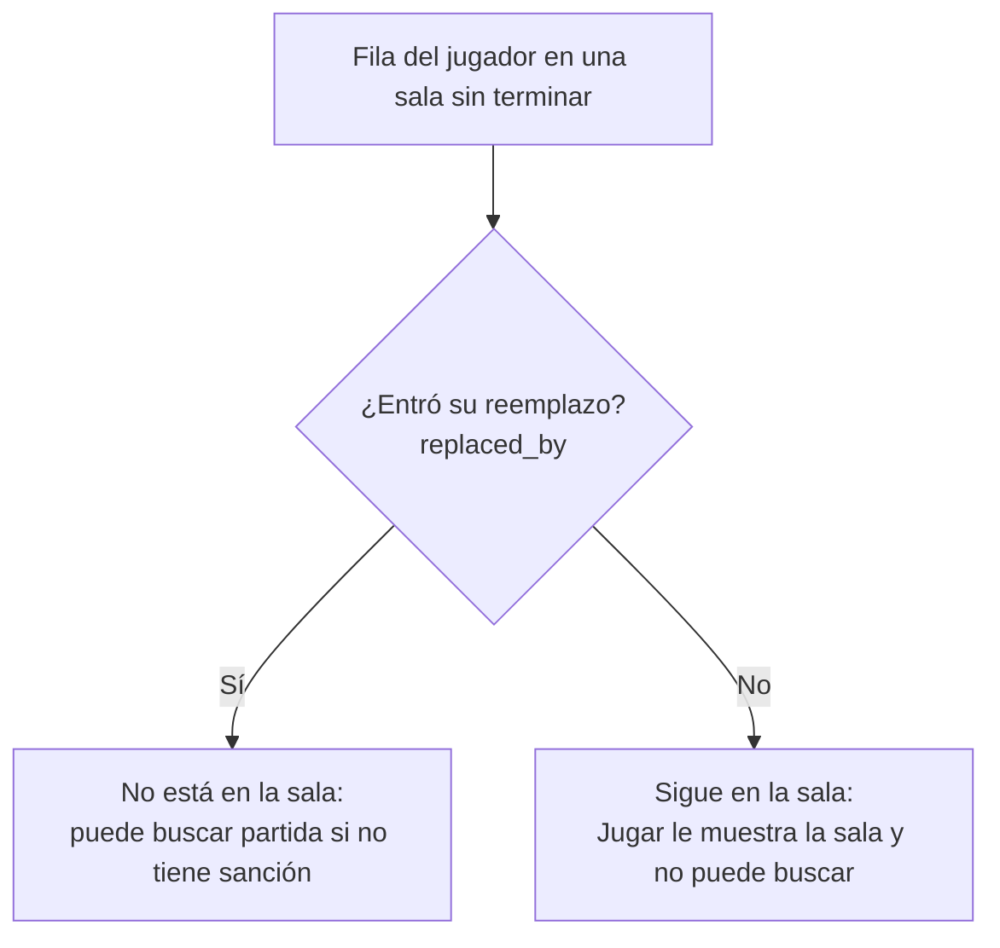

# El jugador reemplazado puede volver a buscar partida: documentación

## Qué hace

Cuando un jugador abandona un mix del matchmaking y entra su reemplazo, ese jugador ya no pertenece a la sala: puede volver a buscar partida en cuanto no tenga sanción, sin esperar a que termine la partida que dejó.

Antes, la web le seguía mostrando la sala en vivo al tocar **Jugar** y la cola no lo dejaba entrar hasta que esa partida terminara, aunque un moderador le hubiera levantado la sanción. Pasó con nachinn el 2026-11-16.

Su sanción y el ELO que pierde por abandonar no cambian. El que abandona y todavía no tiene reemplazo sigue atado a la sala, como antes.

## La regla: `mm_active_lobby`

`mm_active_lobby(usuario)` devuelve la sala abierta del jugador (la que no está `finished` ni `cancelled`). Desde el replanteo `125`, no cuenta las filas de `mm_lobby_players` con `replaced_by`, que se llena cuando el reemplazo entra al servidor (replanteo `75`).

Como es la única función que decide "en qué sala está el jugador", el cambio vale en todos lados:

| Dónde | Qué cambia para el reemplazado |
|---|---|
| `mm_my_live` / `mm_my_state` (**Jugar** en la web) | No le muestra la sala en vivo. Cuando la partida termina, aparece en "Tu última partida", como siempre |
| Entrar a la cola y armar grupo | Ya no le dice que está en una sala |
| Estado de los amigos | Deja de figurar como "jugando" |
| Tomar un reemplazo (`mm_replace_take`) | Puede tomar el de otra partida (no el de la suya: ya jugó en ella) |
| Baneo que saca de la cola (replanteo `107`) | Ya no lo busca en esa sala |

No cambian el servidor, el plugin, la API ni la web.

## Qué cambia para cada rol

| Rol | Qué cambia | Página del manual |
|---|---|---|
| Jugador | Si abandona y entra su reemplazo, puede volver a buscar partida cuando se le termine la sanción, sin esperar a que termine la partida que dejó | `jugador/buscar-partida.md` |
| Moderador, admin y soporte | Al levantarle la sanción a alguien que ya fue reemplazado, puede buscar en el momento | Sin cambios (`moderador/sanciones-matchmaking.md` ya dice que puede buscar enseguida) |

## Términos y privacidad

Sin cambios: no se guarda ni se publica nada nuevo, y la sanción y el ELO del abandono siguen igual.

## Dónde está cada cosa

| Qué | Archivo / ubicación |
|---|---|
| Migración | `supabase/replanteo/125_mm_reemplazado_puede_buscar.sql` |
| Inversa | `docs/bitacora/2026-10-14-replanteo-modelo-datos/reversas/125_mm_reemplazado_puede_buscar.sql` |
| Definición anterior | `supabase/replanteo/48_matchmaking.sql` |
| Reemplazos (`replaced_by`) | `supabase/replanteo/75_mm_reemplazos.sql` |
| Manual | `docs/manual/jugador/buscar-partida.md` |
