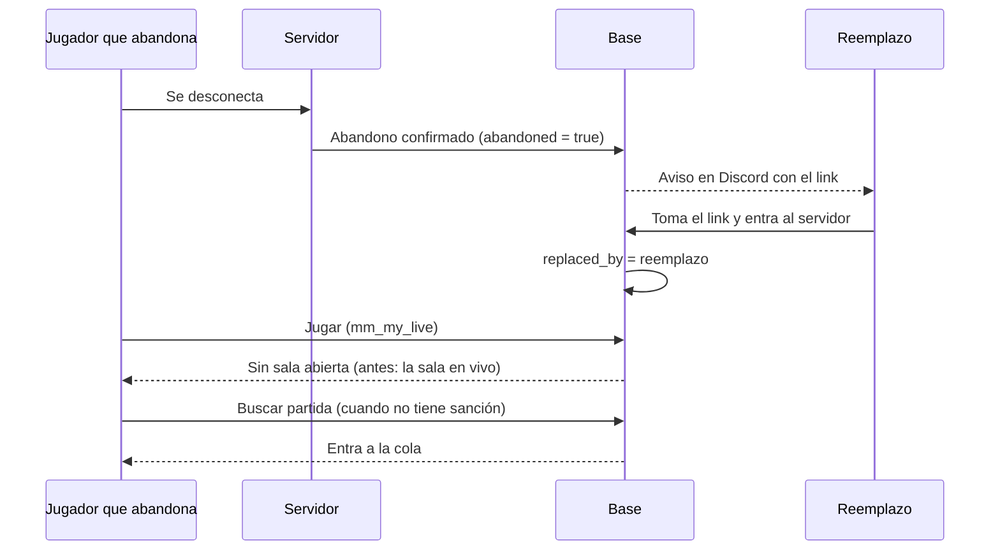

# Plan: el jugador reemplazado puede volver a buscar partida

> Planeación original, escrita el 2026-11-16. Por la urgencia, el arreglo se aplicó en producción antes de escribir este plan; lo pidió Daniel ("la idea es que pueda buscar ya"). Estado: **aprobado por Daniel**.

## Decisiones tomadas

| Tema | Decisión | Por qué |
|---|---|---|
| El problema | nachinn abandonó un mix del matchmaking por un problema técnico y entró su reemplazo (gttt.). Daniel le levantó la sanción, pero en **Jugar** le seguía apareciendo esa sala y no podía buscar otra partida | `mm_active_lobby` cuenta cualquier fila del jugador en una sala sin terminar, también la de quien ya fue reemplazado |
| Dónde se arregla | Solo en `mm_active_lobby`: no cuentan las filas con `replaced_by` | Es la única función que decide "en qué sala está el jugador". La usan la web (`mm_my_live`), la cola, los grupos, el estado "jugando" de los amigos, tomar un reemplazo y el baneo que saca de la cola. En todos, el reemplazado ya no está en la sala |
| El que abandonó sin reemplazo | Sigue atado a la sala, como antes | Todavía puede volver o lo pueden cubrir. Su equipo lo sigue esperando |
| Sanción y ELO del que abandonó | No cambian | El plan de los reemplazos ([`2026-11-04-mm-reemplazos`](../2026-11-04-mm-reemplazos/PLAN.md)) dice que se queda con su sanción y su ELO. Nunca dijo que tuviera que esperar a que termine la partida |
| Si vuelve al servidor | Sigue como hasta ahora: queda de espectador | No cambia nada del servidor ni del plugin |
| Despliegue | En el momento, por el túnel y en una transacción. No hace falta reiniciar nada ni esperar al final de los mix | Es un `create or replace` de una función de lectura que el servidor no usa |

## 1. El flujo completo



## 2. Cambio en la base: replanteo `125`

`125_mm_reemplazado_puede_buscar.sql`, con chequeo de "ya se aplicó" (la función ya menciona `replaced_by`):

```sql
create or replace function public.mm_active_lobby(p_user uuid) returns uuid
  language sql stable as $$
  select l.id from mm_lobby_players lp join mm_lobbies l on l.id = lp.lobby_id
   where lp.user_id = p_user and lp.replaced_by is null and l.status not in ('finished', 'cancelled')
   order by l.created_at desc limit 1 $$;
```

Inversa en `docs/bitacora/2026-10-14-replanteo-modelo-datos/reversas/125_mm_reemplazado_puede_buscar.sql`: la definición de la `48`.

## 3. Manual

`jugador/buscar-partida.md`, en **Reemplazos**: en cuanto entra tu reemplazo puedes volver a buscar partida, cuando se te termine la sanción.

## 4. Requisitos antes de empezar

- El túnel a la base del VPS (`ssh -L 5433:127.0.0.1:5432 ubuntu@<VPS>`).

## 5. Orden de implementación

1. La migración `125` y su inversa.
2. Aplicarla en producción y comprobar que nachinn queda libre y que los 10 de la partida en vivo siguen en su sala.
3. El manual, la bitácora y los README.
4. Commit en `main` (las ramas `feat/frontend-fase-1` y `feat/mm-claim-en-sala` no se emparejan desde el 2026-11-09).
