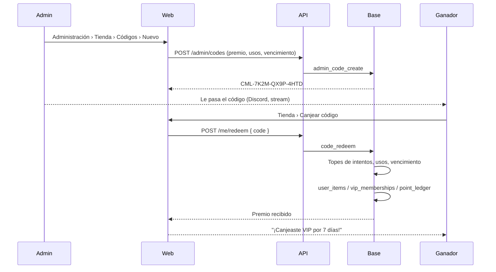
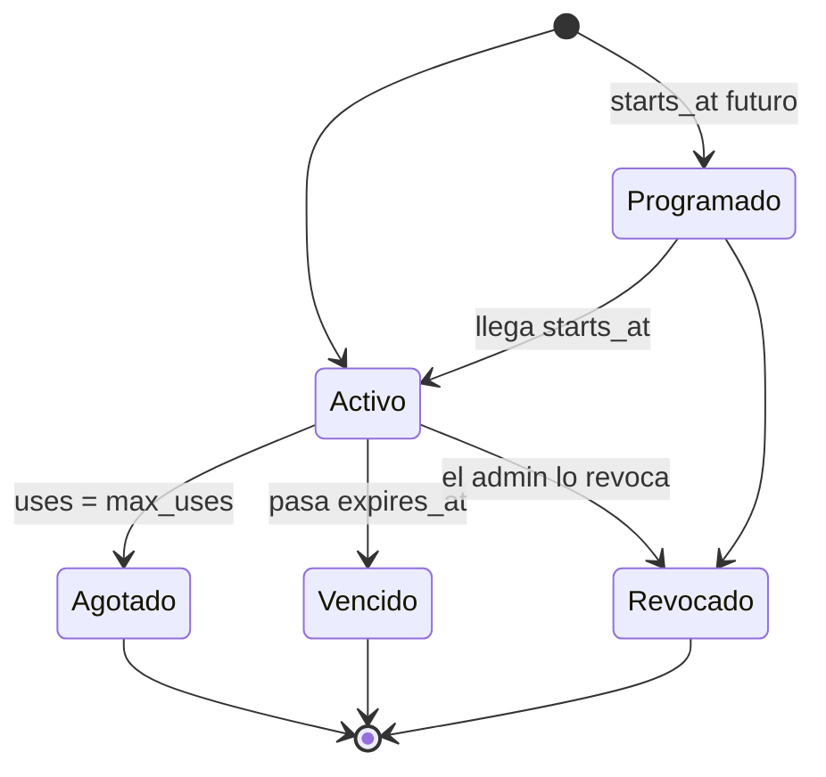
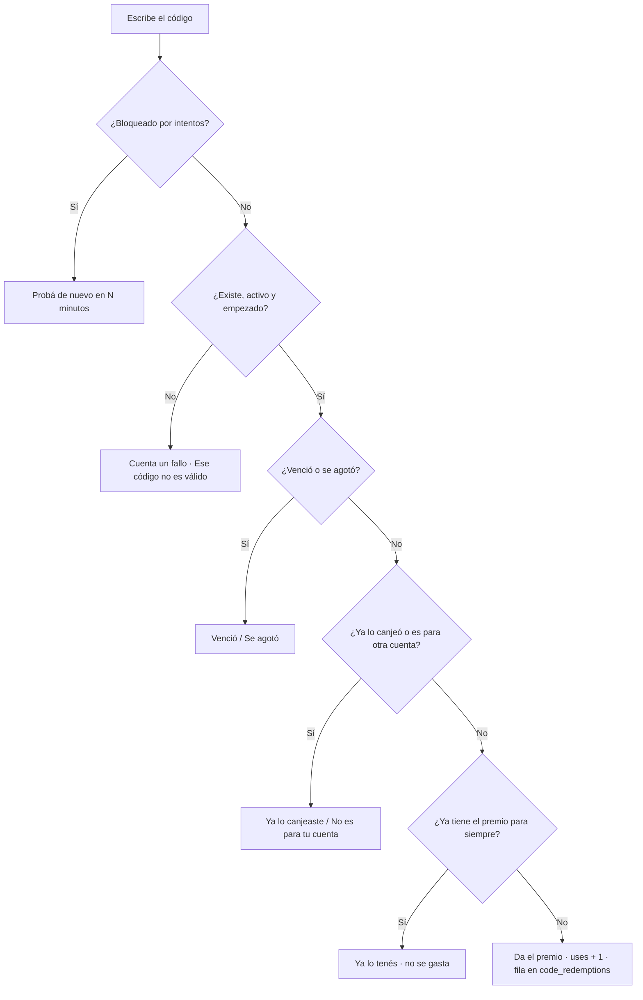

# Plan: códigos canjeables para sorteos

> Planeación original, con lo que pidió Kyan el 2026-11-17. Estado: **propuesta**, pendiente de aprobación.
> La base y la API las implementa Daniel. Prototipo en `/demo/codigos` (solo en `pnpm dev`).

Kyan quiere sortear cosas de la tienda y el VIP. Para eso, un admin genera un **código** con un premio (un artículo
de la tienda, puntos, monedas VIP o días de VIP) y una duración, se lo pasa al ganador (Discord, stream, mensaje) y
el ganador lo escribe en la web para recibirlo.

Se apoya en lo que ya existe y no lo duplica:

- **Tienda e inventario** del replanteo `110` ([`2026-11-11-tienda`](../2026-11-11-tienda/PLAN.md)): `shop_items`,
  `user_items`, `point_ledger` y `points_award`. El canje es una forma más de recibir algo, como `admin_item_grant`
  y `admin_points_grant`.
- **VIP** de la migración `20261028120000_vip.sql` y el replanteo `32`: `vip_memberships` y su regla de "el período
  nuevo empieza donde termina el último", la misma de `admin_vip_grant`.
- **Avisos** (`notify`) y **Administración › Tienda** (`AdminShop`), donde se suma la pestaña Códigos.

## Decisiones tomadas

| Tema | Decisión | Por qué |
|---|---|---|
| Qué se premia | Un premio por código: **artículo** de la tienda, **puntos**, **monedas VIP** o **VIP por días** | Lo que pidió Kyan. Un premio por código mantiene simple el canje y el historial; un sorteo con varios premios son varios códigos |
| Artículos | Cualquiera de `shop_items` menos el premio del VIP (`vip_reward`, el Marco Oro VIP), igual que `admin_item_grant`. Incluye los VIP y los inactivos (un artículo "exclusivo de sorteo") | Lo exclusivo de sorteo es lo que hace atractivo un sorteo |
| Duración del artículo | **Para siempre** o **N días** (1 a 365; atajos 7 y 30). Columna nueva `user_items.expires_at` | "Un ítem para siempre" o por un tiempo, como pidió Kyan |
| Artículo que ya tiene | Para siempre: no se gasta el código y le dice "Ya lo tenés". Temporal: se suman los días. Comprarlo después lo vuelve permanente | Que el ganador no pierda el premio |
| Duración del VIP | **Días** (1 a 365; atajos 1 semana, 1 mes y 3 meses). Sin VIP de por vida por código: ese lo sigue dando un admin a mano | Kyan: "VIP por X días, 1 semana o 1 mes". Un lifetime filtrado sería caro |
| VIP vigente | Se suma al final del período actual, como `admin_vip_grant`. Si ya es lifetime: no se gasta y le dice que ya lo tiene | La misma regla que el resto del VIP |
| Bienvenida VIP | Los VIP por código de **menos de 30 días** no dan las monedas de bienvenida (`tg_award_vip_welcome`) | Que una semana de VIP no regale el mes entero de monedas |
| Quién genera | Solo el **admin** (`is_admin()`). Ni moderadores ni streamers | Un código es plata regalada |
| Usos | Cada código tiene **usos** (1 a 10.000) y se canjea **una vez por cuenta**. Opcional: **solo para una cuenta** (el ganador ya elegido) | Un código de 1 uso para un ganador; uno de 50 usos para "los primeros 50 del stream" |
| Lote | Hasta **100 códigos** de una vez, todos con el mismo premio (`batch_id`), para copiarlos o bajarlos como CSV | Sorteos con muchos ganadores |
| Vencimiento | Opcional: el código deja de servir en una fecha (atajos 7 y 30 días). Aparte de la duración del premio | No es lo mismo "canjealo antes del domingo" que "VIP por 7 días" |
| Formato | `CML-XXXX-XXXX-XXXX`: 12 caracteres al azar de Crockford base32 (sin `I`, `L`, `O` ni `U`), 60 bits, generados en la base con `gen_random_bytes`. Al canjear se ignoran mayúsculas, espacios y guiones, y, después del prefijo `CML`, `O`→`0` e `I`/`L`→`1` | Imposible de adivinar y fácil de dictar en un stream |
| Código personalizado | Se permite (`NAVIDAD2026`): de 8 a 24 letras y números, el admin elige. La pantalla avisa que se adivina más fácil | Para streams; el admin decide el riesgo |
| Fuerza bruta | Por cuenta: **5 fallos en 15 minutos** bloquean 15 minutos, y **20 fallos en el día** bloquean hasta el día siguiente (Bogotá). Por IP: 10 intentos por minuto en la API. Solo cuentan los códigos que no existen | Con 60 bits y 20 intentos por día no se adivina nunca; los topes frenan los códigos personalizados |
| Mensajes | "No existe", "revocado" y "todavía no empezó" dicen lo mismo: **"Ese código no es válido"**. "Venció", "se agotó" y "ya lo canjeaste" se dicen tal cual | No revelar qué códigos existen; lo demás le sirve al jugador |
| Quién canjea | Cualquier cuenta con sesión, sin baneo vigente de la web | Un sorteo es para la comunidad |
| Dónde | **Tienda › Canjear código** (botón junto a la billetera y pestaña Canjear) y un acceso en **Mi perfil**. Nunca por URL (`?code=`) | Los códigos no van en URLs (regla de seguridad del frontend) |
| Historial del jugador | Sus canjes en la pestaña Canjear y en el Historial de la tienda (filas de `point_ledger` con origen `code`). Lo temporal muestra cuánto le queda | Que sepa qué recibió y hasta cuándo |
| Historial del admin | Por código: usos, quién lo canjeó y cuándo. Global: canjes recientes e intentos fallidos con las cuentas bloqueadas | Control de los sorteos y de abusos |
| Revertir | El admin puede **revocar un código** (deja de servir) y **revertir un canje** (quita el artículo, el VIP o los puntos con una fila negativa) | Para premios dados por error o canjes con trampa |
| Avisos | Al canjear, aviso `code_redeemed` en la categoría `account`; al revertir, `code_reverted` | Como `vip_granted` |
| Base | Replanteo **`119`** (propuesto: el siguiente después de la `118` del recap). **Lo confirma Daniel** | Producción usa el replanteo |

## 1. El flujo completo

Estados de un código:

Qué pasa al canjear:

## 2. Base de datos (replanteo `119`, número a confirmar con Daniel)

Va después de la `110` (tienda) y de la `32` (avisos del VIP). Aborta si faltan `shop_items` o `vip_memberships`.

### Tablas

`redeem_codes`: un código.

| Columna | Tipo | Nota |
|---|---|---|
| `id` | `uuid` | |
| `code` | `text unique` | Normalizado (sin guiones, en mayúsculas). Solo lo ven los admins |
| `custom` | `boolean` | Personalizado o al azar |
| `batch_id` | `uuid` | Los del mismo lote |
| `reward` | `text` | `item`, `points`, `vip_coins` o `vip` |
| `item_id` | `text` → `shop_items` | Solo con `item` |
| `amount` | `int` | Puntos o monedas VIP (1 a 100.000) |
| `duration_days` | `int` | Días del artículo o del VIP. `null` = para siempre (solo artículos) |
| `max_uses` | `int` | 1 a 10.000 |
| `uses` | `int` | Cuántas veces se canjeó (y no se revirtió) |
| `for_user` | `uuid` → `profiles` | Solo para esa cuenta (opcional) |
| `starts_at`, `expires_at` | `timestamptz` | Desde cuándo y hasta cuándo sirve (`expires_at` opcional) |
| `label` | `text` | El sorteo: "Sorteo Discord 17/11" (hasta 80) |
| `note` | `text` | Nota interna (hasta 200) |
| `created_by`, `created_at` | | |
| `revoked_at`, `revoked_by`, `revoke_reason` | | |

Con `check` de que cada premio tenga lo suyo (`item` con `item_id`, `vip` con `duration_days`, `points` y `vip_coins`
con `amount` y sin `duration_days`).

`code_redemptions`: un canje.

| Columna | Nota |
|---|---|
| `id`, `code_id`, `user_id`, `redeemed_at` | `unique (code_id, user_id)`: una vez por cuenta |
| `reward`, `item_id`, `amount`, `vip_membership_id` | Lo que recibió, copiado del código |
| `until` | Hasta cuándo le dura (artículo temporal o VIP) |
| `reverted_at`, `reverted_by`, `revert_reason` | Si un admin lo revirtió |

`redeem_attempts`: cada intento fallido (`user_id`, `at`, `ip` opcional, el código escrito **truncado a 4 caracteres**).
Se borran a los **30 días** (`pg_cron`, como las demás limpiezas).

Cambios en tablas que ya existen:

- `user_items`: columna `expires_at timestamptz` (null = para siempre) y `source` acepta `code`.
- `can_use_item`, `my_inventory` y `player_cosmetics_public`: un artículo vencido no se puede usar y se saca de lo
  puesto. `my_inventory` devuelve `expires_at`.
- `shop_buy`, `shop_buy_bundle` y `admin_item_grant`: si el artículo está pero es temporal, lo vuelven permanente
  (`expires_at = null`) en vez de decir "Ya lo tenés".
- `vip_memberships.source` acepta `code`.
- `tg_award_vip_welcome`: no da la bienvenida a los períodos `code` de menos de 30 días.
- `point_ledger`: origen `code`, `ref` = id del canje (el índice único evita pagar dos veces). La reversión usa
  origen `code_revert`.
- `notification_category`: `code_redeemed` y `code_reverted` en `account`.

RLS: las tres tablas sin acceso directo para `anon` ni `authenticated`; todo por funciones `security definer`.

### Funciones

| Función | Quién | Qué hace |
|---|---|---|
| `code_normalize(text)` | interna | Mayúsculas, sin espacios ni guiones, `O`→`0`, `I`/`L`→`1` |
| `code_generate()` | interna | `CML` + 12 de Crockford base32 con `gen_random_bytes`; reintenta si choca |
| `code_redeem(p_code text)` | cuenta | Bloqueo por `pg_advisory_xact_lock` de la cuenta, topes de intentos, validación (diagrama de arriba), `select … for update` del código, da el premio y devuelve `{reward, item_id, amount, until}`. Errores con `errcode` propios para la API |
| `my_redemptions()` | cuenta | Sus canjes, sin el código entero (últimos 4) |
| `admin_code_create(p_reward, p_item, p_amount, p_days, p_max_uses, p_count, p_expires_at, p_starts_at, p_for_user, p_custom, p_label, p_note)` | admin | Crea uno o un lote (hasta 100). Personalizado solo con `p_count = 1`. Devuelve los códigos |
| `admin_codes(p_q, p_state, p_limit, p_offset)` | admin | Lista con estado calculado (programado, activo, agotado, vencido, revocado) |
| `admin_code_redemptions(p_code)` | admin | Quién lo canjeó y cuándo |
| `admin_code_revoke(p_code, p_reason)` | admin | Deja de servir; lo ya canjeado sigue |
| `admin_redemption_revert(p_redemption, p_reason)` | admin | Quita el artículo (`user_items` y lo puesto), revoca el período VIP o anota puntos negativos; `uses - 1` y aviso |
| `admin_redeem_attempts(p_limit)` | admin | Intentos fallidos recientes y cuentas bloqueadas |

Pruebas SQL y la inversa (`reversas/119_…`), como en los replanteos anteriores.

## 3. API (`web/backend`, `routes/codes.ts`)

| Método y ruta | Quién | Respuesta |
|---|---|---|
| `POST /api/v1/me/redeem` `{ code }` | cuenta | `200 { reward, item, amount, until }` |
| `GET /api/v1/me/redemptions` | cuenta | Mis canjes |
| `GET /api/v1/admin/codes` | admin | Lista con filtros (`q`, `state`) y paginada |
| `POST /api/v1/admin/codes` | admin | Crea uno o un lote; `201 { codes: [...] }` |
| `GET /api/v1/admin/codes/{id}/redemptions` | admin | Canjes de un código |
| `POST /api/v1/admin/codes/{id}/revoke` `{ reason }` | admin | `204` |
| `POST /api/v1/admin/redemptions/{id}/revert` `{ reason }` | admin | `204` |
| `GET /api/v1/admin/codes/attempts` | admin | Intentos fallidos y bloqueados |

- Códigos de error (`error.code`), para que la web decida el texto: `code_invalid`, `code_expired`, `code_used_up`,
  `code_already_redeemed`, `code_not_for_you`, `code_already_owned`, `code_vip_lifetime` y `code_rate_limited`
  (`429`, con `retry_after` en segundos).
- Límite por IP en `/me/redeem`: 10 por minuto, con el limitador que ya usan login y registro.
- El código nunca va en la URL ni en los logs de la API (se registra solo la cuenta y el resultado).
- Las funciones nuevas se llaman con `as never` hasta regenerar `db/types.ts`, como en `shop.ts`.

## 4. Web (`web/frontend`)

### Jugador

- **Tienda:** botón **Canjear código** junto a la billetera, que abre la pestaña **Canjear**:
  - un campo que da formato solo (`CML-XXXX-XXXX-XXXX`, en mayúsculas) y acepta pegar el código con o sin guiones;
  - al canjear, una tarjeta con el premio: la vista del artículo (`Thumb`), la cantidad (`Amount`) o el VIP con hasta
    cuándo, y un botón para equiparlo o ir al inventario;
  - los errores según `error.code`; con bloqueo, cuánto falta y sin el botón;
  - **Tus canjes**: fecha, sorteo, premio y cuánto le queda si es temporal.
- **Inventario:** lo temporal muestra "Vence en N días" y, vencido, "Venció · comprarlo" si está a la venta.
- **Mi perfil:** un acceso "¿Ganaste un sorteo? Canjeá tu código" que lleva a la pestaña.

### Admin

**Administración › Tienda › Códigos** (pestaña nueva de `AdminShop`):

- **Nuevo código:** premio (artículo con buscador y vista previa, puntos, monedas VIP o VIP), duración, usos, cantidad
  de códigos, vencimiento, solo para una cuenta, código personalizado (con aviso), sorteo y nota. Al generar, los
  códigos en una ventana con **Copiar** y **Bajar CSV** (avisa que no se publiquen en un canal abierto).
- **Lista:** código (copiar), sorteo, premio, usos `x / y`, vence, estado y acciones (ver canjes, revocar).
- **Canjes de un código:** cuenta, fecha y **Revertir** (con motivo, `ConfirmDialog`).
- **Intentos fallidos:** últimos intentos y cuentas bloqueadas, con contadores arriba (`StatTile`).

### Prototipo

`/demo/codigos` (`routes/demo.codigos.tsx` y `routes/-demo-codigos/`), solo en `pnpm dev`, con datos en memoria y las
mismas reglas de esta propuesta: generar, canjear con varias cuentas, topes de intentos, pasar el tiempo para ver
vencimientos y revertir canjes. Usa las piezas de la tienda (`Thumb`, `Amount`, `VipBadge`) y el catálogo real.

## 5. Manual de usuario

| Rol | Página | Qué cambia |
|---|---|---|
| Jugador | `jugador/tienda-y-puntos.md` | Sección "Canjear un código": dónde, el formato, qué premios hay, lo temporal y los topes de intentos |
| Admin | `admin/tienda.md` | Sección "Códigos y sorteos": crear, lotes, personalizados, revocar, revertir e intentos fallidos |

Moderador, capitán, organizador, streamer y dueño de un servidor externo: sin cambios. Las páginas siguen ocultas
hasta que la tienda esté en producción, como el resto de la tienda.

## 6. Términos y privacidad

En la web (`TermsPage.tsx`, `PrivacyPage.tsx`) y en `terms/terminos.html` y `terms/privacidad.html`, en el mismo commit
y con la marca **"En preparación"** hasta que se implemente:

- **`/terminos`, sección "Puntos, tienda y misiones"**, un punto "Sorteos y códigos":
  - los sorteos son gratis y sin obligación de compra;
  - un código se canjea una vez por cuenta, puede vencer y no tiene valor en dinero: no se vende ni se cambia por
    plata;
  - lo que da un código puede ser por un tiempo, que se ve al canjearlo;
  - el VIP de un código no es un VIP pagado: no tiene derecho de arrepentimiento ni reembolso, y sigue las demás
    reglas del VIP;
  - si un código se obtuvo con trampa, se vendió o se usó por error, podemos revertir el canje;
  - los intentos de adivinar códigos bloquean el canje por un tiempo y pueden llevar a una sanción.
- **`/privacidad`, "VIP, puntos y tienda"**: guardamos los canjes (cuenta, código, fecha y premio) mientras tengas la
  cuenta, y los intentos fallidos (cuenta, fecha, IP y los primeros 4 caracteres de lo que escribiste) durante 30
  días, para frenar abusos. Se suma una fila a la tabla de plazos.

## 7. Requisitos antes de empezar

- Replanteo `110` (tienda) aplicado, o que la `119` vaya en la misma tanda.
- `pgcrypto` (`gen_random_bytes`), que ya está en la base.
- Que Daniel confirme el número `119` y el nombre de las tablas.
- Que Kyan apruebe el plan y el prototipo.

## 8. Orden de implementación

1. Prototipo `/demo/codigos` (este cambio, Kyan).
2. Aprobación de Kyan.
3. Replanteo `119` con sus pruebas SQL y la inversa, en la copia local de producción (Daniel).
4. `routes/codes.ts` con pruebas de integración (Daniel).
5. Web real: pestaña Canjear, inventario con vencimiento, Mi perfil y Administración › Tienda › Códigos.
6. Manual, términos y privacidad, `DOCUMENTACION.md`, `GUIA_IMPLEMENTACION.md` y changelog.
7. Despliegue junto con la tienda (sin cambios en los servidores de juego).
