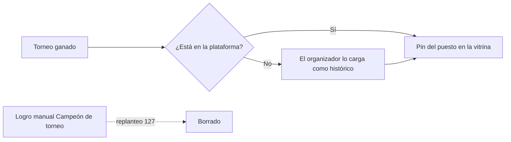

# Sin logros de torneo dados a mano: documentación

## Qué hace

Un trofeo de torneo solo se consigue con un torneo: uno de la plataforma o uno histórico. Se ve en la vitrina del jugador como **pin**, con su puesto ([`2026-11-15-pines-y-trofeos`](../2026-11-15-pines-y-trofeos/)).

Antes del módulo de torneos, un admin daba a mano el logro **Campeón de torneo**, con el nombre del torneo como título. Desde el replanteo `127` ese logro y **Finalista de torneo** ya no existen: se borraron las medallas, las definiciones, los logros destacados que las usaban y los avisos que las anunciaban.

## Lo que se borró en producción (2026-11-17)

| Qué | Cantidad | Detalle |
|---|---|---|
| Medallas `campeon_torneo` dadas a mano | 17 | Slendy 13, Lukas 2, kyan 1 y juanma^.^ 1 |
| Medallas `finalista_torneo` | 0 | |
| Logros destacados del Resumen | 1 | kyan, "CAMPEON TORNEO TITAN 2" |
| Avisos `medal_granted` de esas medallas | 6 | Los de la época de la `114` (medallas automáticas de torneo, que la `123` pasó a pines) |
| Definiciones | 2 | `campeon_torneo` y `finalista_torneo` |

Al borrar, de los torneos de esos logros solo estaban cargados LocalStrike (2019, no el de 2018 del logro) y TORNEO TITAN. En TORNEO TITAN, kyan tiene el pin de cuartos y Lukas ninguno. Los demás torneos (Titan 2, FDX CSSO y los 13 de Slendy) se irán cargando como históricos, y cada jugador recibe su pin al terminarlo.

## Que no vuelvan

- Las plantillas `campeon_torneo` y `finalista_torneo` son de tipo `event_result`. La API rechaza crear una definición desde ellas (400, "Los trofeos de torneo no son medallas…") y el editor de Administración › Medallas no las muestra en la galería.
- Sin definiciones, la ficha del jugador (Administración › Jugadores › Fichas › Medallas) solo ofrece las de Comunidad.

## Respaldo

Lo borrado quedó en `medal_definitions_127_respaldo`, `player_medals_127_respaldo`, `player_medal_featured_127_respaldo` y `notifications_127_respaldo`, sin acceso desde la API. La inversa los vuelve a insertar. Se pueden borrar después del 2026-12-17.

## Qué cambia para cada rol

| Rol | Qué cambia | Página del manual |
|---|---|---|
| Jugador | Pierde los logros de torneo que un admin le había dado a mano. Los trofeos llegan solo como pines, al cargarse el torneo (también los históricos) | `jugador/vitrina-y-pines.md` |
| Admin | Ya no puede dar Campeón ni Finalista de torneo desde la ficha. Para un torneo de afuera, se carga el histórico | `admin/medallas.md` y `admin/usuarios-y-fichas.md` |
| Organizador | Sin cambios: carga los torneos históricos como hasta ahora | Sin cambios (`organizador/subir-torneo-historico.md`) |

## Términos y privacidad

Sin cambios: no cambia qué datos se guardan ni se publican. Los trofeos siguen siendo públicos en el perfil, ahora solo como pines.

## Dónde está cada cosa

| Qué | Archivo / ubicación |
|---|---|
| Migración | `supabase/replanteo/127_sin_logros_de_torneo.sql` |
| Inversa | `docs/bitacora/2026-10-14-replanteo-modelo-datos/reversas/127_sin_logros_de_torneo.sql` |
| Error al crear desde una plantilla de torneo | `web/backend/src/routes/medals.ts` |
| Medallas que da la ficha | `web/frontend/src/features/admin/players/components/FichasTab.tsx` |
| Medalla manual de las pruebas de la API | `web/backend/test/integration/manual-medal.ts` |
| Pines y trofeos | [`2026-11-15-pines-y-trofeos`](../2026-11-15-pines-y-trofeos/) (replanteo `123`) |
