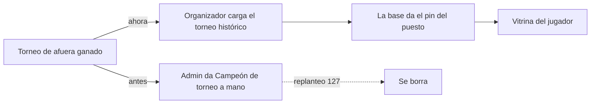

# Plan: sin logros de torneo dados a mano

> Planeación original, escrita el 2026-11-17. Estado: **aprobado por Daniel** ("Borra todos los logros de torneo manuales […] no debe quedar ningún "Logro" relacionado con torneo").

## Decisiones tomadas

| Tema | Decisión | Por qué |
|---|---|---|
| El problema | Antes del módulo de torneos, un admin daba a mano el logro **Campeón de torneo** con el nombre del torneo como título. En producción quedan 17, todos `campeon_torneo` con `source = 'admin'`: Slendy 13, Lukas 2, kyan 1 y juanma^.^ 1. **Finalista de torneo** no tiene ninguno | Daniel (2026-11-17): un jugador solo consigue trofeos con los torneos (normales o históricos), y se ven en la vitrina como pines |
| Qué se borra | Las 17 medallas, el destacado del Resumen que las usa (kyan, "CAMPEON TORNEO TITAN 2"), los 6 avisos `medal_granted` viejos de esas medallas y las dos definiciones (`campeon_torneo` y `finalista_torneo`) | "No debe quedar ningún logro relacionado con torneo". Sin las definiciones, nadie las puede volver a dar desde la ficha |
| Los torneos que todavía no están cargados | Se borran igual. Se irán cargando como históricos y su pin llega con el torneo | Lo dijo Daniel: algunos ya están cargados con sus pines y los demás se crean de a poco |
| Volver a crearlas | No se puede: las plantillas `campeon_torneo` y `finalista_torneo` son `event_result`, que la API rechaza al crear (400) y la galería del editor no muestra | Ya era así desde la `114`. No hay que tocar la plantilla |
| Respaldo | Cuatro tablas `*_127_respaldo` (definiciones, medallas, destacados y avisos), sin acceso desde la API, para la inversa. Se pueden borrar después del 2026-12-17 | Igual que la `123` |
| La API y la web | Solo textos: la ficha decía "campeón de torneo…" entre las de Comunidad, el error de la API "editala desde la lista", la descripción del esquema y los comentarios. Se despliegan con el próximo despliegue de la API y de la web | Con las definiciones borradas, el código de `event_result` queda sin uso pero no molesta |
| Despliegue | La base, en el momento, por el túnel y en una transacción, después de probarla con `rollback` | Son datos y definiciones: el servidor de juego no los usa |

## 1. El flujo

## 2. Cambio en la base: replanteo `127`

`127_sin_logros_de_torneo.sql`, con chequeo de "ya se aplicó" (existe `medal_definitions_127_respaldo`):

1. Respaldo de las dos definiciones, de sus medallas, de sus destacados y de los avisos `medal_granted` que las nombran.
2. Borrar los avisos, los destacados (también lo haría el `on delete cascade`), las medallas y las definiciones.
3. Chequeo final: no queda ninguna medalla ni definición de esas plantillas.

Inversa en `docs/bitacora/2026-10-14-replanteo-modelo-datos/reversas/127_sin_logros_de_torneo.sql`: vuelve a insertar todo desde los respaldos y los borra.

## 3. API y web (solo textos)

- `web/backend/src/routes/medals.ts`: el error al crear desde esas plantillas dice que los trofeos de torneo son pines.
- `web/backend/src/schemas/medals.ts`: la descripción de `definition_id` ya no nombra "campeón de torneo".
- `web/frontend/src/features/admin/players/components/FichasTab.tsx`: "Solo las de Comunidad (staff, caster…)" y el comentario.
- Tests de integración de la API que usaban `campeon_torneo` como medalla manual: pasan a una manual propia de la prueba (`staff`, que se crea si no existe). Los de "medallas de torneo" comprueban que las definiciones ya no están y que no se pueden crear.

## 4. Manual

- `admin/medallas.md`: Campeón y Finalista de torneo ya no existen; los trofeos de torneos de afuera se dan cargando el torneo histórico.
- `admin/usuarios-y-fichas.md`: en Medallas, solo las de Comunidad.
- `jugador/vitrina-y-pines.md`: el "Ojo" dice que los logros de torneo que se habían dado a mano se quitaron y que vuelven como pines al cargarse el torneo.

## 5. Términos y privacidad

Sin cambios: no cambia qué datos se guardan ni se publican (los trofeos siguen siendo públicos en el perfil, ahora solo como pines).

## 6. Orden de implementación

1. La migración `127` y su inversa.
2. Probarla en producción con `rollback` y después aplicarla.
3. Textos de la API y la web, tests, manual, bitácora y README.
4. Commit en `main` cuando Daniel lo pida.
