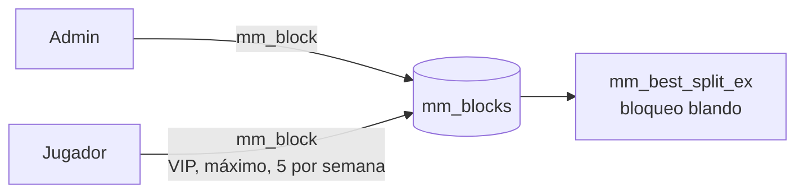

# El admin bloquea jugadores sin límite: documentación

## Qué hace

Un admin puede bloquear a todos los jugadores que quiera en el matchmaking (Jugar › Bloqueo), sin ser VIP, sin el máximo de bloqueos por cuenta y sin el límite de bloqueos nuevos por semana. Para el resto de las cuentas (moderador y soporte incluidos) todo sigue igual.

El bloqueo del admin sigue siendo una preferencia, igual que el de cualquiera: si respetarlo deja los equipos muy desparejos, en esa partida no se respeta y se le avisa (replanteo `104`).

## Reglas

| Control | Jugador | Admin |
|---|---|---|
| Exclusivo VIP (`blocks_vip_only`) | Sí | No |
| Máximo de bloqueos (`max_blocks`, en 0 apagado) | Sí | No (también con 0) |
| Bloqueos nuevos en 7 días (`block_changes_week`) | Sí | No |
| No bloquearse a sí mismo | Sí | Sí |
| Registro en `mm_block_log` y corte de amistad | Sí | Sí |

`mm_my_profile` le manda al admin `blocks.max = null` (sin tope), `vip_only = false`, `allowed = true` y `changes = null`. La web muestra solo la cantidad de bloqueados en vez de `x/máx`.

## Qué cambia para cada rol

| Rol | Qué cambia | Página del manual |
|---|---|---|
| Admin | Bloquea sin límites en Jugar › Bloqueo | `admin/matchmaking.md` |
| Jugador, capitán, organizador, moderador, streamer, dueño de un servidor externo | Nada | — |

## Términos y privacidad

`/terminos` (sección del matchmaking): se agrega que los admins no tienen el límite de VIP ni el de bloqueos por semana. `/privacidad`: sin cambios (no se guarda ningún dato nuevo).

## Dónde está cada cosa

| Qué | Archivo |
|---|---|
| Base | `supabase/replanteo/128_mm_bloqueo_admin_sin_limite.sql` |
| Inversa | `docs/bitacora/2026-10-14-replanteo-modelo-datos/reversas/128_mm_bloqueo_admin_sin_limite.sql` |
| Panel de bloqueo | `web/frontend/src/features/matchmaking/BlockPanel.tsx` y `types.ts` |
| Manual | `docs/manual/admin/matchmaking.md` |
| Términos | `web/frontend/src/features/legal/pages/TermsPage.tsx` y `terms/terminos.html` |
