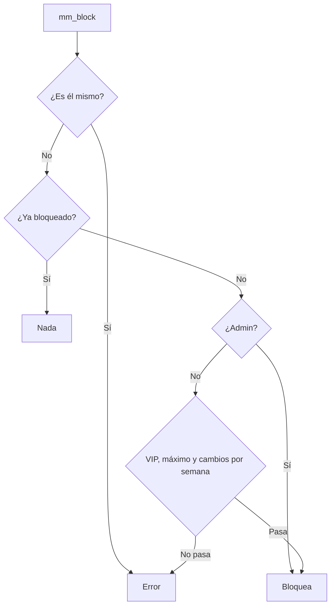

# Plan: el admin bloquea jugadores sin límite

> Planeación original. Estado: **propuesta**, pedida por Daniel el 2026-11-18.

## Decisiones tomadas

| Tema | Decisión | Por qué |
|---|---|---|
| Qué es "bloquear" | El bloqueo de compañeros del matchmaking (Jugar › Bloqueo, replanteos `48` y `104`) | Es el único bloqueo de jugadores con límites por cuenta |
| Quién | Solo el rol admin (`is_admin()`). El moderador y el soporte siguen como cualquier jugador | Lo pedido: "los admins" |
| Qué límites se saltan | Los tres: exclusivo VIP, máximo de bloqueos (`max_blocks`, aunque esté en 0) y cambios por semana (`block_changes_week`) | "Ilimitadamente" |
| El armado | Sin cambios: el bloqueo del admin sigue siendo blando (margen de ELO de la `104`) | No es una sanción, es una preferencia |
| Registro | El bloqueo del admin se sigue guardando en `mm_block_log` | Mismo historial que el resto |

## 1. El flujo

## 2. Base (replanteo `128`)

- `mm_block`: los tres controles quedan dentro de `if not is_admin()`.
- `mm_my_profile`: al admin le manda `blocks.max = null`, `vip_only = false`, `allowed = true` y `changes = null`.
- Inversa en `reversas/128_mm_bloqueo_admin_sin_limite.sql`.

## 3. Web

- `BlockPanel`: con `max` null muestra solo la cantidad y deja agregar siempre.

## 4. Requisitos

Ninguno.

## 5. Orden

1. Replanteo `128` e inversa.
2. Web.
3. Manual y términos.
4. Desplegar la `128` y la web.
