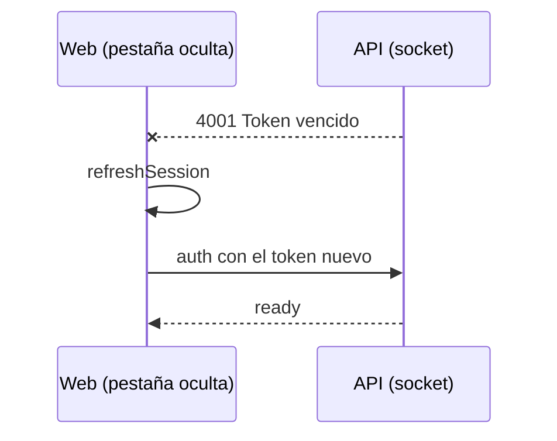

# El token vencido del socket saca de la cola: documentación

## Qué hace

Reporte de yue (2026-11-18): a veces estaba buscando y de repente dejaba de buscar.

El token de acceso dura 1 h y la web lo renovaba solo al hacer un pedido. Buscando con la pestaña oculta (por ejemplo, jugando otra cosa), la web no hace pedidos, así que el token vencía. La API corta el socket al vencer (`4001 Token vencido`), la web reconectaba con el mismo token (`4001 Token inválido`) y, sin conexión por más de 10 s, la presencia del replanteo `63` lo sacaba de la cola.

Ahora el socket renueva el token antes de mandar el `auth` si vence en menos de un minuto. El corte de la hora sigue, pero la reconexión tarda alrededor de 1 s, dentro de los 10 s de gracia.

## Reglas

- `freshToken` (dependencia de `createMmSocket`) da un token vigente: el mismo minuto de margen que `authFetch`, y la renovación única de `refreshSession`.
- Si la renovación falla por la red, manda el token que tiene; si la sesión murió, no manda nada y no reconecta.
- En el segundo que tarda en volver, la cuenta queda en pausa: no se le arma sala en ese momento, pero no pierde su lugar.

## Qué cambia para cada rol

| Rol | Qué cambia | Página del manual |
|---|---|---|
| Jugador | Buscar con la web en segundo plano por más de una hora ya no lo saca de la cola | Ninguna (el manual ya dice que solo sale al cerrar la web) |

## Términos y privacidad

Sin cambios.

## Dónde está cada cosa

| Qué | Archivo / ubicación |
|---|---|
| Socket | `web/frontend/src/features/matchmaking/socket.ts` |
| Prueba | `web/frontend/src/features/matchmaking/socket.test.ts` ("tras un 4001 por token vencido…") |
