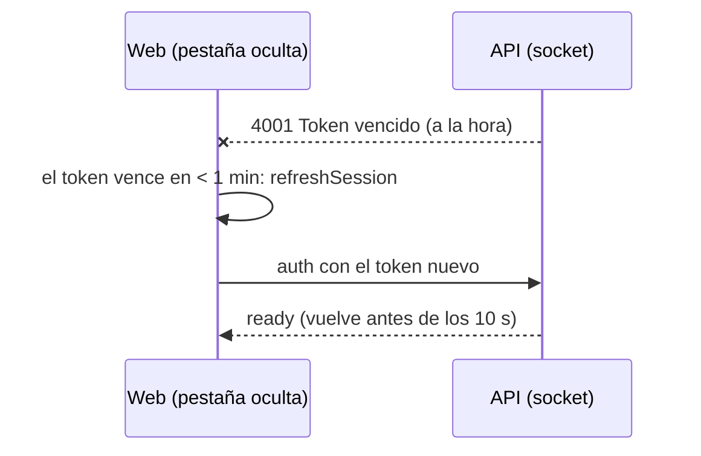

# Plan: el token vencido del socket saca de la cola

> Planeación original. Estado: **propuesta**, pendiente de aprobación.

Reporte de yue (2026-11-18): "a veces está buscando y de repente deja de buscar".

## Decisiones tomadas

| Tema | Decisión |
|---|---|
| Causa | El token de acceso dura 1 h y la web solo lo renueva al hacer un pedido (`authFetch`). Buscando con la pestaña en segundo plano, React Query no hace pedidos, así que nadie lo renueva. Al vencer, la API corta el socket (`4001 Token vencido`); la web reconecta con el mismo token vencido (`4001 Token inválido`) una y otra vez, y sin pestaña visible tampoco hay pedidos de respaldo. A los 10 s la presencia (replanteo `63`) lo saca de la cola |
| Arreglo | El socket renueva el token antes de mandar el `auth` si vence en menos de un minuto (con `refreshSession`, el mismo que usa `authFetch`). El corte de la API a la hora sigue: la reconexión tarda ~1 s, dentro de los 10 s de gracia |
| Sin verificar con datos | No hubo acceso a `mm_queue_log` de producción desde la PC (SSH sin clave). Se confirma con las salidas `disconnected` de yue |

## 1. El flujo

## 2. Web

- `web/frontend/src/features/matchmaking/socket.ts`: `freshToken` en las dependencias; `sendAuth` lo usa.
- Prueba en `socket.test.ts`: tras un `4001`, el `auth` sale con el token renovado.

## 3. Orden

1. Socket y prueba.
2. Documentación, guía, fila en el README y changelog.
3. Desplegar la web (Daniel).
