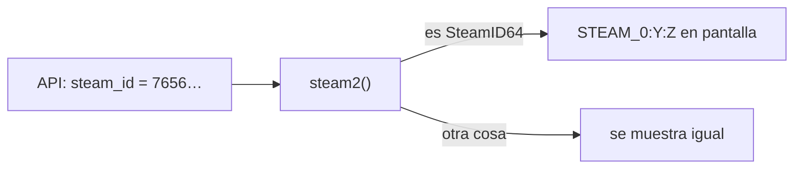

# SteamID en formato STEAM_0 en la web: documentación

## Qué hace

La web muestra las SteamID como `STEAM_0:Y:Z` (como en el juego) en vez de SteamID64 (`7656…`). Solo cambia lo que se ve: la base, la API y lo que manda la web siguen en SteamID64.

## La conversión

`steam2()` en `web/frontend/src/lib/steam.ts`. Con `n = id − 76561197960265728`, queda `STEAM_0:(n mod 2):(n div 2)`. Usa `BigInt` porque un SteamID64 no entra exacto en un `number`. Lo que no es un SteamID64 (`7656` + 13 dígitos) se muestra igual.

Ejemplo: `76561200642051412` → `STEAM_0:0:1340892842`.

## Dónde se ve

| Pantalla | Archivo |
|---|---|
| Administración › Jugadores › Fichas (lista de SteamID e IP compartidas) | `features/admin/players/components/FichasTab.tsx` |
| Administración › Jugadores › SteamID sin vincular y pedidos | `features/admin/players/components/SteamTabs.tsx` |
| Baneos (panel y diálogo) | `features/admin/bans/components/BanPanel.tsx`, `BanDialog.tsx` |
| Ajustes de ELO de los servidores | `features/admin/servers/components/AdjustmentsTab.tsx` |
| Mi perfil › Vincular Steam | `features/profile/pages/LinkSection.tsx` |
| Bienvenida, paso del `!claim` (antes mostraba el SteamID64 cortado) | `features/onboarding/components/ClaimStep.tsx` |

El buscador del diálogo de baneo acepta el nick, `STEAM_X:Y:Z` o SteamID64: `steam64()` (mismo archivo) lo pasa a SteamID64 antes de mandarlo a la API.

## Qué cambia para cada rol

| Rol | Qué cambia | Página del manual |
|---|---|---|
| Jugador | Ve sus SteamID como `STEAM_0:…` en Mi perfil y en la bienvenida | Sin cambios (no nombra el formato) |
| Moderador, soporte y admin | Ven `STEAM_0:…` en Jugadores, Baneos y Ajustes. Para banear pueden pegar el `STEAM_0` que ven o el SteamID64 | `moderador/banear-jugador.md` y `soporte/banear-jugador.md` |

## Términos y privacidad

Sin cambios.

## Dónde está cada cosa

- `web/frontend/src/lib/steam.ts` y `steam.test.ts`.
- Los archivos de la tabla de arriba.
