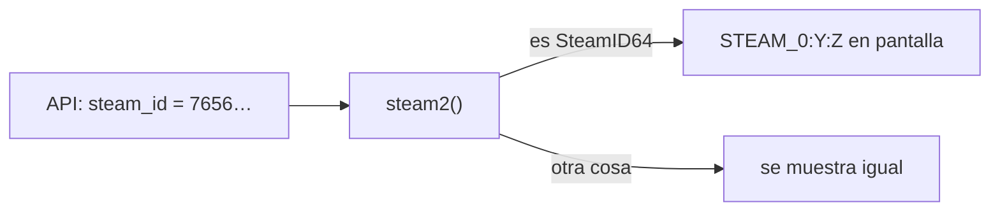

# Plan: SteamID en formato STEAM_0 en la web

> Planeación original. Estado: **aprobada** por Daniel (2026-11-18, "Todas").

## Decisiones tomadas

| Tema | Decisión | Por qué |
|---|---|---|
| Dónde | En todos los lugares de la web que muestran una SteamID | Daniel pidió verla como `STEAM_0:X:Y`, que es como la ven en el juego (`status`, `!claim`) |
| Qué se guarda | Nada cambia: la base, la API y lo que manda la web siguen en SteamID64 | Es solo cómo se muestra; tocar el dato rompería el plugin, los baneos y las búsquedas |
| Cómo | Un helper `steam2()` en `web/frontend/src/lib/steam.ts` | Un solo lugar para la cuenta; lo que no es un SteamID64 se muestra tal cual |
| Cuenta | `BigInt`: `Y = (id − 76561197960265728) mod 2`, `Z = (id − 76561197960265728) div 2` | Un SteamID64 no entra exacto en un `number` |

## 1. El flujo completo

## 2. Cambios en la web

- `src/lib/steam.ts` (nuevo) con su prueba.
- Lo usan: Administración › Jugadores (Fichas y SteamID sin vincular), los baneos (panel y diálogo), los ajustes de servidores, Mi perfil › Vincular Steam y el paso de bienvenida que muestra el SteamID vinculado.
- El buscador del baneo sigue aceptando SteamID64.

## 3. Requisitos antes de empezar

Ninguno.

## 4. Orden de implementación

1. Helper y prueba.
2. Cambiar cada lugar que muestra una SteamID.
3. `tsc`, pruebas y lint de la web.
4. Revisar el manual por menciones al formato.
5. DOCUMENTACION, GUIA y fila en el README.
