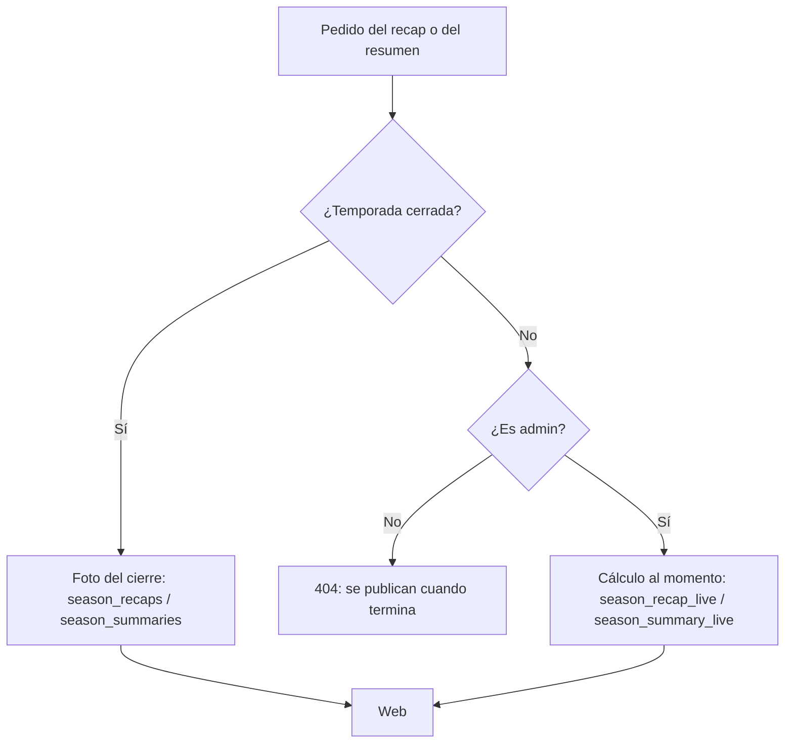

# Estadísticas de la temporada (recap y resumen global): documentación

## Qué hace

Cada temporada tiene dos vistas de estadísticas:

- **El recap de cada jugador:** su temporada en cifras, en formato historia (slides) y en una vista completa que se puede guardar como imagen o PDF. Cada cifra se compara con el promedio de todos los que jugaron.
- **Las estadísticas de la temporada:** cómo anduvieron la web y el matchmaking: los mixes, cuándo se juega, mapas y servidores, la cola y las salas, y la comunidad. Sin rankings de jugadores (Kyan, 2026-11-19: lo de cada jugador está en su recap).

**Mientras la temporada está en curso, solo los admins las ven**, calculadas al momento. **Al cerrarla, se guarda una foto y la ve todo el mundo**, también sin sesión desde la API.

## Una sola cuenta para la vista en vivo y para el cierre

Las dos vistas salen de las mismas funciones, con un "hasta" distinto: `now()` en vivo y `closed_at` al cerrar. Lo que un admin ve durante la temporada es lo que van a ver todos al cerrar, más los mixes que falten.

Cuentan los mismos mixes que el ranking de la temporada (`season_rank`): `kind = 'mix'`, `status = 'finished'`, con `elo_after`, entre `starts_at` y el "hasta". Cada fila se asigna a su ficha por `player_steam_all` (SteamID principal o adicional).

| Función | Qué devuelve | Acceso |
|---|---|---|
| `season_mix_rows(desde, hasta)` | Una fila por ficha y mix, con su equipo, el resultado y sus cifras | Ninguno desde la API |
| `season_player_totals(desde, hasta)` | Totales y promedios de cada ficha: mixes, V/D, rondas, horas, kills, K/D, ADR, % HS, rating, ELO inicial, final y pico, racha | Ninguno |
| `season_final_rows(temporada, hasta)` | El puesto: la foto de `season_standings` si está cerrada; `season_rank` y `season_tier` al momento si no | Ninguno |
| `season_recap_compute(temporada, hasta)` | El recap de **todas** las fichas con al menos 1 mix, con promedio y percentil de cada cifra | Ninguno |
| `season_summary_compute(temporada, hasta)` | El resumen global | Ninguno |
| `season_recap_build(temporada)` | Borra y vuelve a guardar las dos fotos de una temporada cerrada | Ninguno (la llama `season_close_run`) |
| `season_recap_live(temporada, ficha)` | El recap de una ficha, al momento | `authenticated`; si no es `is_admin()`, error `42501` |
| `season_summary_live(temporada)` | El resumen, al momento | `authenticated`; si no es `is_admin()`, error `42501` |

`season_close_run` llama a `season_recap_build` justo después de marcar la temporada cerrada. El replanteo armó las fotos de las temporadas que ya estaban cerradas, en orden de número.

### Las fotos

| Tabla | Clave | Qué guarda |
|---|---|---|
| `season_recaps` | `(season_id, player_id)` | El recap de cada ficha (`data jsonb`) |
| `season_summaries` | `season_id` | El resumen global (`data jsonb`) |

Las dos se leen sin sesión (RLS `select` para todos) y la API no escribe en ellas. Un recálculo del ELO o un mix borrado después del cierre no las cambia, igual que `season_standings`.

## El recap

| Parte | Qué tiene |
|---|---|
| `mixes` | Mixes, rondas, horas (de que arrancó a que terminó cada mix, sin los de más de 3 horas) y el día con más mixes (hora de Argentina) |
| `record` | Victorias, derrotas, % de victorias y la racha de victorias más larga |
| `elo` | ELO inicial, final, pico, la diferencia y un punto por mix (`EloPoint`, el mismo del perfil) |
| `numbers` | Kills, muertes, asistencias, K/D, % HS, ADR, 3K, 4K, aces, aperturas, bombas plantadas y desactivadas, rating |
| `maps` | Cada mapa con mixes, victorias y K/D |
| `best_match` | El mix con mejor rating (si empatan, más kills) |
| `mates` | El compañero con más mixes en el mismo equipo y el que más ganó con él |
| `clips` | Hasta 3: primero sus destacados (`player_featured_clips`), después por la escala de clips (`match_clip_list`, sin los rechazados). La API completa cada clip con su video |
| `compare` | Promedio de la temporada y percentil de 17 cifras: qué parte de los demás quedó por debajo (en muertes, por arriba) |
| `prev` | K/D, ADR, % HS, % de victorias y puesto de la temporada anterior, si jugó |
| `final` | Puesto, si clasificó, cuántos clasificaron, ELO, nivel y medalla (con su dibujo) |
| `weapon`, `rivals` | Por ahora siempre `null`: necesitan `match_kills`, que en `main` no existe |

No hay MVPs: `match_player_stats` no los guarda. En su lugar está el 3K.

## El resumen global: la web y el matchmaking

No tiene datos de jugadores (ni líderes, ni podio, ni mejores partidas): Kyan lo pidió así el 2026-11-19, al probarlo. Lo de cada jugador está en su recap.

| Parte | Qué tiene | De dónde sale |
|---|---|---|
| `games` | Mixes, jugadores, rondas, horas, duración promedio, kills, % HS, aces, 4K, bombas plantadas y desactivadas | Los mixes de la temporada (`season_mix_rows`) |
| `when` | El día con más mixes, los mixes por hora de inicio (0 a 23) y por día de la semana (1 = lunes), en la hora de Argentina | Ídem |
| `maps`, `servers`, `longest` | Mixes y rondas promedio por mapa, mixes por servidor (`game_servers.name`) y el mix con más rondas | Ídem |
| `matchmaking` | Búsquedas y cuentas que buscaron; cuántas terminaron en sala y cuántas no (salió, canceló o se desconectó); espera mediana hasta la sala; salas armadas, jugadas y canceladas con sus motivos; % de lugares que llegaron en grupo; abandonos, reemplazos, reportes, sanciones y baneos del matchmaking | `mm_queue_log`, `mm_lobbies`, `mm_lobby_players`, `mm_replacements`, `mm_reports`, `mm_penalty_log`, `mm_bans`, por su fecha |
| `community` | Cuentas nuevas, visitas a perfiles, comentarios (sin los borrados), amistades aceptadas, clips (y con video), demos subidas, PCW y partidas oficiales terminadas, y torneos (sin los históricos ni los de prueba) | `auth.users`, `profile_visits`, `profile_comments`, `mm_friend_requests`, `match_clip_list`, `matches`, `events` |

## API

| Ruta | Qué hace |
|---|---|
| `GET /api/v1/players/{id}/seasons/{number}/recap` | El recap (id o nick). Cerrada: la foto. Activa: `season_recap_live` si es admin; 404 si no. 404 también si no jugó |
| `GET /api/v1/seasons/{number}/summary` | El resumen. Mismas reglas |
| `GET /api/v1/players/{id}/seasons` | Suma `has_recap` a cada temporada cerrada |

Las dos rutas nuevas usan `optionalUser`. Con la temporada activa responden con `live: true` y `Cache-Control: no-store`. A un jugador o a alguien sin sesión les responden `404 NOT_FOUND` con "Las estadísticas de la temporada se publican cuando termina.", sin llamar a la base. La base vuelve a validar el permiso en `season_*_live`. El nick y la foto de cada persona se completan en la API con los actuales.

## Web

| Pantalla | Qué hay |
|---|---|
| `/player/$nick/recap/$season` | El visor: slides (flechas, tocar a los costados, "Saltar al resumen") y la vista completa con guardar JPEG o PDF y copiar link. Con la temporada activa, el cartel **En vivo · solo admins** y los textos en presente ("así va tu temporada", "si cerrara hoy") |
| `/season/$number` | Las estadísticas de la temporada: tarjetas de cifras, la cola y las salas (con los motivos de cancelación), los mixes por hora y por día (barras con globo), mapas, servidores y comunidad |
| Perfil › Temporadas | **Recap** si `has_recap` y **Estadísticas de la temporada** en cada tarjeta. Para admins, una tarjeta de la temporada en curso con **Recap en vivo** y **Estadísticas** |
| Ranking | **Estadísticas de la temporada** con una cerrada elegida; **Estadísticas en vivo** con la activa, solo para admins |
| Administración › Temporadas | **Estadísticas en vivo** en la tarjeta de la temporada activa |

Las slides sin datos no se muestran (sin mapas, sin mejor partida, sin compañeros con ficha, sin clips, sin rivales).

## Qué cambia para cada rol

| Rol | Qué cambia | Página del manual |
|---|---|---|
| Jugador | Al terminar cada temporada tiene su recap (y puede ver el de cualquiera) y ve las estadísticas de la web y el matchmaking | [`jugador/elo-y-estadisticas.md`](../../manual/jugador/elo-y-estadisticas.md) |
| Admin | Ve el recap de cualquier jugador y las estadísticas de la temporada mientras está en curso, en vivo | [`admin/temporadas.md`](../../manual/admin/temporadas.md) |
| Capitán, organizador, moderador, streamer, dueño de un servidor externo | Lo mismo que el jugador | — |

## Términos y privacidad

`/privacidad` y `terms/privacidad.html`, sección "Qué es público": al terminar cada temporada se publican el recap de cada jugador con al menos un mix (sus cifras comparadas con el promedio, su curva de ELO, sus mapas, su mejor partida, sus compañeros y sus mejores clips) y las estadísticas de la web y del matchmaking, sin datos de cada jugador; el recap sale de partidas que ya son públicas; durante la temporada solo los ven los admins; la imagen y el PDF se arman en el navegador. Fecha de los legales: 19 de noviembre de 2026. `/terminos`: sin cambios (solo la fecha, que es compartida).

## Dónde está cada cosa

| Qué | Archivo / ubicación |
|---|---|
| Replanteo | `supabase/replanteo/128_estadisticas_de_temporada.sql` |
| Inversa | `docs/bitacora/2026-10-14-replanteo-modelo-datos/reversas/128_estadisticas_de_temporada.sql` |
| Rutas | `web/backend/src/routes/seasons.ts` (`recap`, `summary`, `has_recap`) |
| Esquemas | `web/backend/src/schemas/seasons.ts` (`SeasonRecap`, `SeasonSummary`, `RecapParam`, `SeasonNumberParam`) |
| Pruebas de la API | `web/backend/test/unit/season-stats-routes.test.ts` |
| Visor del recap | `web/frontend/src/features/player/recap/` |
| Ruta del recap | `web/frontend/src/routes/_app/player.$nick_.recap.$season.tsx` (fuera del perfil: no se anida) |
| Estadísticas de la temporada | `web/frontend/src/features/ranking/pages/SeasonStats.tsx` y `routes/_app/season.$number.tsx` |
| Botones | `SeasonsTab.tsx`, `SeasonBar.tsx`, `AdminSeasonsPage.tsx` |
| Prototipo de los avisos (pendiente) | `docs/bitacora/2026-11-14-recap-temporada/prototipo/notices.tsx` |
