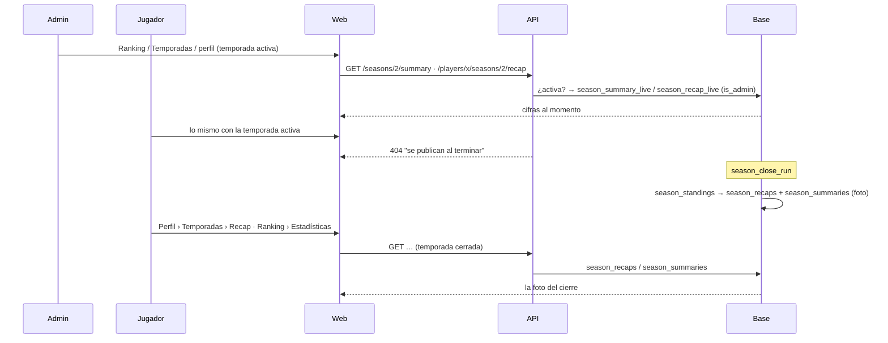

# Plan: estadísticas de la temporada (recap y resumen global)

> Planeación original. Estado: **aprobado por Kyan** (2026-11-19), que lo implementa en `kyan/recap-main` (sale de `origin/main`).

Kyan lo pidió así: "quiero que los admins tengamos acceso a todas las estadísticas de la temporada, además quiero que al terminarla, se muestre a todos". Al preguntarle, aclaró que son **las dos cosas**:

1. **El recap de cada jugador** (plan [`2026-11-14-recap-temporada`](../2026-11-14-recap-temporada/PLAN.md), que estaba para Daniel y sin implementar): los admins lo ven **en vivo** durante la temporada, de cualquier jugador; los demás, al cerrarla.
2. **Un resumen global de la temporada**, nuevo: las cifras de toda la liga (mixes, rondas, kills, mapas, líderes de cada estadística, mejores partidas). En vivo para admins y público al cerrar.

Este plan toma el del 2026-11-14 como base y anota lo que cambia.

## Decisiones tomadas

| Tema | Decisión | Por qué |
|---|---|---|
| Rama | `kyan/recap-main`, nueva desde `origin/main`, con el plan y el prototipo traídos de `kyan/recap` | Traer `main` a `kyan/recap` daba 97 archivos en conflicto; Kyan eligió una rama nueva desde `main`, así queda lista para desplegar |
| Número de replanteo | `128` (no `118`) | `main` ya usa hasta el `127` |
| Una sola forma de calcular | `season_recap_compute(p_season, p_until)` devuelve el recap de **todas** las fichas con al menos 1 mix entre `starts_at` y `p_until`, con promedios y percentiles. `season_summary_compute(p_season, p_until)` devuelve el resumen global | El cierre y la vista en vivo usan la misma cuenta: lo que ve un admin durante la temporada es lo que van a ver todos al cerrar (salvo los mixes que falten) |
| Foto del cierre | `season_close_run` guarda `season_recaps` (una fila por ficha) y `season_summaries` (una por temporada) con `p_until = closed_at`. Las temporadas ya cerradas se arman al aplicar el replanteo | Como `season_standings`: un recálculo del ELO no la cambia y verla no cuesta nada |
| Vista en vivo | `season_recap_live(p_season, p_player)` y `season_summary_live(p_season)`, `security definer`, solo para `is_admin()` (si no, `42501`), con `p_until = now()` | La base vuelve a validar el permiso; la API no puede saltearlo |
| Quién ve qué | Temporada cerrada: todos (sin sesión también). Temporada activa: solo admins; el resto recibe 404 con "Las estadísticas se publican al terminar la temporada" | Es el pedido |
| MVPs | Se sacan del recap: `match_player_stats` no los guarda. En su lugar, **3K** (`k3`) | No inventar datos |
| Arma favorita y rivales | Siempre `null` por ahora: salen de `match_kills`, que en `main` no existe (es la repetición 2D, replanteo `92` de `kyan/pruebas`, sin desplegar). Las slides sin datos no se muestran | Se suman cuando llegue esa tabla |
| Clips | El recap guarda los ids (3 como máximo: primero los destacados de `player_featured_clips`, después por `priority` de `match_clip_list`, que ya saca los rechazados). La API completa cada clip y su video con lo mismo que usan los destacados del perfil | Una sola forma de mostrar un clip |
| Resumen global: líderes | Top 5 de cada estadística. Las de promedio (K/D, ADR, % HS, rating, % de victorias) solo entre quienes llegan al mínimo de mixes de la temporada; las de total (kills, mixes, aces, 4K, aperturas, +ELO), entre todos | Que un jugador con 2 mixes no lidere el K/D |
| Ruta de la API: recap | `GET /api/v1/players/{id}/seasons/{number}/recap`, `optionalUser` | La del plan del 2026-11-14 |
| Ruta de la API: resumen | `GET /api/v1/seasons/{number}/summary`, `optionalUser` | Con número, para la URL de la web |
| `has_recap` | `/players/{id}/seasons` suma `has_recap` a cada temporada cerrada | El botón aparece solo si hay recap |
| Web | `/player/$nick/recap/$season` (el visor del prototipo con datos reales) y `/season/$number` (resumen global, página nueva) | URLs propias para compartir |
| Dónde se entra | Perfil › Temporadas: "Recap" en cada temporada cerrada con recap y, para admins, una tarjeta de la temporada activa con "Recap en vivo". Ranking (pestaña de temporada): "Estadísticas de la temporada" si está cerrada o si es admin. Administración › Temporadas: "Estadísticas en vivo" | Que el admin llegue a todo sin escribir URLs y que el jugador lo encuentre donde ya mira sus temporadas |
| Desde el resumen | Para un admin, cada líder lleva a su recap en vivo; para los demás (temporada cerrada), al recap de ese jugador | "Acceso a todas las estadísticas" |
| Queda afuera | Los avisos (`recap_soon` y el texto nuevo de `season_closed`) y la tarjeta de Para ti del plan del 2026-11-14 | No los pidió ahora; quedan en `docs/PENDIENTES.md` |

## 1. El flujo completo

## 2. Base de datos (replanteo `128_estadisticas_de_temporada.sql`)

Con su inversa en `reversas/` y una fila en el README del replanteo.

- Tablas `season_recaps (season_id, player_id, data jsonb, created_at)` y `season_summaries (season_id, data jsonb, created_at)`, con `on delete cascade`, RLS de lectura para todos y sin escritura desde la API.
- `season_recap_compute(p_season uuid, p_until timestamptz) returns table(player_id uuid, data jsonb)`: mismos mixes que `season_rank` (`kind = 'mix'`, `status = 'finished'`, `elo_after` no nulo, entre `starts_at` y `p_until`), fichas por `player_steam_all`. Arma `season`, `player`, `mixes`, `record`, `elo` (curva), `numbers`, `maps`, `best_match`, `mates`, `clips` (ids), `compare` (promedio y percentil de cada cifra), `prev` (de `season_recaps` de la temporada anterior) y `final` (de `season_standings` si está cerrada; de `season_rank` si no). `weapon` y `rivals` en `null`.
- `season_summary_compute(p_season uuid, p_until timestamptz) returns jsonb`: totales, mapas, líderes, mejores partidas, el día con más mixes y el podio de ELO.
- `season_recap_build(p_season uuid)`: borra y vuelve a guardar las dos fotos de una temporada cerrada.
- `season_close_run`: llama a `season_recap_build(s.id)` después de marcarla cerrada.
- `season_recap_live` y `season_summary_live`: solo admins, con `now()`.
- Permisos: las de cálculo y armado sin `execute` para `anon` y `authenticated`; las `_live`, para `authenticated`. La comprobación del `118_permisos.sql` se respeta.
- Al final: `season_recap_build` sobre cada temporada `closed`, en orden de número.

Las columnas se confirmaron en la copia local de producción: `match_player_stats` no tiene MVPs; `match_kills` no existe.

## 3. API

- `schemas/seasons.ts`: `SeasonRecap`, `SeasonSummary` y `has_recap` en `PlayerSeason`.
- `routes/seasons.ts`: las dos rutas. Si la temporada está activa y quien pide no es admin, 404. En el recap se completan nick y foto actuales de las personas y los clips (`featuredItems` de `clips.ts`, que pasa a exportarse).
- Pruebas: temporada cerrada con y sin recap, activa como admin y como jugador, y temporada que no existe.

## 4. Web

- `pnpm gen:api`.
- `features/player/recap/`: el visor del prototipo (`RecapViewer`, `hints`, `clips`, `export`) con el tipo de la API, sin MVPs y con 3K, y los clips con su video real.
- `routes/_app/player.$nick.recap.$season.tsx` y `routes/_app/season.$number.tsx`.
- `features/season/summary/`: la página del resumen global.
- Botones en `SeasonsTab` del perfil, en el ranking y en Administración › Temporadas. Un cartel "En vivo · solo admins" cuando se ve una temporada activa.
- Se borran `routes/demo.recap.tsx` y `routes/-demo-recap/` (salvo `notices.tsx`, que queda como referencia de lo que falta, dentro de la bitácora).
- Revisión en el navegador en 1440 y 390 px, claro y oscuro.

## 5. Manual, términos y changelog

- Manual: `jugador/elo-y-estadisticas.md` (recap y resumen de la temporada) y `admin/` (estadísticas en vivo).
- Términos y privacidad: se publican el resumen de cada temporada de cada jugador (datos derivados de partidas que ya son públicas) y los promedios de la liga. Se revisa `/privacidad` y `terms/privacidad.html`. La imagen y el PDF se arman en el navegador y no se suben.
- `CHANGELOG_DISCORD.txt`.

## 6. Requisitos antes de empezar

- La copia local de producción (`cmleague-copia-prod`, `127.0.0.1:5434`): tiene la Temporada 1 cerrada y la 2 activa.
- `pnpm` en `web/backend` y `web/frontend`.

## 7. Orden de implementación

1. Replanteo `128` y su inversa; probarlo en la copia (Temporada 1 cerrada y Temporada 2 en vivo, como admin y como jugador).
2. API: esquemas, rutas, `has_recap` y pruebas.
3. Web: tipos, visor, resumen, botones y rutas; revisión en el navegador.
4. Documentación, guía, manual, legales, changelog, `PENDIENTES.md` y la fila de la bitácora.
5. Despliegue (la `128` en el VPS, la API y la web) solo cuando Kyan o Daniel lo pidan.
