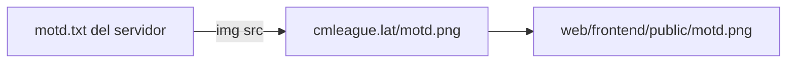

# Pantalla de bienvenida de CMLeague en los servidores: documentación

## Qué hace

Al entrar a cualquiera de los tres servidores (#1, #2 y #3), el jugador ve la pantalla de bienvenida (MOTD) con el logo de CMLeague, "Liga Competitiva CSS Client Mod" y la mención "Servidores de la comunidad MVZG · comu-mvzg.com". Antes mostraba un banner de ExtremeHost.

El `motd.txt` de cada servidor es un HTML que solo muestra la imagen `https://cmleague.lat/motd.png` a pantalla completa. Para cambiar la imagen basta con reemplazar el PNG en la web: los servidores no se tocan.



## Cómo se genera la imagen

`pruebas/motd-banner.html` se dibuja con Chrome sin ventana, a 768×433:

```sh
chrome --headless=new --hide-scrollbars --window-size=768,433 --screenshot=motd.png docs/bitacora/2026-11-19-motd-cmleague/pruebas/motd-banner.html
```

Usa el logo `web/frontend/src/assets/brand/cmleague-lockup-color-fondo-oscuro.svg` y el naranja de la marca (`#ff6900`).

## Qué cambia para cada rol

| Rol | Qué cambia | Página del manual |
|---|---|---|
| Jugador | Al entrar a un servidor ve la pantalla de CMLeague en vez de la de ExtremeHost. | Ninguna |

## Términos y privacidad

Sin cambios.

## Dónde está cada cosa

| Qué | Archivo / ubicación |
|---|---|
| Imagen | `web/frontend/public/motd.png`, publicada en `https://cmleague.lat/motd.png` |
| HTML de la imagen | `pruebas/motd-banner.html` |
| MOTD de los servidores | `cstrike/motd.txt` del #1 (`157703b5`), el #2 (`cd1be322`) y el #3 (`16c850ff`); copia en `pruebas/motd.txt` |
