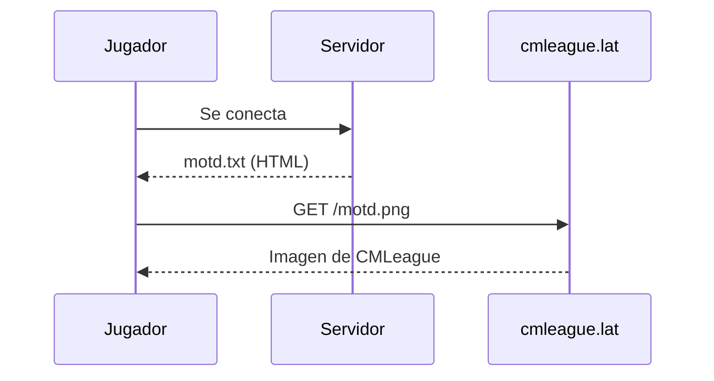

# Plan: pantalla de bienvenida de CMLeague en los servidores

> Planeación original, aprobada por Daniel en el chat el 2026-11-19 (se escribe después, junto con la documentación, porque el cambio se acordó y se hizo en la misma conversación).

## Decisiones tomadas

| Tema | Decisión |
|---|---|
| Qué se quita | El MOTD (`cstrike/motd.txt`) de los tres servidores mostraba un banner de ExtremeHost (`https://i.imgur.com/QXIgnm2.png`), heredado del servidor de ExtremeHost al armar el #1. Los servidores son de MVZG y dos son regalados: no va publicidad de otro host. |
| Qué se pone | Una imagen de CMLeague con el logo oficial, "Liga Competitiva CSS Client Mod" y "Servidores de la comunidad MVZG · comu-mvzg.com". |
| Formato | PNG de 768×433, como el anterior. El MOTD del v34 lo dibuja un navegador viejo que no muestra SVG. |
| Dónde se aloja | `https://cmleague.lat/motd.png` (`web/frontend/public/motd.png`), en nuestro dominio y no en imgur. |
| Cómo se publica | Se copia solo el PNG a la versión publicada de la web, sin `desplegar.sh web`, porque la copia de trabajo tiene cambios sin commit de otros requerimientos (términos y privacidad). |

## 1. El flujo

## 2. Cambios

- Web: `web/frontend/public/motd.png`.
- Servidores: en `cstrike/motd.txt` de los tres, solo cambia el `src` de la imagen.

## 3. Orden

1. Generar el PNG y mostrárselo a Daniel.
2. Copiarlo al VPS y comprobar que responde.
3. Cambiar `motd.txt` en el #1, el #2 y el #3 por la API del panel.
