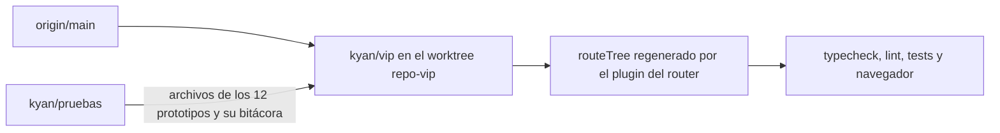

# Los prototipos VIP en el frontend nuevo

Los prototipos de los beneficios VIP y de las misiones, que estaban en `kyan/pruebas` sobre el frontend de octubre, ahora están en la rama **`kyan/vip`**, creada desde `main` (`7615857e`, 2026-11-18). Siguen siendo rutas `/demo/…` con datos en memoria, que solo existen en `pnpm dev`.

## Qué ya estaba en `main` y qué se trajo

### Ya estaba en `main`, hecho de verdad (no se tocó)

| Qué | Dónde | Desde |
|---|---|---|
| Widget para streamers (OBS), con los diseños Stats, Barra y Vertical, la foto en el anillo de nivel y guardado en la cuenta | `features/widget/`, `/widget`, `/demo/widget` | 2026-11-11 (replanteos 110 a 112) |
| Tienda de cosméticos con puntos y monedas VIP, lo propio guardado y permisos | `features/shop/`, `/shop`, Administración › Tienda | 2026-11-14 (replanteos 118 y 119) |
| Códigos canjeables para sorteos | `features/shop/` | 2026-11-17 (replanteo 126) |
| Medallas (plantillas y SVG) | `features/medals/` | 2026-11-04 |
| "Cómo ser VIP": un diálogo que dice que se escriba a un admin por Discord | `features/vip/VipDialog.tsx` | 2026-11-07 (Daniel) |

### Se trajo a `kyan/vip` (prototipos)

| Prototipo | Ruta | Bitácora |
|---|---|---|
| Hacete VIP: planes, beneficios, estado y vencimiento | `/demo/vip` | [`2026-10-29-hacete-vip`](../2026-10-29-hacete-vip/) |
| Exportar stats en imagen o PDF | `/demo/exportar` | [`2026-10-29-exportar-stats`](../2026-10-29-exportar-stats/) |
| Buscador y filtros avanzados | `/demo/buscador` | [`2026-10-29-buscador-avanzado`](../2026-10-29-buscador-avanzado/) |
| Desglose de la fórmula de ELO | `/demo/elo` | [`2026-10-29-desglose-elo`](../2026-10-29-desglose-elo/) |
| Vista previa del próximo recálculo | `/demo/recalculo` | [`2026-10-29-proximo-recalculo`](../2026-10-29-proximo-recalculo/) |
| Comparador de hasta 5 jugadores | `/demo/comparador` | [`2026-10-29-comparador-5`](../2026-10-29-comparador-5/) |
| Widget para la bio de Twitch y Twitter | `/demo/bio` | [`2026-10-29-widget-bio`](../2026-10-29-widget-bio/) |
| Partidas favoritas | `/demo/favoritas` | [`2026-10-29-partidas-favoritas`](../2026-10-29-partidas-favoritas/) |
| Créditos con los VIP | `/demo/creditos` | [`2026-10-29-creditos`](../2026-10-29-creditos/) |
| Stats avanzadas post-torneo | `/demo/torneo-stats` | [`2026-10-29-stats-torneo`](../2026-10-29-stats-torneo/) |
| Misiones semanales y Primeros pasos | `/demo/misiones` | [`2026-10-29-misiones-semanales`](../2026-10-29-misiones-semanales/) |
| Configs de los jugadores | `/demo/configs` | [`2026-10-29-configs-jugadores`](../2026-10-29-configs-jugadores/) |

También se trajo `docs/RESUMEN_PROTOTIPOS_VIP.md`, con lo que le toca a cada uno de Daniel y Esteban, y las filas de esas bitácoras al índice.

## Cómo se pasó

- **Archivos traídos:** los de `kyan/pruebas`. Se comparó con los originales de `repo-mm-ejemplo` y son la última versión.
- **Sin cambios en el código:** compilaron con la estructura de `main` sin tocarles nada. Las piezas que usan de `main` (`LevelBadge`, `PlayerAvatar`, `VipBadge`, `Podium`, `SearchBox`, los componentes de `ui/`) se ven con su estilo actual.
- **Lo único que cambió:** `src/routeTree.gen.ts`, regenerado por el plugin del router al correr `vite build`.
- **Candados VIP:** siguen llevando a `/demo/vip`. El diálogo "Cómo ser VIP" de `main` sigue siendo lo que usa la web real.

## Qué cambia para cada rol

Nada. Las rutas `/demo/…` no existen en el build de producción (`beforeLoad` tira `notFound` fuera de `pnpm dev`), así que ningún rol ve algo distinto. No hay páginas del manual para actualizar.

## Términos y privacidad

Sin cambios. Son prototipos sin datos reales. Cuando se implemente alguno, hay que revisar `/terminos` y `/privacidad`. Los que más los tocan son estos:

- **Pagos del VIP.**
- **Configs que suben los jugadores**, que se guardan y se publican.
- **Créditos**, que publican nombres.

## Archivos

En `web/frontend/src/`:

- **Módulos:** `features/bio`, `compare5`, `configs`, `elo`, `export`, `missions`, `search` y `season`.
- **En `features/vip`:** `plans.ts`, `upsell.tsx`, `VipPage.tsx`, `Favorites.tsx`, `Credits.tsx`, `TournamentStats.tsx` y `demo.ts`. Este último es nuevo junto al `VipDialog.tsx` que ya estaba.
- **Rutas:** las 12 `routes/demo.*.tsx` de la tabla de arriba.

## Pruebas (2026-11-19)

- `pnpm exec tsc -b`: 0 errores.
- `eslint` sobre los archivos traídos: sin errores.
- Tests de configs, misiones, ELO, temporada y buscador: 5 archivos, 36 tests, pasan.
- **En el navegador**, con el frontend de `repo-vip` en el puerto 5178, se abrieron las 12 rutas y cada una muestra su contenido:
  - El canvas de exportar y los tres de la bio.
  - Las 20 filas del buscador y las 40 de favoritas.
  - El ticket del ELO, la cuenta regresiva del recálculo y el gráfico del comparador.
  - Créditos, misiones (con Primeros pasos) y configs.
  - Las stats del torneo, bloqueadas sin VIP y completas con VIP.
- **Errores de la consola, que no son de los demos:** salen de la portada (`/`), que pide datos a la API y no estaba levantada, y de un aviso de `key` en `HowItWorks`, que ya está en `main`.
- **Sin revisar:** el modo claro y el celular.
