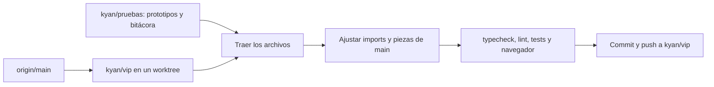

# Plan: los prototipos VIP en el frontend nuevo

> Planeación original. Estado: **propuesta**, pedido por Kyan el 2026-11-19: "todo lo que tenemos renovalo con el frontend nuevo, cuando termines pushealo a `kyan/vip`".

Los prototipos de los beneficios VIP y las misiones se armaron entre el 2026-10-29 y el 2026-11-08 en `kyan/pruebas` (y antes en `repo-mm-ejemplo`), sobre el frontend de esa época. Desde entonces el frontend nuevo cambió mucho en `main`:

- La estructura de los módulos es otra (`api/`, `components/`, `lib/` y `pages/`).
- Hay componentes comunes nuevos.
- El widget para streamers, la tienda con monedas VIP y el diálogo "Cómo ser VIP" ya están implementados de verdad.

## Decisiones tomadas

| Tema | Decisión | Por qué |
|---|---|---|
| Base | `kyan/vip`, rama nueva desde `origin/main` (`7615857e`, 2026-11-18) | `main` es el frontend nuevo en producción; Kyan pidió esa rama |
| Dónde se trabaja | Un worktree aparte (`repo-vip`) | La copia de `repo` está en `kyan/guia` con cambios sin commit de otras tareas |
| Qué se trae | Los 12 prototipos que todavía no existen en `main`: exportar stats, buscador avanzado, desglose de ELO, próximo recálculo, comparador de 5, widget para la bio, partidas favoritas, créditos, stats post-torneo, misiones, Hacete VIP y configs de los jugadores | Es lo que "tenemos" y falta en el frontend nuevo |
| Qué no se trae | El widget para OBS, la tienda y las medallas | Ya están en `main`, hechos de verdad: no se duplican |
| Cómo quedan | Como hasta ahora: rutas `/demo/…` con datos en memoria, solo en `pnpm dev` | Siguen siendo prototipos para Daniel y Esteban; la API no tiene esas rutas |
| Adaptación | Se ajustan los imports a la estructura de `main` y se reusan sus piezas donde ya existen (avatar, nivel, medalla VIP, comparador) | No duplicar lo que hay |
| Candados VIP | Siguen llevando a `/demo/vip` (planes y vencimiento) | Es el prototipo de la página; el diálogo de `main` es lo provisorio de hoy |
| Bitácora | Se traen las carpetas de la bitácora de cada prototipo y `RESUMEN_PROTOTIPOS_VIP.md`, y se suman sus filas al índice | Así los links de los prototipos funcionan en esta rama |
| Push | `git push -u origin kyan/vip`, a esa rama y a ninguna otra | Lo pidió Kyan |

## 1. Pasos

## 2. Lo que no cambia

- No toca la API, la base ni el plugin.
- Las rutas `/demo/…` no existen en el build de producción, así que no cambia nada para ningún rol.
- No cambian `/terminos` ni `/privacidad`.
