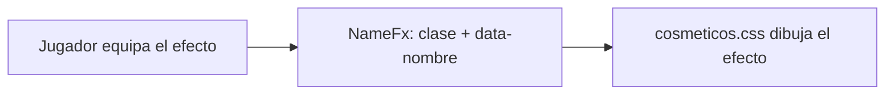

# Efectos de nombre que hagan lo que dice su nombre: documentación

## Qué hace

Cuatro efectos de nombre de la tienda no hacían lo que prometía su nombre. Se rediseñaron solo en el CSS (`web/frontend/src/features/shop/cosmeticos.css`). Las clases, los ids, los precios y quién los tiene no cambian: quien ya los tenía equipados ve el efecto nuevo sin hacer nada.

## Los cuatro efectos

| Efecto | Clase | Antes | Ahora |
|---|---|---|---|
| Brillo | `nombre-brillo` | Destello blanco sobre el color del texto: en modo oscuro el texto ya es blanco y no se veía nada | Franja del color principal (`--primary`) con centro blanco que recorre el nombre; se ve en claro y en oscuro |
| Glitch | `nombre-glitch` | Un parpadeo de 0,3 s cada 2,4 s con copias corridas 2-3 px: casi no se notaba | Cada 3 s, dos ráfagas: el nombre se inclina y se corre, y aparecen cortes horizontales rosa y celeste que cambian de altura (`::before` y `::after`, leen `data-nombre`) |
| Burbujas | `nombre-fondo-mar` | Degradado azul con destello, igual a Oro o Esmeralda en otro color | Letras de agua (celeste arriba, azul abajo) y, por detrás (`::after`, `z-index: -1`), seis columnas de burbujas que suben a distinta velocidad y se desvanecen arriba |
| Sombra | `nombre-sombra` | Sombra negra: en modo oscuro no se veía | Sombra larga del color del texto, cada vez más transparente (`color-mix`) |

Con `prefers-reduced-motion` (por ejemplo, Windows con los "Efectos de animación" apagados) las animaciones se apagan, pero cada efecto muestra un cuadro fijo: Brillo con la franja en el medio, Glitch con la mitad de arriba rosa y la de abajo celeste corridas, Burbujas con las burbujas quietas. Antes, quietos, Brillo y Glitch se veían como un nombre normal: por eso parecía que no hacían nada.

## Revisados y sin cambios

Del resto de los efectos de nombre, tres prometen más de lo que hacen y quedan para que Daniel decida:

| Efecto | Qué promete | Qué hace |
|---|---|---|
| Galaxia | "Estrellas que viajan por las letras" | Las estrellas son puntos de 1-2 px dentro de las letras: casi no se ven |
| Píxel | "Letras de 8 bits" | Usa Consolas (monoespaciada), no una letra pixelada |
| Binario (Robot del futuro) | Binario | Celeste monoespaciado que parpadea: no hay ceros ni unos |

Además, Neón, Ki, Plasma, Mutante y Radiactivo tienen el texto casi blanco: en modo claro se leen poco.

## Qué cambia para cada rol

| Rol | Qué cambia | Página del manual |
|---|---|---|
| Jugador | Brillo, Glitch, Burbujas y Sombra se ven distinto (y mejor) donde aparece su nombre | Sin cambios: `jugador/tienda-y-cosmeticos.md` no describe cada efecto |

## Términos y privacidad

Sin cambios.

## Dónde está cada cosa

| Qué | Dónde |
|---|---|
| Reglas y `@keyframes` (`cos-glitch*`, `cos-burbujas`) | `web/frontend/src/features/shop/cosmeticos.css` |
| Componente que pone la clase y `data-nombre` | `web/frontend/src/features/shop/cosmetics.tsx` (`NameFx`) |
