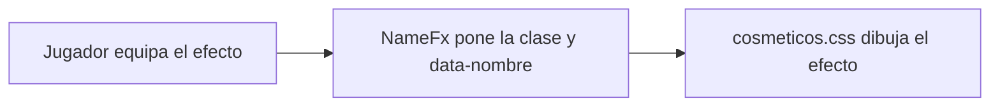

# Plan: efectos de nombre que hagan lo que dice su nombre

> Planeación original. Estado: **aprobado** por Daniel el 2026-11-20 ("quiero mejorar algunos items de la tienda").

## Decisiones tomadas

| Tema | Decisión |
|---|---|
| Alcance | Solo el CSS de los efectos (`web/frontend/src/features/shop/cosmeticos.css`). Las clases, los ids y los precios no cambian: quien ya los tiene ve el efecto nuevo sin hacer nada |
| Brillo | El destello era blanco sobre `currentColor`: en modo oscuro el texto ya es casi blanco y no se veía nada. Pasa a una franja del color principal con el centro blanco, que se ve en claro y en oscuro |
| Glitch | Era un parpadeo de 0,3 s cada 2,4 s con desfase de 2-3 px: casi no se notaba. Pasa a ráfagas con cortes horizontales que cambian de altura, desfase en `em` y un tirón de la letra |
| Burbujas | Era un degradado azul con destello, igual a Oro o Esmeralda pero en azul. Pasa a agua azul con burbujas que suben por el nombre (`::after`) |
| Sombra | La sombra era negra: en modo oscuro no se veía. Pasa a ser del color del texto, cada vez más transparente |
| Sin tocar | Galaxia, Píxel y Binario también prometen más de lo que hacen, pero se le consultan a Daniel antes de cambiarlos |

## 1. El flujo completo

No cambia el flujo: solo el dibujo de cuatro clases.

## 2. Cambios en la web

`cosmeticos.css`: reglas de `.nombre-brillo`, `.nombre-glitch` (y sus `::before`/`::after`), `.nombre-sombra` y `.nombre-fondo-mar` (con `::after`), y sus `@keyframes`. Con `prefers-reduced-motion` siguen quietos (la regla de abajo del archivo ya apaga las animaciones de `nombre-*`).

## 3. Requisitos antes de empezar

Ninguno.

## 4. Orden de implementación

1. Cambiar el CSS.
2. Revisarlo en una página de prueba con el CSS, en claro y en oscuro, con capturas.
3. `pnpm test` del módulo de la tienda.
4. Documentación, changelog y fila en el índice.
