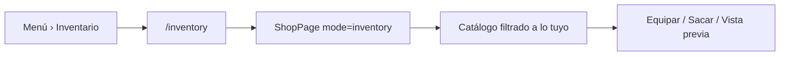

# Sección Inventario, aparte de la Tienda: documentación

## Qué hace

Suma la página **Inventario** (`/inventory`) al menú, en Comunidad, debajo de Tienda. Muestra solo lo que tienes de la tienda, separado por tipo y colección, con lo que tienes puesto primero, y deja ponértelo, sacártelo y probarlo en la vista previa. Es la misma página de la tienda (`ShopPage`) en modo inventario: mismas tarjetas, misma vista previa y misma ventana grande.

## Qué cambia respecto de la Tienda

| Parte | Tienda | Inventario |
|---|---|---|
| Título y texto | "Tienda" | "Inventario": todo lo que tienes, por tipo |
| Botones de arriba | Canjear código, Historial | Canjear código, **Ir a la tienda** |
| Vista previa | Al lado del saldo | A todo el ancho, sin el saldo |
| Saldo, lo que ganas por mix y aviso del VIP | Sí | No |
| Ofertas de la semana | Sí | No |
| Filtro "Mostrar" | Sí | No (siempre es lo tuyo) |
| Contadores de tipos y colecciones | Todo el catálogo | Lo tuyo |
| Orden | El elegido | El elegido, con lo puesto primero |
| Lo propio (Avatares y Fondos) | Panel de subidas | El mismo panel |
| Sin nada | "Nada coincide con el filtro." | "Todavía no tienes nada de este tipo", con enlace a la Tienda |

La Tienda no cambia y conserva su filtro **Lo mío**.

## Límite conocido

El catálogo (`shop_catalog`) trae solo los artículos activos: si tienes algo que después se desactivó, no aparece en Inventario (tampoco en **Lo mío**), aunque lo sigas pudiendo usar. En la base local nadie tiene uno así. Para mostrarlo haría falta que la API devuelva también lo tuyo inactivo.

## Qué cambia para cada rol

| Rol | Qué cambia | Página del manual |
|---|---|---|
| Jugador | Nueva página **Inventario** en el menú | `jugador/tienda-y-cosmeticos.md` (actualizada, sección "Ponértelo") |
| Los demás | Lo mismo que el jugador | — |

## Términos y privacidad

Sin cambios: muestra lo mismo que ya mostraba la tienda.

## Dónde está cada cosa

| Qué | Dónde |
|---|---|
| Ruta | `web/frontend/src/routes/_app/inventory.tsx` |
| Modo inventario | `web/frontend/src/features/shop/ShopPage.tsx` (prop `mode`) |
| Menú | `web/frontend/src/features/shell/lib/nav.ts` (`key: "inventory"`, `BackpackIcon`) |
| Pruebas | `web/frontend/src/features/shop/Inventory.test.tsx` y `web/frontend/src/features/shell/lib/nav.test.ts` |
