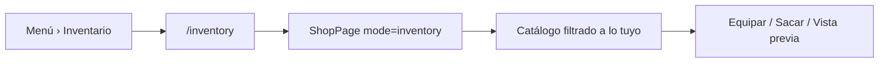

# Plan: sección Inventario, aparte de la Tienda

> Planeación original. Estado: **aprobado** por Daniel el 2026-11-20 ("Inventario separado de Tienda para que encuentren sus ítems más fácilmente").

## Decisiones tomadas

| Tema | Decisión |
|---|---|
| Dónde | Página nueva `/inventory` ("Inventario") en el menú, en Comunidad, debajo de Tienda |
| Cómo | La misma página de la tienda (`ShopPage`) con `mode="inventory"`: mismas tarjetas, vista previa, ventana grande y botones de equipar. Sin copiar componentes |
| Qué muestra | Solo lo tuyo (`owned`), por tipo y colección, con lo que tienes puesto primero. Los contadores de tipos y colecciones cuentan lo tuyo. En Avatares y Fondos, también lo propio que subiste (el panel de siempre) |
| Qué no muestra | El saldo y lo que ganas por mix, el aviso del VIP, las ofertas de la semana y el filtro "Mostrar" (Puedo comprar, Solo VIP…). Arriba, un botón **Ir a la tienda** en lugar de **Historial** |
| Vacío | "Todavía no tienes nada de este tipo", con un enlace a la Tienda |
| La Tienda | No cambia: sigue con su filtro "Lo mío" |
| API y base | Sin cambios: usa el mismo catálogo (`GET /shop/items`) |
| Límite conocido | El catálogo trae solo artículos activos: lo que tengas de un artículo que después se desactivó no aparece (tampoco hoy en "Lo mío"). En la base local nadie tiene uno así. Queda anotado |

## 1. El flujo completo

## 2. Web (`web/frontend`)

- `src/routes/_app/inventory.tsx`: la ruta (con `?canjear=true`, como la tienda).
- `src/features/shop/ShopPage.tsx`: prop `mode` y lo que cambia en cada parte.
- `src/features/shell/lib/nav.ts`: la entrada del menú (`BackpackIcon`).
- Pruebas: la entrada del menú y el filtro del inventario.

## 3. Manual

`jugador/tienda-y-cosmeticos.md`: "Ponértelo" desde Inventario.

## 4. Requisitos antes de empezar

Ninguno.

## 5. Orden de implementación

1. Ruta, modo y menú.
2. Pruebas y revisión con capturas.
3. Manual, documentación, changelog y fila en el índice.
