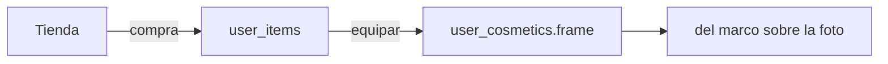

# 13 marcos nuevos en la tienda: documentación

## Qué hace

Suma 13 marcos de perfil a la tienda, en la colección `cs`. Diez se compran con puntos (550) y tres son exclusivos de VIP (450 monedas VIP). Todos llevan la etiqueta **Nuevo** durante 3 días, porque entran con `created_at` de ahora.

Se hicieron con la guía de arte nueva (`docs/guia_y_flujo_de_arte_conceptual_estilo_steam.md`), tomando como referencia marcos de la tienda de puntos de Steam. Algunos se generaron con IA (imagen con `flux` y animación con `kling`, en Replicate) y otros se dibujaron como SVG animado. Son diseños propios: no copian los de Steam.

## Los marcos

| Id | Nombre | Archivo | Animado | Precio |
|---|---|---|---|---|
| `marco-cyberpunk` | Cyberpunk | `cyberpunk.webp` | No | 550 puntos |
| `marco-plasma-liquido` | Plasma líquido | `plasma-liquido.webp` | Sí | 550 puntos |
| `marco-plasma-fuego` | Plasma de fuego | `plasma-fuego.webp` | Sí | 550 puntos |
| `marco-boceto` | Boceto | `boceto.webp` | Sí | 550 puntos |
| `marco-boceto-tiza` | Boceto de tiza | `boceto-tiza.webp` | Sí | 550 puntos |
| `marco-destellos` | Destellos | `destellos.svg` | Sí | 450 monedas VIP (VIP) |
| `marco-conejo` | Conejo | `conejo.svg` | Sí | 450 monedas VIP (VIP) |
| `marco-energia-violeta` | Energía violeta | `energia-violeta.svg` | Sí | 550 puntos |
| `marco-energia-toxico` | Energía tóxica | `energia-toxico.svg` | Sí | 550 puntos |
| `marco-energia-ambar` | Energía ámbar | `energia-ambar.svg` | Sí | 550 puntos |
| `marco-energia-hielo` | Energía de hielo | `energia-hielo.svg` | Sí | 550 puntos |
| `marco-energia-magenta` | Energía magenta | `energia-magenta.svg` | Sí | 550 puntos |
| `marco-synthwave` | Synthwave | `synthwave.webp` | Sí | 450 monedas VIP (VIP) |

Los archivos están en `web/frontend/public/cosmetics/marcos/`. Los precios son los iniciales: el admin los cambia en Administración › Tienda.

## Reglas de dibujo

- La web pone la foto dentro del marco con un margen de 12,5 % por lado y esquinas redondeadas al 8 %. Todos los marcos tocan o pisan ese borde, sin dejar espacio (Daniel, 2026-11-20).
- Se ven en el tema claro y en el oscuro. El Boceto negro casi no se ve en el oscuro: para eso está el Boceto de tiza.
- Los WebP animados pesan de 50 KB (Boceto) a 620 KB (Plasma de fuego). Los SVG, de 6 KB a 37 KB.

## Qué cambia para cada rol

| Rol | Qué cambia | Página del manual |
|---|---|---|
| Jugador | 13 marcos nuevos para comprar y ponerse (3 solo para VIP) | `docs/manual/jugador/tienda-y-cosmeticos.md` (sin cambios: describe los marcos en general) |
| Admin | 13 artículos más para editar en Administración › Tienda | `docs/manual/admin/tienda-y-puntos.md` (sin cambios) |

## Términos y privacidad

Sin cambios. Son imágenes de la tienda: no se guarda ni se publica ningún dato nuevo de los usuarios. Replicate se usó solo para hacer las imágenes, fuera de la web.

## Dónde está cada cosa

| Qué | Archivo / ubicación |
|---|---|
| Los marcos | `web/frontend/public/cosmetics/marcos/` |
| Catálogo | `web/frontend/public/cosmetics/catalogo.json` (versión 16) |
| Migración | `supabase/replanteo/133_tienda_marcos_nuevos.sql` |
| Inversa | `docs/bitacora/2026-10-14-replanteo-modelo-datos/reversas/133_tienda_marcos_nuevos.sql` |
| Guía de arte | `docs/guia_y_flujo_de_arte_conceptual_estilo_steam.md` |
| Scripts de la guía | `docs/recortar_marco.mjs`, `hueco_marco.mjs`, `animar_marco.sh`, `temblor_marco.mjs`, `recolorear_marco.mjs`, `generar_destellos.mjs`, `generar_energia.mjs`, `generar_codigo.mjs`, `generar_vacio.mjs`, `vista_marco_svg.mjs` y `png_rgba.mjs` |
