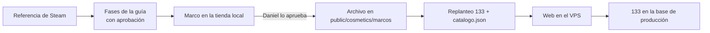

# Plan: 13 marcos nuevos en la tienda

> Planeación original. Estado: **aprobado** por Daniel el 2026-11-20, marco por marco, durante la sesión en que se hicieron (cada uno se vio en la tienda local antes de seguir).

## Decisiones tomadas

| Tema | Decisión |
|---|---|
| Cómo se hacen | Con la guía de arte nueva (`docs/guia_y_flujo_de_arte_conceptual_estilo_steam.md`): una referencia de Steam por marco (`inspiraciones/1.gif` a `7.gif`, fuera del repo), fases con aprobación de Daniel en cada paso y, según el diseño, IA de Replicate (`flux` y `kling`) o SVG dibujado con código. |
| Qué se publica | Solo lo que Daniel aprobó en la tienda local: Cyberpunk, Plasma líquido, Plasma de fuego, Boceto, Boceto de tiza, Destellos, Conejo, Energía (violeta, tóxica, ámbar, de hielo y magenta) y Synthwave. Los descartados (Llamas fantasma, Vacío y Código) no se publican. |
| VIP | Destellos, Conejo y Synthwave son exclusivos de VIP, a 450 monedas VIP como los demás marcos VIP. El resto, 550 puntos como los marcos de la colección `cs`. |
| Colección | `cs`, como la mayoría de los marcos. |
| Formatos | SVG animado (Destellos, Conejo y Energía) o WebP (animado salvo Cyberpunk), de 256 a 512 px y de 6 KB a 620 KB. Los marcos se dibujan con ``: nada de WebM. |
| Nombres | Sin "IA" en el nombre ni en la descripción. Los ids y los archivos tampoco lo llevan. |
| Orden | Después del último artículo del catálogo (orden 3920 a 4040), como la `130`. |
| Base | Una migración nueva (`133`) que inserta los 13 y falla si alguno ya existe, con su inversa. Los mismos datos en `catalogo.json` (versión 16). |

## 1. El flujo completo

## 2. Archivos

Los 13 archivos van en `web/frontend/public/cosmetics/marcos/` y se publican con la web. La guía de arte y sus scripts (`docs/*.mjs`, `docs/animar_marco.sh`) van en `docs/` para poder repetir el proceso.

## 3. Base de datos

`supabase/replanteo/133_tienda_marcos_nuevos.sql` inserta los 13 en `shop_items` en una transacción, después de comprobar que no existan, y comprueba al final que estén los 13. La inversa los borra, salvo que un código canjeable dé alguno.

## 4. Requisitos antes de empezar

- Túnel a la base del VPS para aplicar la `133`.
- Acceso del usuario `deploy` al VPS para la web.

## 5. Orden de implementación

1. Los archivos de los marcos y `catalogo.json`.
2. La `133` y su inversa, probadas en la base local.
3. Commit y push a `main`.
4. La web en el VPS, desde una copia limpia del commit (sin los cambios sin commit de otros requerimientos).
5. La `133` en la base de producción, con un respaldo antes. Va después de la web, para que los marcos no aparezcan sin su archivo.
