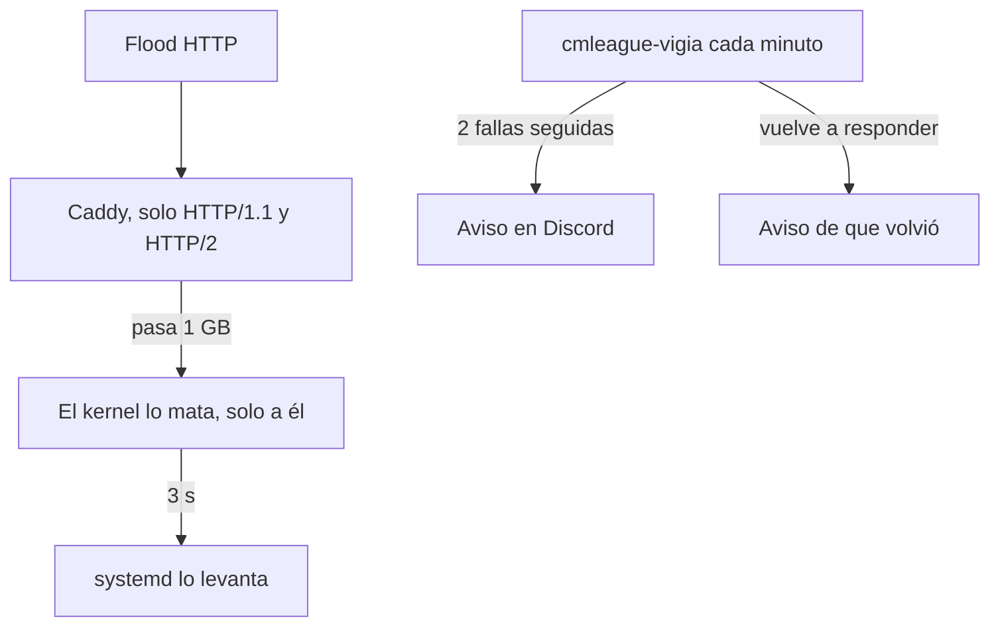

# Protección del VPS contra floods HTTP: documentación

## Qué hace

El 2026-11-20 un flood HTTP (capa 7) contra `cmleague.lat` llevó a Caddy a más de 3 GB de RAM y el kernel lo mató dos veces: a las 01:00:36 y, después de levantarlo a mano, de nuevo a las 01:12:27 UTC. Como Caddy es la puerta de entrada de la web, la API y la base, todo quedó sin responder hasta que alguien lo levantó a mano, y nadie recibió aviso.

Esta primera tanda no frena el ataque, que es lo que hará Cloudflare más adelante, pero limita el daño:

- Caddy tiene un tope de memoria y se reinicia solo en 3 segundos si lo pasa. Un flood ya no deja sin memoria a Supabase, la API ni el matchmaking, y la caída dura segundos en lugar de quedar hasta que alguien lo note.
- HTTP/3 está apagado: el 95 % del ataque entró por ahí.
- Un vigía avisa por Discord cuando la web, la API o la base no responden durante dos minutos, y cuando vuelven.

## El ataque

| Dato | Valor |
|---|---|
| Primera ola | Subiendo desde ~00:40; pico entre 00:59:11 y 01:00:19 UTC: 48.663 `GET /` en 68 s (~715 por segundo) |
| Segunda ola | 01:09 a 01:12 UTC, apenas volvió Caddy |
| Protocolo | 95 % HTTP/3 (QUIC), el resto HTTP/2 |
| Origen | Muchas IPs y User-Agents de Chrome y Firefox falsos. En la primera ola mandó más la red `45.82.77.0/24`; en la segunda, IPs distintas (`161.114.14.236`, `212.134.61.41`, `69.55.49.177`, …). Bloquear IPs sirve poco |
| Servidores de juego | Sin cambios: el #1, el #2 y el #3 siguieron andando, con tráfico normal |

## Caddy

- **Drop-in** `/etc/systemd/system/caddy.service.d/cmleague.conf` (`deploy/vps/caddy-cmleague.conf`): `Restart=always`, `RestartSec=3`, `MemoryMax=1G` y `MemorySwapMax=0`. Sin swap, para que se reinicie rápido en vez de arrastrar todo el VPS (en la segunda caída llegó a usar 810 MB de swap). Sin `MemoryHigh`: sin swap, ese freno lo deja colgado sin responder en vez de reiniciarse.
- **Caddyfile** (`deploy/vps/Caddyfile`): bloque global `servers { protocols h1 h2 }`. Los navegadores pasan solos a HTTP/2.
- **Firewall:** quedaron bloqueadas en `ufw` la red `45.82.77.0/24` y las IPs `94.142.141.161`, `89.111.141.45`, `77.239.100.172` y `130.94.11.187`, con el comentario `flood 2026-11-20`.

## Vigía

| Pieza | Dónde |
|---|---|
| Script | `deploy/vps/vigia.sh` → `/srv/cmleague/vigia.sh` |
| Servicio y timer | `cmleague-vigia.service` (oneshot, `DynamicUser`) y `cmleague-vigia.timer` (cada minuto, en el segundo 30) |
| Webhook | `/etc/cmleague/vigia.env` (root, 600), con el mismo `DISCORD_UPTIME_WEBHOOK` de `respaldo.env` |
| Estado | `/run/cmleague-vigia/`, un archivo por sitio: `ok`, `falla1` o `caido` |

Revisa `https://cmleague.lat/`, `https://api.cmleague.lat/` y `https://db.cmleague.lat/rest/v1/`. Cualquier respuesta `1xx` a `4xx` cuenta como viva: la API responde `302` y la base `401` sin clave. Un `000` (no conecta) o un `5xx` cuenta como falla. Avisa solo cuando cambia el estado.

**Limitación:** corre en el mismo VPS. Si se cae el VPS entero, no avisa.

## Cloudflare

- Desde el 2026-11-20 (02:53 UTC) el DNS está en Cloudflare (plan Free). Con proxy: `cmleague.lat`, `www`, `api` y `db`. Sin proxy ("DNS only"): `hud` y `relay` (UDP del HUD) y los registros del correo.
- Caddy toma la IP real del cliente de `CF-Connecting-IP` solo si la conexión viene de un rango de Cloudflare (`trusted_proxies`), y se la pasa a la API y a Kong en `X-Forwarded-For`.
- **Firewall:** 80 y 443 solo para Cloudflare y las máquinas de los servidores de juego, y el UDP del HUD (27500-27519) solo para esas máquinas, con `solo-cloudflare.sh on|off`. Lo directo a la IP se descarta antes de llegar a Caddy; lo único abierto a todos es el SSH. La lista de máquinas (`PERMITIDOS`) hoy es solo MVZG (`190.104.34.3`): **un servidor de juego en otra máquina se agrega ahí y se vuelve a correr `on`**, o su HUD no llega.
- **Rate limiting** en Cloudflare: 50 pedidos en 10 s por IP a las páginas de la web (no a `/assets/`, la API ni la base), bloqueo de 10 s.
- **En un ataque:** Configuration Rule `Hostname equals cmleague.lat` → `I'm Under Attack` (solo para la web).
- **Pendiente:** el HUD de las transmisiones no funciona mientras `hud` siga en DNS only con el 443 cerrado. Hay que pasar `csstv_hud_host` del #1, el #2 y el #3 a `relay.cmleague.lat` y `hud` a Proxied.

## Qué cambia para cada rol

Nada para los usuarios.

## Términos y privacidad

- **`/privacidad`:** en la tabla de servicios, Cloudflare pasa de "Demos y clips, y parte de la web" a "Demos y clips, parte de la web y la protección de toda la web contra ataques", con la marca "En preparación" (`Wip` en `PrivacyPage.tsx` y `` en `terms/privacidad.html`). Con el proxy, Cloudflare ve la IP y los pedidos de todos los visitantes. La marca se quita cuando el DNS pase a Cloudflare.
- La fecha de actualización pasa al 20 de noviembre de 2026 (`LEGAL_UPDATED`, `terms/privacidad.html` y `terms/terminos.html`).
- El vigía no guarda datos de nadie, y Caddy ya guardaba la IP en el log de acceso.

## Dónde está cada cosa

| Archivo | Qué es |
|---|---|
| `deploy/vps/caddy-cmleague.conf` | Drop-in de systemd para Caddy |
| `deploy/vps/Caddyfile` | Sin HTTP/3 |
| `deploy/vps/vigia.sh`, `cmleague-vigia.service`, `cmleague-vigia.timer`, `vigia.env.example` | Vigía |
| `deploy/vps/solo-cloudflare.sh` | 80 y 443 en `ufw` solo para Cloudflare y MVZG, o abiertos a todos (`/srv/cmleague/solo-cloudflare.sh on\|off`) |
| `deploy/vps/preparar.sh` | Instala todo lo anterior en un VPS nuevo |
