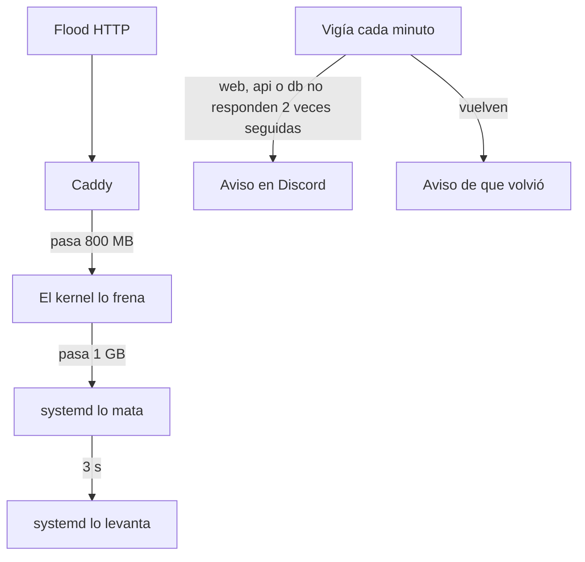

# Plan: protección del VPS contra floods HTTP

> Planeación original. Estado: **aprobada por Daniel el 2026-11-20** ("empecemos por las mejoras cortas y dejemos de última las que puedan tardar más").

## Qué pasó

El 2026-11-20, entre las 00:59:11 y las 01:00:19 UTC, `cmleague.lat` recibió unas 48.700 peticiones `GET /` en 68 segundos (~715 por segundo). El 95 % llegó por HTTP/3, con User-Agents falsos y desde muchas IPs (la que más mandó fue la red `45.82.77.0/24`). El tráfico venía subiendo desde las 00:40.

Caddy llegó a 3,1 GB de RAM (el VPS tiene 3,8 GB) y el kernel lo mató a las 01:00:36. Como `caddy.service` no tiene `Restart=`, quedó caído: la web, la API y `db.cmleague.lat` no respondieron hasta que se levantó a mano, unos 10 minutos después. En ese rato fallaron los timers `notify`, `season`, `medals` y `demos` (`fetch failed`) y nadie recibió aviso.

Ese mismo día, al diagnosticar, se bloquearon en `ufw` la red `45.82.77.0/24` y las IPs `94.142.141.161`, `89.111.141.45`, `77.239.100.172` y `130.94.11.187` (comentario `flood 2026-11-20`), y se levantó Caddy.

## Decisiones tomadas

| Tema | Decisión | Por qué |
|---|---|---|
| Orden | Primero lo corto y solo del VPS; Cloudflare al final | Lo corto se hace en una tanda sin tocar el DNS; Cloudflare implica mover los nameservers de Namecheap |
| Memoria de Caddy | `MemoryHigh=800M` y `MemoryMax=1G` | Que un flood mate a Caddy y no deje sin memoria a Supabase, la API y el matchmaking |
| Caddy caído | `Restart=always` con `RestartSec=3` | Hoy, si muere, queda caído hasta que alguien lo levante |
| HTTP/3 | Apagado (`protocols h1 h2`) | Por ahí entró el 95 % del ataque y es lo que más memoria le consume a Caddy. Los navegadores pasan solos a HTTP/2 |
| Logs | Se dejan como están | Fueron los que permitieron diagnosticar el ataque. Con `roll_keep 5` el disco no crece |
| Rate limit por IP | No en esta tanda | Caddy no trae el módulo y contra un ataque distribuido sirve poco. Va con Cloudflare |
| Aviso | Vigía cada minuto en el VPS que avisa por Discord (`DISCORD_UPTIME_WEBHOOK`) cuando la web, la API o la base dejan de responder y cuando vuelven | Esta vez nadie se enteró. Solo avisa en el cambio de estado, para no llenar el canal |

## 1. El flujo

## 2. Caddy

- `deploy/vps/caddy-cmleague.conf`: un drop-in en `/etc/systemd/system/caddy.service.d/cmleague.conf` con `Restart=always`, `RestartSec=3`, `MemoryHigh=800M` y `MemoryMax=1G`.
- `deploy/vps/Caddyfile`: bloque global con `servers { protocols h1 h2 }`.
- `preparar.sh` instala el drop-in, para que un VPS nuevo quede igual.

## 3. Vigía

- `deploy/vps/vigia.sh`: pide `https://cmleague.lat/`, `https://api.cmleague.lat/` y `https://db.cmleague.lat/rest/v1/` (cualquier respuesta HTTP cuenta como "responde"; `000` o un 5xx, no). Guarda el estado en `/run/cmleague-vigia/` y avisa por Discord cuando un sitio falla dos veces seguidas y cuando vuelve.
- `cmleague-vigia.service` (oneshot, con `EnvironmentFile=/etc/cmleague/vigia.env`) y `cmleague-vigia.timer` (cada minuto).
- `vigia.env.example` con `DISCORD_UPTIME_WEBHOOK=`. El valor sale del `.env` de la raíz (el mismo que ya usa `respaldo.env`).

Limitación: si se cae el VPS entero, el vigía también, y no avisa. Eso lo cubre un chequeo de afuera (un Worker de Cloudflare con cron), que va con la parte de Cloudflare.

## 4. Lo que queda para después (más largo)

- Mover el DNS a Cloudflare con proxy, regla de rate limiting y `ufw` con 80/443 solo para las IPs de Cloudflare. Revisar el WebSocket del matchmaking (ping antes de 100 s), el límite de 100 MB por subida y `trusted_proxies cloudflare` para la IP real del cliente.
- Chequeo de afuera (Worker con cron).

## 5. Requisitos

- SSH al VPS como `ubuntu`. Nada nuevo que instalar.

## 6. Orden de implementación

1. Escribir los archivos en `deploy/vps/` y sumarlos a `preparar.sh`.
2. Subirlos al VPS, validar el Caddyfile y hacer `systemctl reload caddy` (no `restart`: no corta los sockets del matchmaking por `stream_close_delay`).
3. `daemon-reload` para el drop-in y comprobar `MemoryMax` y `Restart` con `systemctl show caddy`.
4. Instalar el vigía con su `vigia.env` y comprobar que corre. Probar el aviso una vez con un sitio que no existe.
5. Documentación, guía, fila en el README de la bitácora y `docs/PENDIENTES.md`.
