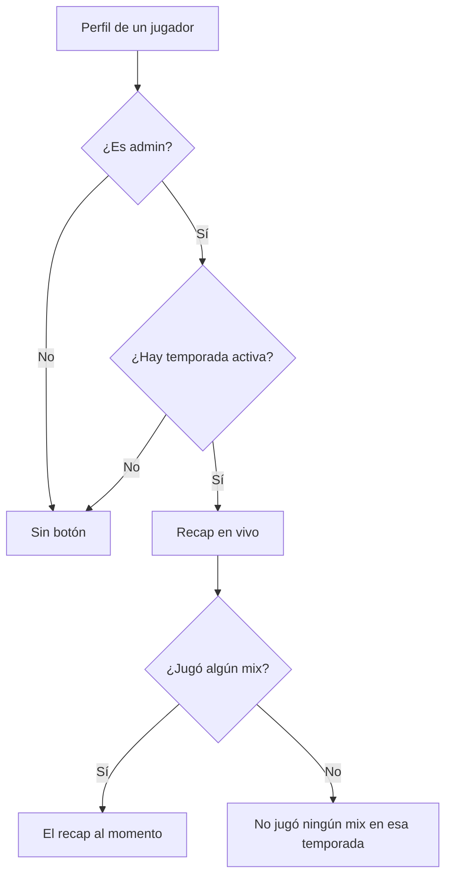

# Recap en vivo de cualquier jugador para los admins: documentación

## Qué hace

Un admin que abre el perfil de cualquier jugador ve el botón **Recap en vivo** en la cabecera, al lado de Verificar. Lleva al recap de ese jugador en la temporada activa, calculado al momento: cómo va hasta ahora, con el cartel **En vivo · solo admins**. Sirve para seguir la temporada y para probar el recap antes del cierre.

No cambia la base ni la API: usa `season_recap_live` y `GET /api/v1/players/{id}/seasons/{number}/recap` del replanteo `129` ([`2026-11-19-estadisticas-de-temporada`](../2026-11-19-estadisticas-de-temporada/)). La base vuelve a comprobar que sea admin.

## Cuándo ven el recap los demás

| Temporada | Quién la ve | Cuándo |
|---|---|---|
| Temporada 1 (cerrada) | Todos | Apenas se aplique la `129` en el VPS y se despliegue la web: la `129` arma las fotos de las cerradas |
| Temporada 2 (activa) | Solo admins, en vivo | Hasta que cierre |
| Temporada 2 al cerrar | Todos | Cuando la cierra el cron del VPS (`cmleague-season.timer`, cada 10 minutos, `season_close_due`): al pasar `ends_at`, el 2026-12-09 a las 09:00 UTC (06:00 en Argentina). Con un mix en vivo espera hasta 6 horas. También la cierra un admin con **Terminar temporada** |

Al cerrar, `season_close_run` guarda la foto (`season_recaps` y `season_summaries`) en la misma transacción. Desde ese momento el botón **Recap** aparece en Perfil › Temporadas para cada jugador con al menos un mix.

## Qué cambia para cada rol

| Rol | Qué cambia | Página del manual |
|---|---|---|
| Admin | Botón **Recap en vivo** en la cabecera de cualquier perfil | [`admin/temporadas.md`](../../manual/admin/temporadas.md) |
| Jugador, capitán, organizador, moderador, streamer, dueño de un servidor externo | Nada | — |

## Términos y privacidad

Sin cambios: `/privacidad` ya dice, desde la `129`, que durante la temporada solo los admins ven el recap.

## Dónde está cada cosa

| Qué | Archivo |
|---|---|
| Botón | `web/frontend/src/features/player/pages/PlayerProfile.tsx` (`LiveRecapButton`) |
| Manual | `docs/manual/admin/temporadas.md` |
