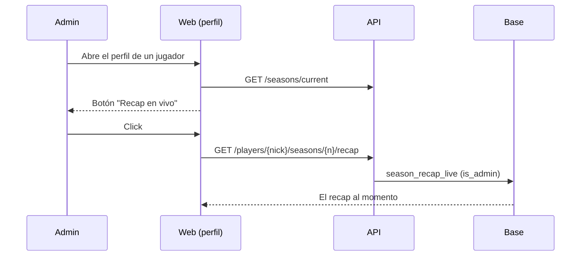

# Plan: recap en vivo de cualquier jugador para los admins

> Planeación original. Estado: **aprobado por Daniel** (2026-11-20), junto con traer a `main` el recap de Kyan ([`2026-11-19-estadisticas-de-temporada`](../2026-11-19-estadisticas-de-temporada/)).

Daniel lo pidió así: "que los admins puedan ver el recap de cualquier jugador en cualquier momento dándole click a un botón para ver cómo van hasta ahora (y también me sirve para probar)".

## Decisiones tomadas

| Tema | Decisión | Por qué |
|---|---|---|
| Qué ya hay | El recap de Kyan ya calcula el recap en vivo para admins (`season_recap_live`) y lo muestra en Perfil › **Temporadas**, en una tarjeta de la temporada en curso | No hace falta tocar la base ni la API |
| Qué falta | Un botón a la vista: **Recap en vivo** en la cabecera del perfil de cualquier jugador, solo para admins, con la temporada activa | La tarjeta queda dentro de una pestaña y hay que saber que existe |
| Sin temporada activa | El botón no aparece. Las cerradas ya tienen su botón **Recap** en Temporadas, para todos | Entre temporadas no hay nada en vivo |
| Jugador sin mixes en la temporada | El botón aparece igual y el recap dice que no jugó ningún mix (404 de la API) | Saber si jugó costaría otra consulta por cada perfil que abre un admin |
| Legales | Sin cambios: la privacidad ya dice que durante la temporada solo los admins ven estos datos | |

## 1. El flujo

## 2. Web

- `features/player/pages/PlayerProfile.tsx`: `LiveRecapButton` en la cabecera, al lado de Verificar, con `currentSeasonOptions`, que lleva a `/player/$nick/recap/$season`.

## 3. Manual

- `docs/manual/admin/temporadas.md`: el botón nuevo en "Estadísticas en vivo".
