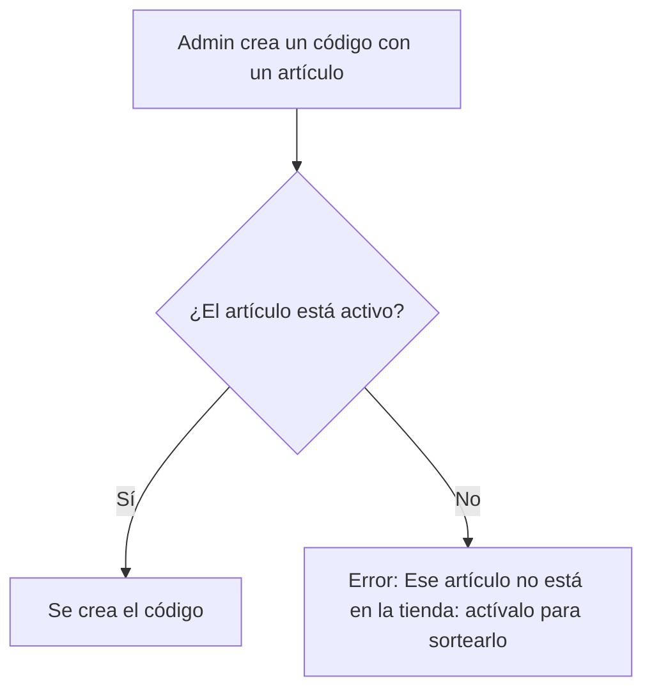

# Los sorteos no dan artículos desactivados: documentación

## Qué hace

Un código canjeable nuevo ya no puede dar un artículo desactivado de la tienda (`shop_items.active = false`). La base lo rechaza y el formulario de Administración › Tienda › Códigos solo muestra los artículos activos. Cambia lo decidido el 2026-11-16 en [`2026-11-16-codigos-canjeables`](../2026-11-16-codigos-canjeables/PLAN.md), que dejaba sortear lo inactivo como "exclusivo de sorteo".

## Reglas

| Caso | Qué pasa |
|---|---|
| Código nuevo con un artículo activo | Se crea, como antes |
| Código nuevo con un artículo desactivado | `admin_code_create` lanza "Ese artículo no está en la tienda: actívalo para sortearlo"; la API lo devuelve como cualquier error de la base |
| Código ya creado con un artículo que después se desactivó | Sigue dando el artículo: `code_redeem` no cambia |
| Quiero sortear algo que no se vende | Se activa en Catálogo, se crea el código y se vuelve a desactivar |

## Qué cambia para cada rol

| Rol | Qué cambia | Página del manual |
|---|---|---|
| Admin | La búsqueda de artículos al crear un código muestra solo los activos | `admin/tienda-y-puntos.md` (actualizada) |
| Jugador | Nada: los códigos que ya tiene siguen funcionando | — |

## Términos y privacidad

Sin cambios: los términos no hablan de qué artículos se sortean.

## Dónde está cada cosa

| Qué | Dónde |
|---|---|
| Validación | `supabase/replanteo/131_sorteos_sin_desactivados.sql` (`admin_code_create`) |
| Inversa | `docs/bitacora/2026-10-14-replanteo-modelo-datos/reversas/131_sorteos_sin_desactivados.sql` |
| Formulario | `web/frontend/src/features/shop/AdminCodesSection.tsx` (`active: "true"` en la búsqueda) |
| Prueba | `web/frontend/src/features/shop/AdminCodesSection.test.tsx` |
