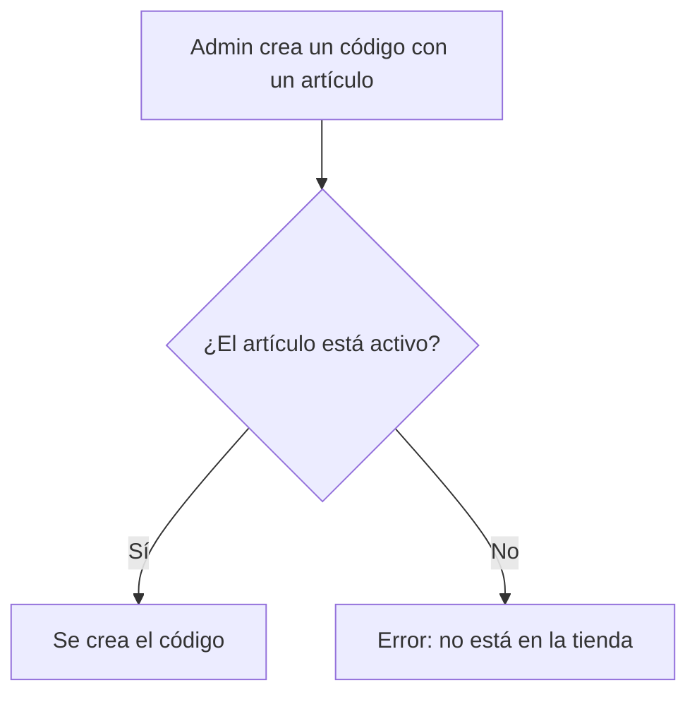

# Plan: los sorteos no dan artículos desactivados

> Planeación original. Estado: **aprobado** por Daniel el 2026-11-20 ("Sacarlos del todo").

## Decisiones tomadas

| Tema | Decisión |
|---|---|
| Qué cambia | Un código canjeable nuevo no puede dar un artículo desactivado (`shop_items.active = false`). Cambia lo decidido en [`2026-11-16-codigos-canjeables`](../2026-11-16-codigos-canjeables/PLAN.md), donde lo inactivo se podía sortear como "exclusivo de sorteo" |
| Dónde | En la base (`admin_code_create` lo rechaza) y en la web (la lista de artículos del formulario muestra solo los activos). La API no cambia: pasa el error de la base como los demás |
| Códigos ya creados | Siguen dando su artículo aunque esté desactivado: no se tocan `code_redeem` ni los códigos guardados |
| Para sortear uno desactivado | El admin lo activa en Administración › Tienda, crea el código y, si quiere, lo vuelve a desactivar |

## 1. El flujo completo

## 2. Base (`supabase/replanteo`)

`131_sorteos_sin_desactivados.sql`: `create or replace` de `admin_code_create` (la misma de la `126`) con `if not i.active then raise exception …`. Inversa: la función de la `126`.

## 3. Web (`web/frontend`)

- `AdminCodesSection.tsx`: la búsqueda de artículos pide `active: true` y se quita el aviso "No está en la tienda".
- `AdminCodesSection.test.tsx`: el artículo de prueba pasa a activo y se comprueba que la búsqueda pide solo activos.

## 4. Requisitos antes de empezar

Ninguno.

## 5. Orden de implementación

1. Migración e inversa; aplicarla en la base local y probar que rechaza un inactivo y acepta uno activo.
2. Web y su prueba.
3. Manual del admin (si nombra lo inactivo), documentación y fila en los índices.
