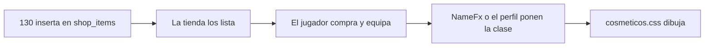

# Colección Equipo táctico y otros nombres y temas: documentación

## Qué hace

Suma 22 artículos a la tienda: 10 efectos de nombre y 12 temas. Son solo CSS (clases de `cosmeticos.css`, la clase es igual al id), así que no hay archivos nuevos en `public/cosmetics/`. Daniel los eligió en una maqueta (artifact "Nuevos nombres y temas") el 2026-11-20.

## Los artículos

| Id | Tipo | Nombre | Colección | Precio | Qué hace |
|---|---|---|---|---|---|
| `nombre-flashbang` | Nombre | Flashbang | `tactico` | 300 puntos | Cada 3,6 s el nombre se desenfoca y una copia blanca brillante (`::after`) aparece y se apaga |
| `nombre-humo` | Nombre | Humo | `tactico` | 300 puntos | Se esfuma en humo gris (desenfoque, transparencia y sombra que sube) y vuelve |
| `nombre-c4` | Nombre | C4 | `tactico` | 300 puntos | Rojo; pulsos de brillo cada vez más seguidos y un destello al final |
| `nombre-nocturna` | Nombre | Visión nocturna | `tactico` | 300 puntos | Verde fósforo con líneas que bajan y un titileo |
| `nombre-radar` | Nombre | Radar | `tactico` | 300 puntos | Barrido verde de izquierda a derecha, con estela |
| `nombre-headshot` | Nombre | Headshot | `tactico` | 300 puntos | Cada 2,8 s se sacude y una copia roja (`::after`) aparece un instante |
| `tema-flashbang` | Tema | Flashbang | `tactico` | 300 monedas VIP | Blanco frío; el borde destella y se apaga |
| `tema-humo` | Tema | Humo | `tactico` | 300 monedas VIP | Gris; resplandor que respira |
| `tema-c4` | Tema | C4 | `tactico` | 300 monedas VIP | Rojo oscuro; el borde late cada vez más rápido |
| `tema-nocturna` | Tema | Visión nocturna | `tactico` | 300 monedas VIP | Verde sobre negro; líneas en el fondo y un barrido que baja |
| `tema-radar` | Tema | Radar | `tactico` | 300 monedas VIP | Un barrido verde da la vuelta al borde (`conic-gradient` con `@property --cos-radar`) |
| `tema-headshot` | Tema | Headshot | `tactico` | 300 monedas VIP | Carmesí; cada tanto un golpe rojo en el borde |
| `nombre-killfeed` | Nombre | Kill feed | `cs` | 250 puntos | Recuadro oscuro con borde rojo y nombre celeste, como el aviso de muerte del juego. Sin animación |
| `nombre-spray` | Nombre | Spray | `cs` | 250 puntos | Rosa, inclinado, con la pintura que chorrea |
| `nombre-tormenta` | Nombre | Tormenta | `cs` | 250 monedas VIP | Azul con relámpagos que iluminan las letras |
| `nombre-eclipse` | Nombre | Eclipse | `cs` | 250 monedas VIP | Letras negras con una corona dorada que gira |
| `tema-medianoche`, `tema-cobre`, `tema-lavanda`, `tema-turquesa`, `tema-vino`, `tema-menta` | Tema | Medianoche, Cobre, Lavanda, Turquesa, Vino, Menta | `cs` | 350 puntos | Colores lisos, sin animación |

Los precios son los iniciales: el admin los cambia en Administración › Tienda.

## Reglas de dibujo

- **Movimiento reducido:** cada efecto animado tiene un cuadro fijo en el bloque `prefers-reduced-motion` de `cosmeticos.css` (Flashbang y C4 con su brillo, Radar con el barrido a mitad, Headshot inclinado con un borde rojo, el borde del tema Radar a medio giro, etc.).
- **Página del jugador con tema:** `.perfil-tema` apaga la animación y la sombra en el fondo de la página entera. El borde animado o el resplandor de **todos** los temas (no solo los nuevos) va en cada tarjeta de la página que no esté dentro de otra tarjeta (`.perfil-tema.tema-X [data-slot="card"]:not([data-slot="card"] *)`). Las líneas de Visión nocturna y el borde giratorio de Radar van con `:not(.perfil-tema)` más ese mismo selector, así que están en las tarjetas y no en el fondo de la página.
- **Copias con `::after`:** Flashbang y Headshot ponen el blanco y el rojo en una copia del nombre (lee `data-nombre`, como Glitch). Animar `color` en el propio nombre lo iba tiñendo toda la vuelta, no solo en el destello.

## Qué cambia para cada rol

| Rol | Qué cambia | Página del manual |
|---|---|---|
| Jugador | 22 artículos nuevos en la tienda (Temas y Nombres) y la colección "Equipo táctico" en el filtro | Sin cambios: `jugador/tienda-y-cosmeticos.md` no lista artículos ni colecciones |
| Admin | Los ve y les cambia el precio o los desactiva en Administración › Tienda, como a los demás | Sin cambios |

## Términos y privacidad

Sin cambios: no hay datos nuevos, ni pagos nuevos, ni servicios externos.

## Dónde está cada cosa

| Qué | Dónde |
|---|---|
| Clases y `@keyframes` | `web/frontend/src/features/shop/cosmeticos.css` (bloque "Equipo táctico", antes del de movimiento reducido) |
| Nombre de la colección | `web/frontend/src/features/shop/types.ts` (`COLLECTIONS.tactico`) |
| Catálogo (versión 15) | `web/frontend/public/cosmetics/catalogo.json` |
| Migración | `supabase/replanteo/130_tienda_equipo_tactico.sql` |
| Inversa | `docs/bitacora/2026-10-14-replanteo-modelo-datos/reversas/130_tienda_equipo_tactico.sql` |
