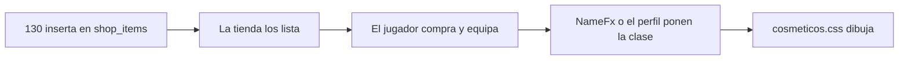

# Plan: colección Equipo táctico y otros nombres y temas para la tienda

> Planeación original. Estado: **aprobado** por Daniel el 2026-11-20, que eligió los 22 artículos en la maqueta (artifact "Nuevos nombres y temas").

## Decisiones tomadas

| Tema | Decisión |
|---|---|
| Qué se agrega | 22 artículos: 10 efectos de nombre y 12 temas. Son solo CSS: no hay archivos nuevos en `public/cosmetics/` |
| Colección nueva | `tactico` ("Equipo táctico"): los 6 nombres y los 6 temas de Flashbang, Humo, C4, Visión nocturna, Radar y Headshot. Los demás van a `cs` (Counter-Strike), como los efectos y temas sueltos de ahora |
| Precios | Nombres tácticos 300 puntos; temas tácticos VIP a 300 monedas VIP (tienen el borde animado, como los temas VIP de ahora); Kill feed y Spray 250 puntos; Tormenta y Eclipse VIP a 250 monedas; los seis temas lisos 350 puntos. El admin los puede cambiar después |
| Movimiento reducido | Cada efecto tiene un cuadro fijo que se entiende sin animación (como Brillo y Glitch desde [`2026-11-20-efectos-de-nombre`](../2026-11-20-efectos-de-nombre/)) |
| Página del jugador con tema | `.perfil-tema` ya apaga la animación y la sombra en la página entera; lo que los temas nuevos ponen aparte (líneas de Visión nocturna, borde giratorio de Radar) se limita a `:not(.perfil-tema)`, para que quede solo en la tarjeta de arriba |
| Base | Migración `130_tienda_equipo_tactico.sql`: inserta los 22 en `shop_items` (falla si alguno ya existe). Inversa: los borra (y con ellos, por `on delete cascade`, lo comprado) |

## 1. El flujo completo

## 2. Web (`web/frontend`)

- `src/features/shop/cosmeticos.css`: clases `nombre-flashbang`, `nombre-humo`, `nombre-c4`, `nombre-nocturna`, `nombre-radar`, `nombre-headshot`, `nombre-killfeed`, `nombre-spray`, `nombre-tormenta`, `nombre-eclipse`, `tema-flashbang`, `tema-humo`, `tema-c4`, `tema-nocturna`, `tema-radar`, `tema-headshot`, `tema-medianoche`, `tema-cobre`, `tema-lavanda`, `tema-turquesa`, `tema-vino` y `tema-menta`, con sus `@keyframes` y su cuadro fijo en el bloque de `prefers-reduced-motion`.
- `src/features/shop/types.ts`: `COLLECTIONS.tactico = "Equipo táctico"`.
- `public/cosmetics/catalogo.json`: los 22 y la colección; versión 15.

## 3. Base (`supabase/replanteo`)

- `130_tienda_equipo_tactico.sql` y su inversa en `docs/bitacora/2026-10-14-replanteo-modelo-datos/reversas/`.
- Fila en `supabase/replanteo/README.md`.

## 4. Requisitos antes de empezar

Ninguno. Para probar en local, la base local con la `119` aplicada.

## 5. Orden de implementación

1. CSS, colección y catálogo.
2. Migración e inversa.
3. Revisión visual con capturas (oscuro, claro y movimiento reducido) y `pnpm test` de la tienda.
4. Aplicar la 130 en la base local si está levantada y verlo en la tienda.
5. Documentación, manual (si nombra colecciones), changelog y fila en el índice.
