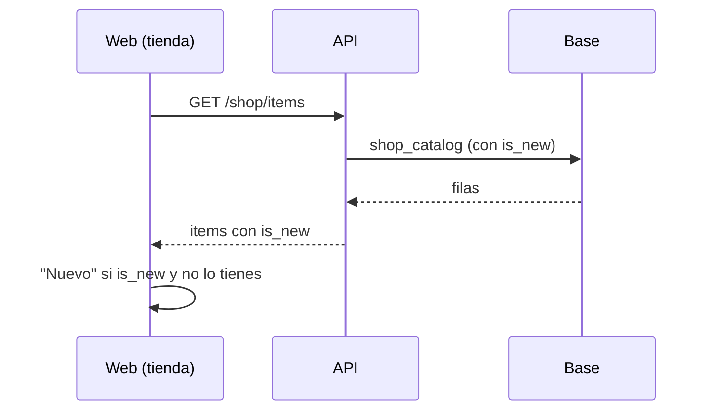

# Etiqueta "Nuevo" en la tienda durante 3 días: documentación

## Qué hace

Cada artículo que entró a la tienda hace menos de 3 días lleva la etiqueta **Nuevo** en su tarjeta, salvo que ya lo tengas. La fecha es la de `shop_items.created_at` (cuando el artículo entra a la base); la regla se calcula en la base y la API la pasa como `is_new`.

## Reglas

| Caso | ¿"Nuevo"? |
|---|---|
| El artículo entró a la base hace menos de 3 días (`created_at >= now() - 3 días`) y no lo tienes | Sí |
| Lo mismo, pero ya lo tienes | No |
| Estaba desactivado y lo activan | No: su `created_at` es el de cuando entró |
| Le cambian el precio o entra a las ofertas | No |

En producción, los 369 artículos de la `119` entraron el 2026-11-14, así que no salen como nuevos. Los 22 de la `130` salen como nuevos los 3 días siguientes a que se aplique.

## Datos

| Dónde | Qué |
|---|---|
| `shop_catalog.is_new` (vista, replanteo `132`) | `created_at >= now() - interval '3 days'` |
| `ShopItem.is_new` (API, `GET /shop/items`) | El mismo valor |
| `ItemCard` (web) | Etiqueta verde **Nuevo** con un destello, arriba a la izquierda, antes de la de oferta |

## Qué cambia para cada rol

| Rol | Qué cambia | Página del manual |
|---|---|---|
| Jugador | Ve la etiqueta **Nuevo** en lo que llegó en los últimos 3 días | `jugador/tienda-y-cosmeticos.md` (actualizada) |
| Admin | Nada: un artículo nuevo sale como "Nuevo" solo al agregarlo a la base | — |

## Términos y privacidad

Sin cambios.

## Dónde está cada cosa

| Qué | Dónde |
|---|---|
| Vista | `supabase/replanteo/132_tienda_etiqueta_nuevo.sql` |
| Inversa | `docs/bitacora/2026-10-14-replanteo-modelo-datos/reversas/132_tienda_etiqueta_nuevo.sql` |
| API | `web/backend/src/schemas/shop.ts` (`ShopItem.is_new`) y `web/backend/src/routes/shop.ts` (`CATALOG`, `CatalogRow`) |
| Web | `web/frontend/src/features/shop/ShopPage.tsx` (`ItemCard`, ahora exportado para la prueba) |
| Pruebas | `web/backend/test/unit/shop-routes.test.ts` y `web/frontend/src/features/shop/shop.test.tsx` ("etiqueta Nuevo") |
