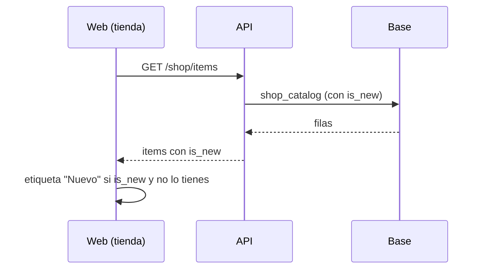

# Plan: etiqueta "Nuevo" en la tienda durante 3 días

> Planeación original. Estado: **aprobado** por Daniel el 2026-11-20.

## Decisiones tomadas

| Tema | Decisión |
|---|---|
| Desde cuándo cuenta | `shop_items.created_at` (ya existe desde la `119`): cuando el artículo entra a la base. Los de la `130` cuentan desde que se aplique en producción |
| Dónde se calcula | En la base, en la vista `shop_catalog`: columna `is_new` (`created_at >= now() - 3 días`). La regla queda en un solo lugar y la API la pasa tal cual |
| Qué no cuenta | Activar un artículo que estaba desactivado no lo vuelve "Nuevo" (su `created_at` es el de siempre). Cambiar su precio tampoco |
| API | `ShopItem.is_new` (booleano) en `GET /shop/items` |
| Web | Etiqueta "Nuevo" en la tarjeta del artículo de la tienda y en la vista grande; se oculta en lo que ya tienes |
| Artículos de la 119 en producción | Se cargaron el 2026-11-14: al desplegar ya pasaron los 3 días y no salen como nuevos |

## 1. El flujo completo

## 2. Base

`132_tienda_etiqueta_nuevo.sql`: `create or replace view public.shop_catalog` igual a la de la `119` con `is_new` al final (una vista solo admite columnas nuevas al final). Inversa: la vista de la `119`.

## 3. API (`web/backend`)

`schemas/shop.ts` (`ShopItem.is_new`), `routes/shop.ts` (`CATALOG`, `CatalogRow` y la respuesta) y la prueba `test/unit/shop-routes.test.ts`.

## 4. Web (`web/frontend`)

`pnpm gen:api`, la etiqueta en `ShopPage.tsx` (tarjeta) y en `ItemPreview.tsx` (vista grande), y una prueba.

## 5. Requisitos antes de empezar

La API local levantada para `gen:api`.

## 6. Orden de implementación

1. Migración e inversa, aplicadas en la base local.
2. API y su prueba.
3. `gen:api`, web y su prueba.
4. Manual del jugador (`jugador/tienda-y-cosmeticos.md`), documentación, changelog y filas en los índices.
