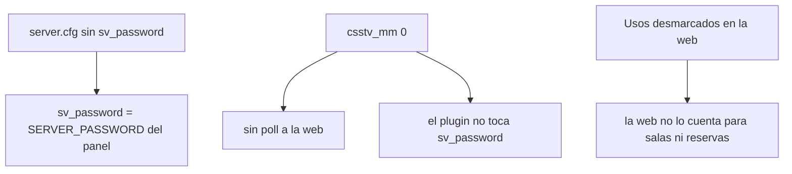

# El #3 libre: documentación

## Qué hace

Desde el 2026-11-21 el **#3** (`190.104.34.3:27031`, SourceTV `27067`) es un servidor de mix libre, como antes del matchmaking: no toma salas del matchmaking ni reservas de PCW o torneo. Se entra con la contraseña fija `torneo921` y el mix empieza con `!ready` (8 jugadores, con cuchillo) o `!live`. El resultado llega a la web como un mix (`csstv_send 1`).

## Lo propio del #3

- `csstv_mm "0"` en `csstv_reporter.cfg` (el #1 y el #2 siguen en `1`).
- `SERVER_PASSWORD` del panel: `torneo921`. Para cambiarla, se cambia esa variable (vale desde el próximo arranque) y, para que valga ya, `sv_password` por RCON.
- Esto es una excepción a "configuración igual en todos los servidores": queda anotada en `CLAUDE.md`.

## Volver a sumarlo al matchmaking

`csstv_mm "1"` en su `csstv_reporter.cfg` (y `csstv_mm 1` por RCON), marcar sus usos en la web y, si se quiere, dejar `SERVER_PASSWORD` como estaba: con `csstv_mm 1` el plugin pone una contraseña al azar y la maneja la web.

## Qué cambia para cada rol

- **Jugador:** puede entrar al #3 con la contraseña y jugar un mix sin pasar por la web. El matchmaking tiene un servidor menos.
- **Capitán:** las PCW no se juegan en el #3.
- **Organizador:** los torneos no se juegan en el #3.
- **Moderador y admin:** sin cambios en los comandos.
- **Streamer y dueño de servidor externo:** sin cambios.

Ninguna página del manual nombra al #3: sin cambios en el manual.

## Términos y privacidad

Sin cambios: los mixes del #3 se guardan y publican igual que cualquier mix.

## Dónde está cada cosa

- `cstrike/cfg/sourcemod/csstv_reporter.cfg` del #3 (respaldo del panel: `csstv_reporter copy.cfg`, o similar, en la misma carpeta).
- Variable `SERVER_PASSWORD` en Startup del panel de MVZG (`16c850ff`).
- Usos del servidor: Administración › Servidores › CMLeague #3.
