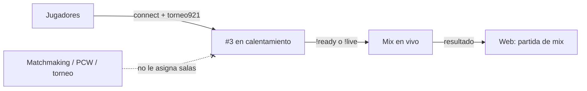

# Plan: el #3 libre, sin matchmaking, PCW ni torneo

Pedido por Daniel el 2026-11-21: que el **#3** (`16c850ff`, `:27031`) se pueda usar para jugar como antes del matchmaking: se entra con contraseña, se arma el mix y se empieza con `!ready` o `!live`, sin pasar por el matchmaking, la PCW ni el torneo de la web.

## Decisiones tomadas

- **Contraseña fija:** `torneo921` (Daniel). Va en la variable `SERVER_PASSWORD` del panel, que la línea de arranque pasa como `+sv_password`; el `server.cfg` del #3 no tiene `sv_password`.
- **Los mixes se siguen mandando a la web** (`csstv_send 1`, Daniel): cuentan como mix, con estadísticas, ELO de mix y demo.
- **Los usos de la web los desmarca Daniel** (Administración › Servidores › CMLeague #3 › Usos: matchmaking, PCW y torneo).
- Sin cambios en el plugin, la base, la API ni la web: alcanza con `csstv_mm 0`.

## 1. El flujo completo

## 2. El servidor

- `csstv_mm "0"` en `cfg/sourcemod/csstv_reporter.cfg`: el plugin deja de pedir salas (`csstv_mm_poll`) y deja de poner y rotar la contraseña (`Mm_OnConfigsExecuted` sale enseguida).
- Por RCON, `csstv_mm 0` y `sv_password "torneo921"`, para que valga sin esperar un cambio de mapa (`csstv_mm` se lee en cada poll).

## 3. Requisitos antes de empezar

- El #3 sin mix en curso ni sala tomada (último evento del reporter: el cierre de la partida). No se reinicia nada.

## 4. Orden de implementación

1. RCON (corta el poll en el acto, así no toma una sala mientras Daniel desmarca los usos).
2. `SERVER_PASSWORD` en el panel.
3. `csstv_reporter.cfg` con respaldo.
4. Daniel desmarca los usos en la web.
