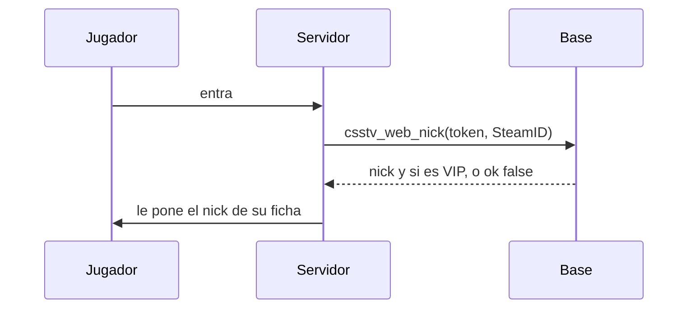

# El nick de la web en producción: documentación

## Qué hace

Cada jugador con ficha pública juega en los servidores con el nombre de su ficha, también en torneos y PCW. El reporter se lo pide a la base al entrar (no al empezar la partida), con `csstv_web_nick`. Un VIP usa el nombre que quiera. Sin ficha o con la ficha privada, cada uno conserva el suyo.

Las reglas del juego y la limpieza de caracteres están en [`2026-11-25-nombre-web-en-vivo`](../2026-11-25-nombre-web-en-vivo/).

## Base

`csstv_web_nick(p_token, p_steam)`: el nick de la ficha dueña del SteamID (principal o adicional) y si su cuenta es VIP. Sin ficha o con la ficha privada, `ok: false`.

## Qué cambia para cada rol

| Rol | Qué cambia | Página del manual |
|---|---|---|
| Jugador | Juega con su alias de la web; un VIP, con el que quiera | `jugador/jugar-en-el-servidor.md` y `jugador/crear-cuenta.md` |
| Los demás | Nada | — |

## Términos y privacidad

- **Términos:** en los servidores juegas con el nombre de tu ficha.
- **Privacidad, qué es público:** en los servidores apareces con tu tag.

## Dónde está cada cosa

| Qué | Archivo |
|---|---|
| Base | `supabase/replanteo/134_nick_de_la_web.sql` y su inversa |
| Plugin | `server/addons/sourcemod/scripting/csstv/webnick.inc` |
