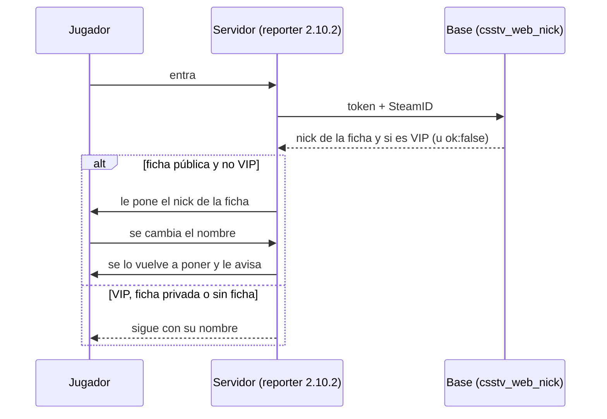

# Plan: el nick de la web en producción

> Planeación original. Estado: **aprobada por Daniel** (2026-11-22).

Daniel (2026-11-22): "siento que hoy no funciona el bloquear el nombre en los servidores". La idea es que cada jugador juegue con el nombre de su ficha de la web: si entra con otro se le cambia solo, y no se lo puede cambiar durante la partida. Los VIP sí.

## Lo que se encontró

- **#1, #2 y #3 corren el reporter 2.10.2 de Kyan** (`kyan/pruebas`, commit `7c0567ae`, binario en su bitácora `2026-11-13-ready-automatico/build_2.10.2/`). Trae el "nombre de la web" de la 2.10.1 (`csstv/webnick.inc`, commit `1cb45520`, bitácora de Kyan `2026-11-12-cuchillo-por-vida-y-nombre-web`).
- **La base de producción no tiene `csstv_web_nick`:** Kyan subió el plugin pero no su replanteo `113_nick_de_la_web.sql` (el número choca con la `113` de `main`, chat y jugadores históricos). Cada jugador que entra deja en `errors_*.log`: `csstv_web_nick: HTTP {"code":"PGRST202" … Could not find the function public.csstv_web_nick(p_steam, p_token)`. El 2026-11-22: 29 en el #1, 41 en el #2 y 21 en el #3. Sin respuesta de la base, el plugin deja a cada uno con su nombre.
- Lo de `main` sin commit (`2026-11-13-nombre-de-la-ficha-en-mix`, reporter 2.11.0 sobre la 2.10.0) no sirve para producción: subirlo pisaría la 2.10.2 (cuchillo por vida, `!ready` automático y el mismo nombre de la web).

## Decisiones tomadas

| Tema | Decisión | Porqué |
| --- | --- | --- |
| Arreglo | Aplicar en producción la función de Kyan como replanteo `134_nick_de_la_web.sql`, sin cambios en la lógica | El plugin desplegado ya hace lo pedido; solo falta la función. No se toca ningún servidor, ni se reinicia ni recarga nada |
| PCW y torneo | También el nick de la ficha, como en el mix y el matchmaking | Decidido por Daniel (2026-11-22). Reemplaza lo decidido el 2026-11-13 ("en torneos y PCW, como antes"). La 2.10.2 ya lo hace así |
| VIP | Libre: entra con su nombre y se lo cambia | Pedido de Daniel y regla de Kyan |
| Ficha privada | No se fuerza (la función responde `ok: false`) | No revelar a quién pertenece un SteamID; regla de Kyan |
| Prueba previa | En el servidor local, con los mismos `.smx` del #1, contra la base local (nunca la real) | Pedido de Daniel |
| `2026-11-13-nombre-de-la-ficha-en-mix` | Queda sin desplegar; se decide aparte si se descarta | Hace lo mismo que la 2.10.2 sobre una versión vieja |

## 1. El flujo

## 2. Base

`supabase/replanteo/134_nick_de_la_web.sql`: `csstv_web_nick(p_token, p_steam)`, igual a la `113` de Kyan (security definer, `csstv_auth`, `steam_owner`, `is_vip`). Inversa en `docs/bitacora/2026-10-14-replanteo-modelo-datos/reversas/134_nick_de_la_web.sql`.

## 3. Prueba local (`pruebas/`)

1. Respaldar `addons/sourcemod/plugins/` y `cfg/sourcemod/csstv_reporter.cfg` del servidor local.
2. Bajar los `.smx` de `plugins/` del #1 por la API del panel y ponerlos en el local, en lugar de los suyos.
3. Aplicar la `134` en la base local, con un servidor de prueba (token) y el cfg apuntando a la base local con `csstv_send 1` (la base local, no la real).
4. Con bots: `csstv_webnick_fake` (VIP, sin VIP, sin ficha) en el calentamiento y en vivo, y `sm_rename`.
5. Con Daniel entrando con su cliente: se lee su SteamID del `status`, se le arma una ficha de prueba en la base local, y se prueba sin VIP (le pone el nick y no lo deja cambiar, en el calentamiento y en vivo) y con VIP (libre).
6. Restaurar todo: plugins, cfg, cola vacía, la base local sin lo sembrado y sin la `134`.

## 4. Requisitos

- La base local levantada (`supabase_db_v34frag-api`) y la API key del panel (`SFTP_CSS_API_KEY`).
- Que no haya un `srcds` local corriendo.

## 5. Orden

1. Prueba local (este plan).
2. Con la confirmación de Daniel: `pruebas/probar_134.sql` contra producción (se deshace solo), después la `134` y `notify pgrst, 'reload schema'`.
3. Comprobar en `errors_*.log` de #1, #2 y #3 que no aparecen más `PGRST202` y, en `L*.log`, `Nombre de la web: … pasa a llamarse …`.
4. Manual, términos y privacidad si dicen otra cosa, `DOCUMENTACION.md`, `GUIA_IMPLEMENTACION.md` y `docs/PENDIENTES.md`.
