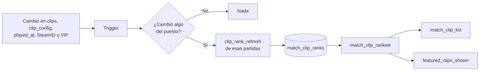

# Ranking de clips guardado: documentación

## Qué hace

El puesto de cada clip en su partida (qué jugadas se muestran, en qué orden y cuáles son de VIP) se guarda en la tabla `match_clip_ranks`, en lugar de calcularse en cada lectura. Lo mantienen al día unos triggers, que recalculan solo las partidas afectadas cuando cambia algo de lo que define el puesto.

Antes, `match_clip_ranked` (replanteo 76) armaba el puesto de **todos** los clips de la base en cada consulta, aunque se pidieran los 5 de una partida. En producción eso tardaba entre 0,9 y 1,9 s por lectura (con picos de 8 s), y crecía con cada partida. Al terminar un mix se juntaban el grabador de clips, el bot de Discord y los 10 jugadores de la sala: con 2 CPU en el VPS, las conexiones de PostgREST quedaban ocupadas y toda la web se trababa de uno a tres minutos, hasta `/auth/me` (15 a 19 s).

Las vistas `match_clip_ranked`, `match_clip_list` y `featured_clips_shown` devuelven exactamente lo mismo que antes (mismas columnas, mismas filas), así que la API, la web, el grabador y el bot no cambian.

## Cómo se diagnosticó

| Qué se midió | Resultado |
|---|---|
| Log de Caddy de la API (producción, 2026-11-22) | Picos de uno a tres minutos en los que tarda todo, unos 20 s después del fin de cada partida (19:24:57, 20:16:31 y 06:34:59 UTC) |
| `pg_stat_statements` (producción) | `clip_discord_pending` 1510 ms de promedio, `player_featured_clips_list` 1351 ms, `match_clip_list` de una partida entre 900 y 1860 ms |
| Base local (copia del 2026-11-20, 4080 clips) | `match_clip_list` de una partida 390 ms: el plan recorre los 4080 clips, con `steam_owner()` y `vip_at()` por cada uno |

Se descartó, midiendo: el guardado del resultado y el ELO (~250 ms), las medallas (~200 ms), la métrica `mvp_mixes` (3 ms), el trabajo de demos del VPS y un recálculo de ELO por temporada.

## El puesto de un clip

La regla es la misma de la 76 y no cambió:

1. Cada clip tiene un tipo (`ace`, `4k`, `3k`, `clutch_N`) con una prioridad de `clip_config.priorities`.
2. Por jugador (su ficha, o la SteamID si es invitado) se quedan los `per_player` mejores.
3. Por partida, los `per_match` mejores de los que no son de VIP.
4. Los de VIP van aparte (hasta `vip_per_match`), después de esos.
5. Los forzados que no entraron, al final.

## Datos

### `match_clip_ranks`

Una fila por cada clip que se lista (los que no entran en el puesto no están).

| Columna | Qué es |
|---|---|
| `clip_id` | El clip (clave primaria; se borra con el clip) |
| `match_id` | La partida (índice) |
| `position` | Su puesto en la partida |
| `vip` | Si entró por el cupo de VIP |
| `type`, `priority` | Su tipo y la prioridad de ese tipo |
| `owner_id` | La ficha dueña de la SteamID (índice), o `null` si es invitado |

Tiene RLS y no tiene permisos para `anon` ni `authenticated`: solo la leen las vistas, que son de `postgres`.

### Lo que se sigue leyendo en vivo

El nombre del jugador, el video (`video_status`, `video_key`, `video_seconds`, `video_drive_id`, `video_in_r2`), la revisión, la demo y el estado de la partida salen de `match_clips`, `matches` y `players` en cada lectura, como antes.

## Funciones

| Función | Qué hace |
|---|---|
| `clip_rank_refresh(partidas uuid[])` | Borra y vuelve a calcular el puesto de los clips de esas partidas (`null` = todas). Toma un `pg_advisory_xact_lock` para que dos recálculos no choquen |
| `clip_rank_refresh_steams(steam_ids text[])` | Recalcula las partidas con clips de esas SteamID |
| `clip_rank_player_steams(ficha uuid)` | Las SteamID de una ficha: la principal y las extra |

Ninguna se puede llamar desde la API.

## Cuándo se recalcula

| Trigger | Tabla | Cuándo | Qué recalcula |
|---|---|---|---|
| `clip_rank_ins`, `clip_rank_del` | `match_clips` | Clips nuevos o borrados | Sus partidas |
| `clip_rank_upd` | `match_clips` | Si cambia `match_id`, `round`, `player_steamid`, `kill_ticks`, `clutch_vs`, `round_won` o `video_forced` | Sus partidas. Los cambios del video no recalculan |
| `clip_rank_config` | `clip_config` | Si cambian las prioridades o los topes | Todo (unos 400 ms) |
| `clip_rank_match` | `matches` | Si cambia `played_at` y tiene clips | Esa partida (define si el dueño era VIP) |
| `clip_rank_player_ins_del`, `clip_rank_player_upd` | `players` | Ficha nueva o borrada, o cambio de `steam_id` o `user_id` | Las partidas con clips de sus SteamID |
| `clip_rank_extra_steam` | `player_extra_steam_ids` | Cualquier cambio | Las partidas con clips de esa SteamID |
| `clip_rank_vip` | `vip_memberships` | Cualquier cambio | Las partidas con clips de las fichas de esa cuenta |

Los de `match_clips` son por sentencia, con tablas de transición. Comparan con `except` y no con un join, porque las tablas de transición no tienen estadísticas y el join terminaba en un loop anidado.

## Tiempos (base local, copia del 2026-11-20)

| Consulta | Antes | Después |
|---|---|---|
| `match_clip_list` de una partida | 390 ms | 0,6 ms |
| `clip_discord_pending` | 780 ms | 15 ms |
| `player_featured_clips_list` | 400 ms | 6 ms |
| `clip_render_claim` | 450 ms | 4 ms |
| Cambiar el video de los 4080 clips | 65 ms | 50 ms |

## Qué cambia para cada rol

Nada para los usuarios: ven los mismos clips, en el mismo orden. La web deja de trabarse al terminar una partida.

## Términos y privacidad

Sin cambios: no se guarda ningún dato nuevo de las personas. La tabla repite el puesto, que ya se calculaba con los mismos datos.

## Dónde está cada cosa

| Qué | Archivo / ubicación |
|---|---|
| Migración | `supabase/replanteo/136_ranking_de_clips_guardado.sql` |
| Inversa | `docs/bitacora/2026-10-14-replanteo-modelo-datos/reversas/136_ranking_de_clips_guardado.sql` |
| Pruebas de los triggers | `docs/bitacora/2026-11-22-ranking-de-clips-guardado/pruebas/triggers.sql` |
| Medición de tiempos | `docs/bitacora/2026-11-22-ranking-de-clips-guardado/pruebas/tiempos.sql` |
| La vista de antes (la regla del puesto) | `supabase/replanteo/76_clips_destacados_y_rechazo.sql` y la inversa de la 136 |
