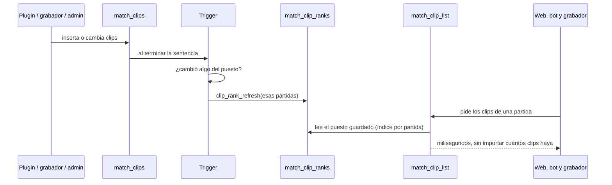

# Plan: ranking de clips guardado (la web ya no se traba al terminar una partida)

> Planeación original. Estado: **aprobado por Daniel el 2026-11-22**.

## Por qué

Los jugadores reportan que la página se pone lenta al terminar una partida. Se midió el 2026-11-22:

- **En producción** (log de Caddy de la API): tres picos en el día, cada uno de uno a tres minutos, en los que tarda todo, hasta `/auth/me` (15 a 19 s). Empiezan unos 20 s después del fin de una partida: 19:24:57 → 19:25-19:27, 20:16:31 → 20:16-20:18 y 06:34:59 → 06:35 (UTC).
- **`pg_stat_statements` de producción:** las consultas que pasan por las vistas de clips son las más lentas. `clip_discord_pending` promedia 1510 ms (4812 llamadas), `player_featured_clips_list` 1351 ms (4669), y las de `match_clip_list` de una partida entre 900 y 1860 ms, con picos de 8 s.
- **En la base local** (copia de producción del 2026-11-20, 4080 clips): `match_clip_list` de una partida (5 clips) tarda 390 ms, `clip_discord_pending` 780 ms, `player_featured_clips_list` 400 ms y `clip_render_claim` 450 ms.

`match_clip_ranked` (replanteo 76) arma el puesto de **todos** los clips de la base (CTE, funciones de ventana y `steam_owner()` y `vip_at()` por cada clip) antes de filtrar el que se pidió. Cuesta lo mismo pedir 5 clips que 4000, y crece con cada partida (unos 13 clips por mix).

Al terminar una partida se juntan: `clips_notify_detected` al guardar el resultado, el grabador (`clip_render_claim`, que usa la vista 3 veces), los 10 jugadores en la sala terminada (`/mm/lobbies/{id}/match`), el detalle de la partida y, cuando terminan los videos, el bot de Discord. Con 2 CPU, pocas consultas de 1-2 s ocupan las conexiones de PostgREST y todo lo demás hace fila.

Se descartó, midiendo: el guardado del resultado y el ELO (~250 ms), las medallas (~200 ms), la métrica `mvp_mixes` (3 ms), el trabajo de demos del VPS (1 s por corrida, no baja nada) y un recálculo de ELO por temporada (no hay temporadas con fecha futura).

Escribir `steam_owner` y `vip_at` adentro de la vista (sin funciones) baja de 383 a 256 ms con el mismo resultado: no alcanza, porque el costo es armar todo el ranking.

## Decisiones tomadas

| Tema | Decisión | Por qué |
|---|---|---|
| Solución | Guardar el puesto de cada clip en una tabla (`match_clip_ranks`) y que las vistas la lean | El puesto solo cambia cuando cambia algo de lo que lo calcula; calcularlo en cada lectura es el problema |
| Qué se guarda | Por clip listado: partida, puesto, `vip`, `type`, `priority` y `owner_id` | Es lo que sale del ranking. El resto (video, nombre, demo, estado) se sigue leyendo en vivo de `match_clips`, `matches` y `players` |
| Las vistas | `match_clip_ranked` pasa a leer la tabla, con **las mismas columnas en el mismo orden** (`create or replace view`). `match_clip_list` y `featured_clips_shown` no cambian | La API, el grabador, el bot, el frontend y las funciones que usan las vistas siguen igual |
| El cálculo | Una función `clip_rank_refresh(partidas)` con la misma lógica de la vista de hoy, pero solo para las partidas que se le pasan (`null` = todas) | Todas las ventanas del ranking se parten por partida: calcular una partida sola da lo mismo que calcular todo |
| Cuándo se recalcula | Con triggers, para no depender de que cada función se acuerde: clips nuevos, borrados o con cambios en lo que define el puesto; `clip_config`; `matches.played_at`; las SteamID de los jugadores (`players.steam_id`, `player_extra_steam_ids`); `players.user_id`; `vip_memberships` | Son todas las entradas del ranking de hoy. Los cambios de video (`video_status`, etc.) no lo recalculan |
| Concurrencia | Un `pg_advisory_xact_lock` antes de recalcular | Dos recálculos de la misma partida a la vez chocarían con la clave primaria |
| Permisos | La tabla con RLS y sin políticas, sin permisos para `anon` y `authenticated` | Solo la leen las vistas (de `postgres`), como hoy |
| Verificación | La migración compara la definición actual de las vistas (md5) y aborta si no es la esperada. Al final compara el ranking guardado con el de la vista vieja, clip por clip, y aborta si difiere en una fila | Si producción tiene otra versión de la vista, no se cambia nada |
| Número | Replanteo `136_ranking_de_clips_guardado.sql`, con su inversa | Sigue la numeración |

## 1. El flujo completo

## 2. La base de datos (replanteo 136)

1. Verifica el md5 de `pg_get_viewdef` de `match_clip_ranked`, `match_clip_list` y `featured_clips_shown`.
2. Tabla `match_clip_ranks` (`clip_id` clave primaria y referencia a `match_clips` con `on delete cascade`, `match_id`, `position`, `vip`, `type`, `priority`, `owner_id`), con índices por `match_id` y `owner_id`.
3. `clip_rank_refresh(uuid[])`: borra y vuelve a insertar el ranking de esas partidas.
4. Llena la tabla con todas las partidas y la compara con la vista vieja.
5. `create or replace view match_clip_ranked` leyendo la tabla.
6. Triggers:
   - `match_clips`: después de insertar, borrar o actualizar (por sentencia, con tablas de transición). En la actualización solo recalcula si cambió `match_id`, `round`, `player_steamid`, `kill_ticks`, `clutch_vs`, `round_won` o `video_forced`.
   - `clip_config`: recalcula todo si cambian las prioridades o los topes.
   - `matches`: si cambia `played_at` y la partida tiene clips.
   - `players` (`steam_id`, `user_id`), `player_extra_steam_ids` y `vip_memberships`: recalculan las partidas con clips de esas SteamID.
7. Vuelve a comparar con la vista vieja guardada al principio y aborta si difiere.

## 3. La API, la web, el grabador y el bot

No cambian: leen las mismas vistas con las mismas columnas.

## 4. Requisitos antes de empezar

- La base local con la copia de producción (2026-11-20), para comparar el ranking nuevo con el viejo.
- Para desplegar: acceso al VPS (SSH con la llave del agente de Windows) y la confirmación de Daniel justo antes.

## 5. Orden de implementación

1. `supabase/replanteo/136_ranking_de_clips_guardado.sql` y su inversa en `docs/bitacora/2026-10-14-replanteo-modelo-datos/reversas/`.
2. Pruebas en la base local, en transacciones con `rollback` (`pruebas/`):
   - el ranking guardado igual al de la vista vieja, clip por clip;
   - cada trigger: clip nuevo, cambio de prioridades, forzar un clip, cambiar la SteamID de un jugador, VIP nuevo, cambio de `played_at`; después de cada uno, la tabla igual a la vista vieja;
   - los tiempos de antes y después de `match_clip_list`, `clip_discord_pending`, `player_featured_clips_list` y `clip_render_claim`;
   - la inversa deja las vistas como estaban (mismo md5).
3. Aplicar en la base local.
4. Desplegar en producción (con la confirmación de Daniel): la migración por `docker exec` en el VPS.
5. Medir en producción: `pg_stat_statements` y el log de Caddy en la próxima partida.
6. `DOCUMENTACION.md`, `GUIA_IMPLEMENTACION.md`, `CHANGELOG_DISCORD.txt`, la fila en `docs/bitacora/README.md`, la del replanteo en `supabase/replanteo/README.md` y `docs/PENDIENTES.md`.
