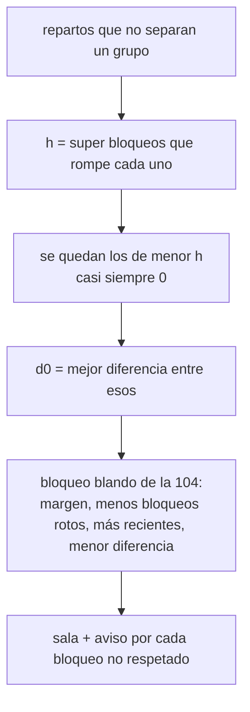

# Super bloqueo del admin: documentación

## Qué hace

Un admin marca cualquiera de sus bloqueos del matchmaking (Jugar › Bloqueo) como **super bloqueo**. Ese bloqueo se respeta siempre al armar la sala, aunque los equipos queden desparejos: no le aplica el margen de ELO del bloqueo blando (replanteo `104`). Los bloqueos normales, del admin o de cualquiera, siguen igual.

## Reglas

| Caso | Qué pasa |
|---|---|
| Super bloqueo de un admin | Los dos nunca quedan en el mismo equipo, cueste lo que cueste en ELO |
| Imposible respetarlo (los dos en el mismo grupo, o más super bloqueos que lugares) | Se rompen los menos posibles; la sala se arma igual y al admin le llega el aviso `mm_block_ignored` de siempre |
| Quien lo marcó deja de ser admin | El armado mira el rol actual: cuenta como un bloqueo normal. Ya no lo puede marcar ni desmarcar (sí sacar el bloqueo) |
| Sacar el bloqueo | Se va con la marca |
| Reemplazos | Sin cambios: el reemplazo entra en el equipo del que se fue |

## Datos y funciones

| Objeto | Qué es |
|---|---|
| `mm_blocks.super` | `boolean`, `false` por defecto |
| `mm_block_super(p_player, p_on)` | Solo admin (`42501` si no); marca o desmarca un bloqueo propio; si no existe, "Primero bloqueá a ese jugador" |
| `mm_best_split_ex` | Cuenta los super bloqueos rotos (solo si quien bloqueó tiene hoy `role = 'admin'`) y se queda con los repartos que rompen menos antes de calcular `d0` y el margen. `diff_free` pasa a ser `d0` entre esos repartos |
| `mm_my_profile` | `blocks.list[].super` |
| API | `PUT /api/v1/mm/blocks/{id}/super` con `{ "enabled": boolean }`; devuelve el estado completo |

## Web

Jugar › Bloqueo: el admin ve un escudo en cada bloqueado para marcarlo o desmarcarlo, y la etiqueta **Super** en los marcados.

## Qué cambia para cada rol

| Rol | Qué cambia | Página del manual |
|---|---|---|
| Admin | Marca sus bloqueos como super bloqueo | `admin/matchmaking.md` |
| Jugador | Puede tocarle una partida más despareja si en la sala hay un super bloqueo | — (lo dicen los términos) |
| Capitán, organizador, moderador, soporte, streamer, dueño de un servidor externo | Nada | — |

## Términos y privacidad

- **Términos** (`/terminos` y `terms/terminos.html`), sección del matchmaking: los admins pueden marcar un bloqueo como super bloqueo, que siempre se respeta aunque los equipos queden desparejos. Sin la marca "En preparación": se desplegó el mismo día.
- **Privacidad:** sin cambios (la marca es parte del bloqueo, que ya figura entre lo que ven solo tú y el staff).

## Dónde está cada cosa

| Qué | Archivo |
|---|---|
| Base | `supabase/replanteo/135_mm_super_bloqueo.sql` |
| Inversa | `docs/bitacora/2026-10-14-replanteo-modelo-datos/reversas/135_mm_super_bloqueo.sql` |
| Pruebas | `pruebas/probar_135.sh` y `probar_135.sql` |
| API | `web/backend/src/routes/mm.ts` |
| Web | `web/frontend/src/features/matchmaking/BlockPanel.tsx`, `source.ts`, `demo.ts`, `types.ts`, `src/api/schema.d.ts` |
| Manual | `docs/manual/admin/matchmaking.md` |
| Términos | `web/frontend/src/features/legal/pages/TermsPage.tsx` y `terms/terminos.html` |
