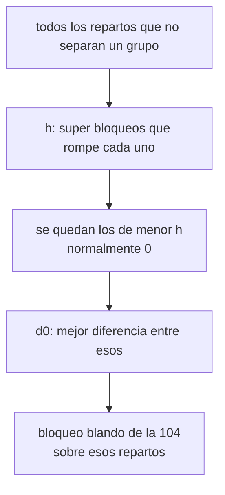

# Plan: super bloqueo del admin

> Planeación original. Estado: **propuesta**, pedida por Daniel el 2026-11-22.

## Decisiones tomadas

| Tema | Decisión | Por qué |
|---|---|---|
| Qué es | Una marca sobre un bloqueo que el admin ya tiene en Jugar › Bloqueo (replanteos `48`, `104` y `128`) | Lo pedido: "marcar como super bloqueo los bloqueos que ya tienen" |
| Quién | Solo el rol admin (`is_admin()`), sobre sus propios bloqueos | Lo pedido: "solo los admins" |
| El armado | El super bloqueo siempre se respeta, aunque los equipos queden desparejos: el margen de ELO (`block_margin`) no se le aplica | Lo pedido |
| Si es imposible | Si ningún reparto respeta todos los super bloqueos (por ejemplo, los dos en el mismo grupo, que nunca se separa), se rompen los menos posibles y se avisa como hoy. La sala se arma igual | Que una marca no trabe la cola |
| Si deja de ser admin | El super bloqueo vuelve a contar como uno normal (el armado mira el rol actual de quien bloqueó) | Que el poder siga al rol |
| Los bloqueos normales | Sin cambios | Lo pedido |
| Reemplazos | Sin cambios: el reemplazo entra en el equipo del que se fue, como hoy | Fuera de lo pedido |

## 1. El armado

## 2. Base (replanteo `135`)

- `mm_blocks.super boolean not null default false`.
- `mm_block_super(p_player, p_on)`: solo admin; marca o desmarca un bloqueo suyo que exista (si no, error).
- `mm_best_split_ex`: cuenta por reparto los super bloqueos rotos (solo si quien bloqueó es admin hoy) y descarta los repartos que rompen más que el mínimo antes de calcular `d0` y aplicar el margen.
- `mm_my_profile`: `blocks.list[].super`.
- Inversa en `reversas/135_mm_super_bloqueo.sql`.

## 3. API

- `PUT /api/v1/mm/blocks/{id}/super` con `{ "enabled": boolean }`. Devuelve el estado, como bloquear.

## 4. Web

- Jugar › Bloqueo: el admin ve un botón por bloqueo para marcarlo o desmarcarlo como super bloqueo, y una etiqueta en los marcados.

## 5. Requisitos

Ninguno.

## 6. Orden

1. Replanteo `135`, inversa y pruebas en la base local.
2. API y web.
3. Manual del admin y términos.
4. Desplegar la `135`, la API y la web.
