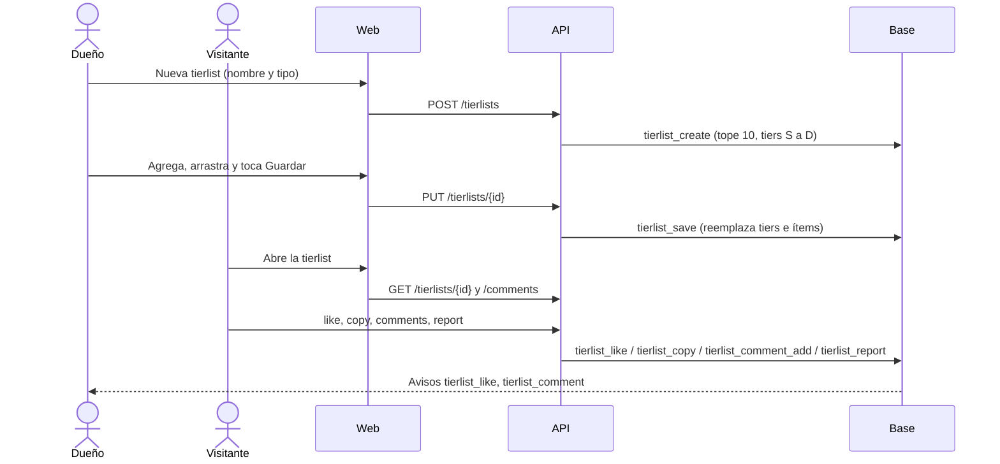
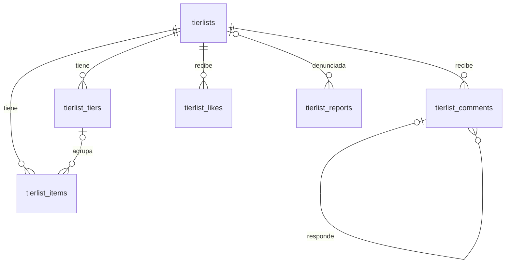

# Tierlists de jugadores y equipos: documentación

## Qué hace

Cada jugador con cuenta y ficha arma rankings por tiers (tierlists) de jugadores o de equipos. Mete fichas y equipos de CMLeague o nombres de afuera, los ordena en tiers con nombre propio y los muestra en la pestaña **Tierlists** de su perfil. Arriba de esa pestaña va la destacada, entera, y abajo "Ver otras tierlists".

Las tierlists son públicas. Los demás les dan me gusta, las copian para editarlas como propias, las descargan como imagen, las comentan y responden los comentarios (dos niveles: no se responde una respuesta). Las tierlists y los comentarios se denuncian, y los revisan soporte, moderadores y admins en Administración › Baneos › **Tierlists**.

Todas las reglas (topes, dueño, dos niveles, quién comenta) las aplica la base (replanteo `137`). La API (`routes/tierlists.ts`) solo llama a sus funciones.

## Reglas

| Regla | Valor |
|---|---|
| Tierlists por cuenta | 10 (también al copiar) |
| Tiers por tierlist | 1 a 10. Nueva: S, A, B, C y D |
| Al crearla | En el banco, las 30 primeras fichas del ranking (`player_overview` por ELO) o los 10 primeros equipos (`team_ranking`, posición oficial, sin bandos de PCW). Una copia no los suma |
| Ítems por tierlist | 100, contando el banco ("Sin clasificar") |
| Nombres (tierlist, tier, ítem externo) | 1 a 40 caracteres, sin palabras bloqueadas |
| Tipo | `players` o `teams`, fijo desde que se crea |
| Ítems | Una ficha (en las de jugadores), un equipo que no es bando de PCW (en las de equipos) o un nombre externo (en las dos). Cada ficha o equipo, una vez |
| Destacada | Una por ficha. Destacar otra le saca la marca a la anterior |
| Comentarios | Dos niveles, 280 caracteres, 30 s entre comentarios y 30 por día (Bogotá), palabras bloqueadas. No comentan ni dan me gusta los baneados ni los bloqueados por el dueño (`profile_social_check`) |
| Me gusta | Uno por cuenta, no a la propia. Aviso al dueño la primera vez de cada cuenta |
| Copiar | Ajena, con tiers e ítems; sin comentarios, me gusta ni destacada. Nombre `<hasta 32> (copia)`. `copied_from` apunta a la original (null si se borra) |
| Denuncias | Una por cuenta y tierlist o comentario, 20 por día, motivos `toxic`, `spam`, `harassment` y `other` |

- Un ítem de CMLeague muestra el nick, la foto (o el avatar puesto) y el escudo **al día**: no se guarda una copia. Si la ficha o el equipo se borran, el ítem se va con ellos.
- Borrar un tier manda sus ítems al banco (en el editor). El banco no se muestra a los demás ni sale en la imagen.
- Un comentario borrado queda guardado (`deleted_at`). Si tiene respuestas, se ve "Comentario borrado" y las respuestas siguen.
- Al borrar la cuenta se borran sus tierlists (`owner` con `on delete cascade`), aunque la ficha siga.

## Datos (replanteo `137`)

| Tabla | Columnas clave |
|---|---|
| `tierlists` | `owner` (cuenta), `player_id` (ficha), `name`, `kind`, `featured` (índice único parcial por ficha), `comments_open`, `copied_from`, `updated_at` |
| `tierlist_tiers` | `tierlist_id`, `label`, `position` (0 a 9) |
| `tierlist_items` | `tierlist_id`, `tier_id` (null = banco), `position`, `ref_player`, `ref_team` o `external_name` (exactamente uno) |
| `tierlist_comments` | `tierlist_id`, `parent_id` (null = comentario), `author`, `body`, `deleted_at`, `deleted_by` |
| `tierlist_likes` | `(tierlist_id, user_id)` |
| `tierlist_reports` | `target` (`tierlist` o `comment`), `tierlist_id` y `comment_id` (`set null` al borrar), `snapshot` (el texto denunciado), `author` (la ficha), `reason`, `note`, `status` |

Todas con RLS y sin permisos directos: se usan con funciones `security definer`.

| Función | Quién | Qué hace |
|---|---|---|
| `tierlists_of(ficha)` | Cualquiera | Las de una ficha, la destacada primero |
| `tierlist_get(id)` | Cualquiera | La tierlist con sus tiers, el banco y los `can_*` de quien mira |
| `tierlist_comments_list(id, antes)` | Cualquiera | 20 comentarios por página con todas sus respuestas. `total` (comentarios y respuestas) y `threads` (los que se paginan) |
| `tierlist_create`, `tierlist_save`, `tierlist_delete`, `tierlist_feature`, `tierlist_comments_set` | El dueño | Crear, guardar todo junto, borrar, destacar, abrir o cerrar comentarios |
| `tierlist_copy`, `tierlist_like`, `tierlist_comment_add`, `tierlist_report` | Con sesión y ficha | Copiar, me gusta, comentar o responder, denunciar |
| `tierlist_comment_delete` | El autor, el dueño de la tierlist o soporte | Borra con `deleted_at`. Lo del soporte queda en su actividad (`tierlist_comment_delete`) |
| `tierlist_reports_admin`, `tierlist_report_resolve` | Soporte, moderadores y admins | La cola de denuncias; `dismiss` o `delete` (el comentario o la tierlist). Queda en la actividad del soporte (`tierlist_report`) |

Avisos nuevos, en la categoría **Amigos** (`friends`): `tierlist_comment` (al dueño), `tierlist_reply` (al autor del comentario) y `tierlist_like` (al dueño, una vez por cuenta).

## API

| Método | Ruta | Sesión |
|---|---|---|
| GET | `/api/v1/players/{id}/tierlists`, `/api/v1/tierlists/{id}`, `/api/v1/tierlists/{id}/comments` | No |
| POST | `/api/v1/tierlists` | Sí |
| PUT / DELETE | `/api/v1/tierlists/{id}` | Dueño |
| PUT | `/api/v1/tierlists/{id}/featured`, `/api/v1/tierlists/{id}/comments-open` | Dueño |
| PUT | `/api/v1/tierlists/{id}/like` | Sí |
| POST | `/api/v1/tierlists/{id}/copy`, `/api/v1/tierlists/{id}/comments`, `/api/v1/tierlists/{id}/report` | Sí |
| DELETE | `/api/v1/tierlist-comments/{id}` | Sí |
| GET / POST | `/api/v1/admin/tierlist-reports`, `/api/v1/admin/tierlist-reports/{id}/resolve` | Soporte, moderador o admin |

## Web

- **Perfil › Tierlists** (`TierlistsTab.tsx`): la destacada (o la última editada) entera, "Ver otras tierlists" y, para el dueño, **Nueva tierlist** con el contador `n/10`.
- **`/tierlists/$id`** (`TierlistPage.tsx`): la tierlist con me gusta, **Editar**, **Destacar en mi perfil**, **Copiar**, **Descargar imagen**, **Copiar enlace**, denunciar y **Borrar**, y los comentarios. `?editar=true` abre el editor si es del que mira.
- **Editor** (`TierlistEditor.tsx`): arrastrar y soltar nativo (HTML5, sin librerías) y, para el teléfono y el teclado, el menú "⋮" de cada ítem (mover a un tier, correr, quitar). El buscador usa `/players?q=` y `/teams?q=&kind=official`; toda la fila del resultado (foto y nombre) agrega. Guarda todo junto.
- **Navegación:** la ruta de arriba dice Ranking › nick del autor › nombre de la tierlist (el nick lleva a la pestaña Tierlists de su perfil), y la vista y el editor tienen la flecha de volver (al paso anterior o, si se entró directo, al perfil del autor).
- **Imagen** (`lib/export.ts`): canvas de 1200 px con los tiers, la foto o el logo de cada ítem (la inicial si no carga o no deja CORS), el nick del autor y el logo. JPEG con `saveJpeg` del recap.
- **Administración › Baneos › Tierlists** (`TierlistReportsPanel.tsx`), con el número de denuncias por revisar en la pestaña.

## Qué cambia para cada rol

| Rol | Qué cambia | Página del manual |
|---|---|---|
| Jugador | Arma, destaca, copia, descarga, comenta, responde, da me gusta y denuncia tierlists. Avisos nuevos en Amigos | [`jugador/tierlists.md`](../../manual/jugador/tierlists.md), [`jugador/notificaciones.md`](../../manual/jugador/notificaciones.md) |
| Capitán | Nada | — |
| Organizador | Nada | — |
| Soporte | Pestaña **Tierlists** en Baneos y la papelera en todos los comentarios de tierlists | [`soporte/borrar-comentarios.md`](../../manual/soporte/borrar-comentarios.md) |
| Moderador | Lo mismo que el soporte, y ve en la actividad del soporte lo que borró | [`moderador/borrar-comentarios.md`](../../manual/moderador/borrar-comentarios.md) |
| Admin | Lo mismo que el moderador | — |
| Streamer | Nada | — |
| Dueño de un servidor externo | Nada | — |

## Términos y privacidad

Cambian (fecha de actualización: 22 de noviembre de 2026). Salieron de "En preparación" con el despliegue del 2026-11-23:

- **Términos:** las tierlists son públicas, son opinión de quien las arma y siguen las reglas de los comentarios. Cualquiera puede copiarlas o descargarlas. El autor borra o cierra sus comentarios, y el soporte, los moderadores y los admins pueden borrar comentarios o tierlists denunciados.
- **Privacidad:** datos nuevos (tierlists, comentarios, me gusta, denuncias), qué se publica (el contenido y el total de me gusta, no quién los dio; tu ficha puede aparecer en tierlists ajenas, como en el ranking) y dos plazos nuevos en la tabla de conservación.

## Dónde está cada cosa

| Qué | Archivo / ubicación |
|---|---|
| Migración e inversa | `supabase/replanteo/137_tierlists.sql`, `docs/bitacora/2026-10-14-replanteo-modelo-datos/reversas/137_tierlists.sql` |
| API | `web/backend/src/routes/tierlists.ts` (montada en `app.ts`), `SUPPORT_ACTIONS` en `schemas/bans.ts` |
| Pruebas de la API | `web/backend/test/integration/tierlists.test.ts` |
| Módulo web | `web/frontend/src/features/tierlists/` (`api/`, `components/`, `lib/board.ts` con su prueba, `lib/export.ts`, `pages/`) |
| Ruta | `web/frontend/src/routes/_app/tierlists.$id.tsx` |
| Pestaña del perfil | `web/frontend/src/features/player/components/tabs/TierlistsTab.tsx`, `PlayerTabs.tsx`, `lib/search.ts` |
| Moderación | `web/frontend/src/features/admin/bans/components/TierlistReportsPanel.tsx`, `pages/AdminBansPage.tsx`, `lib/support.ts` |
| Avisos | `web/frontend/src/features/shell/notifications/lib/model.ts` |
| Manual | `docs/manual/jugador/tierlists.md` y las páginas de la tabla de roles |
| Legales | `web/frontend/src/features/legal/pages/TermsPage.tsx`, `PrivacyPage.tsx`, `terms/terminos.html`, `terms/privacidad.html` |
