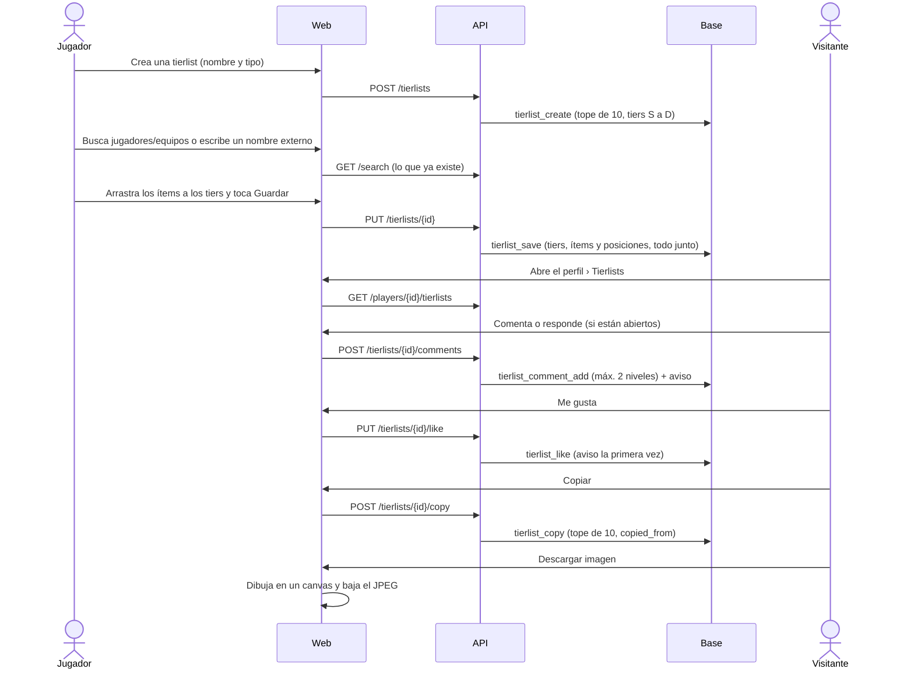
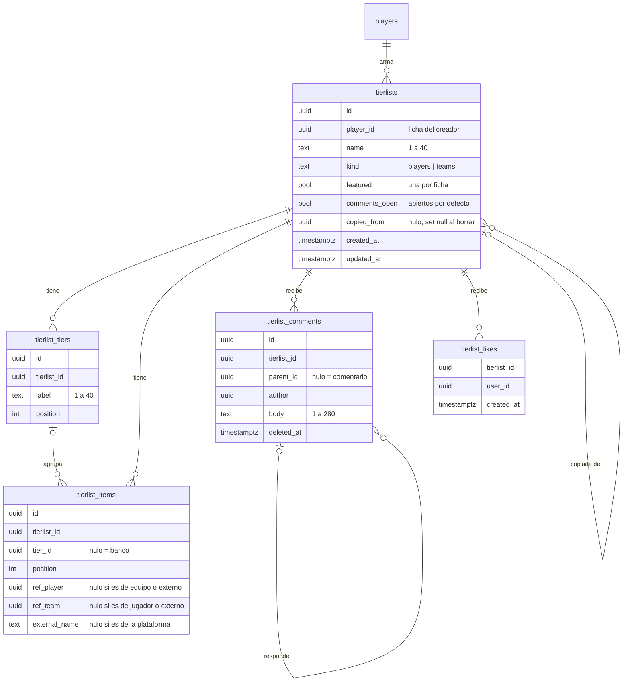

# Plan: tierlists de jugadores y equipos

> Planeación original. Estado: **propuesta**, pendiente de aprobación.

Cada jugador con cuenta puede armar tierlists de jugadores o de equipos, que se ven en una pestaña nueva de su perfil. Las demás personas pueden comentarlas y responder esos comentarios.

## Decisiones tomadas

| Tema | Decisión | Por qué |
|---|---|---|
| Quién crea | Con sesión y ficha de jugador, igual que para comentar un perfil (replanteo 91). La tierlist queda en la ficha (`players`) del que la arma | El perfil público se arma sobre la ficha. |
| Tipos | `players` (jugadores) o `teams` (equipos). Se elige al crearla y no se cambia | Un tipo mezclado no tiene sentido en el buscador. |
| Ítems de la plataforma | Fichas de `players` y equipos reales de `teams` (sin los `kind = 'mix'`), sin mínimo de jugadores | Los equipos de mix se arman solos en cada partida y no son equipos de verdad. |
| Ítems externos | Solo el nombre (hasta 40 caracteres), para jugadores y equipos, sin foto. Se muestran con la inicial, como `TeamCrest` e `initialOf` | Sin subir imágenes no hay que guardarlas, moderarlas ni pasarlas por términos. |
| Ítems de la plataforma en pantalla | Nick, avatar, nombre y escudo actuales, leídos al mostrar, no copiados | Si alguien cambia de nick, la tierlist lo muestra al día. |
| Ítem borrado | Si se borra la ficha o el equipo, su ítem se borra con él (`on delete cascade`) | No quedan ítems vacíos. |
| Visibilidad | Todas públicas, también sin sesión. No hay `is_public` | Así lo pidió Daniel. |
| Destacada | Como mucho una por ficha: `featured` con un índice único parcial. Va arriba de la pestaña, con "Ver otras tierlists" si hay más | La base asegura que haya una sola. |
| Topes | 10 tierlists por cuenta, 10 tiers por tierlist, 100 ítems por tierlist, nombres (de la tierlist, de cada tier y de cada ítem externo) de hasta 40 caracteres | Lo definió Daniel. |
| Tiers | Al crearla trae S, A, B, C y D. Se renombran, se agregan, se borran y se reordenan. Al borrar un tier, sus ítems vuelven al banco | Arranque rápido, como en Tiermaker. |
| Banco | Los ítems sin tier quedan en el banco (`tier_id` nulo) y se muestran abajo | Se puede cargar todo y clasificar después. |
| Guardado | La tierlist completa (tiers e ítems con su posición) se guarda de una vez con un RPC, `tierlist_save`, al tocar "Guardar" | Un solo cambio atómico, sin una llamada por cada ítem arrastrado. |
| Arrastrar y soltar | API nativa de HTML5, más botones "subir", "bajar" y "mover a tier" para el celular y el teclado. No se suma ninguna librería | En el proyecto no hay librería de arrastrar y soltar, y el arrastre nativo no anda con el dedo. |
| Comentarios | Dos niveles: comentario y respuesta. No se responde una respuesta: la base lo rechaza si el padre ya tiene padre. Hasta 280 caracteres, con los mismos topes y filtros que los del perfil (`comment_blocked_word`, `profile_social_blocked`, 30 s entre comentarios y 30 por día) | Así lo pidió Daniel, y reusa las reglas del muro. |
| Borrar un comentario | Queda con `deleted_at`, como en el perfil. Si tiene respuestas, se ve "Comentario borrado" y las respuestas siguen | No se pierde el hilo. |
| Quién borra comentarios | El autor, el dueño de la tierlist y moderadores, soporte o admins | Igual que en el muro del perfil. |
| Denuncias | `tierlist_reports`, de una tierlist (por su nombre o el de sus tiers e ítems) o de un comentario. Se resuelven en la misma pantalla que las denuncias de comentarios del perfil | Reusa el patrón y la cola de moderación de los replanteos 94 y 117. |
| Avisos | Al dueño, por cada comentario en su tierlist. Al autor del comentario, por cada respuesta. Van en la categoría `friends`, como `profile_comment` | Usa la misma preferencia que ya existe. |
| Escritura | Por la API (`web/backend`), que llama a los RPC con la sesión. Como en `routes/community.ts` | Es el patrón del perfil social. |
| Me gusta | Uno por cuenta y tierlist, que se da y se saca. No hay "no me gusta". Hace falta sesión y ficha, y no se le da a una tierlist propia. Se muestra el total | Copia `profile_votes` (replanteo 91), pero solo con el +1. |
| Aviso de me gusta | Al dueño, la primera vez que cada cuenta le da me gusta a esa tierlist (sacarlo y volver a darlo no avisa de nuevo), en `friends` | Igual que `profile_like`. |
| Cerrar comentarios | El dueño los cierra o los abre en cada tierlist (`comments_open`, abiertos por defecto). Cerrados, no se ven ni se pueden dejar, y los me gusta siguen | Igual que los comentarios del perfil. |
| Copiar la tierlist de otro | Con sesión y ficha, "Copiar" arma una tierlist nueva propia con el mismo tipo, tiers e ítems, y el nombre "<nombre> (copia)" recortado a 40. No copia comentarios, me gusta ni destacada. Cuenta para el tope de 10. Guarda `copied_from` y muestra "Basada en la tierlist de <nick>" (si la original se borra, el enlace desaparece) | Se le reconoce al autor original sin atar una tierlist a la otra. |
| Compartir como imagen | "Descargar imagen" dibuja la tierlist en un canvas (título, tiers con sus ítems, avatar o inicial de cada uno, nick del autor y logo de CMLeague) y la baja como JPEG con `saveJpeg`, sin librerías, como el recap (`features/player/recap/export.ts`). Si una foto no carga, va la inicial. Al lado, "Copiar enlace" a `/tierlists/$id`. Lo puede usar cualquiera, también sin sesión | Ya hay un exportador a imagen hecho a mano. |
| Rama | `main`. No es matchmaking ni toca el servidor | — |

## 1. El flujo completo

## 2. Base de datos: `supabase/replanteo/134_tierlists.sql`

- `tierlist_likes`: clave primaria `(tierlist_id, user_id)` y `on delete cascade` desde las dos tablas. El aviso de "la primera vez" usa el `ref` de la notificación, como `profile_like`.

- `tierlist_items`: un `check` asegura que esté exactamente uno de `ref_player`, `ref_team` o `external_name`, y que coincida con el `kind` de la tierlist (se valida en `tierlist_save`). `ref_player` y `ref_team` llevan `on delete cascade`. Hay un `unique` por tierlist y referencia, para que un jugador no aparezca dos veces.
- `tierlists`: el índice único `(player_id) where featured` limita la destacada a una.
- `tierlist_comments`: `parent_id` apunta a la misma tierlist. `tierlist_comment_add` rechaza el comentario si el padre ya tiene padre (en la base, no solo en la web).
- `tierlist_reports`: como `profile_comment_reports` (replanteo 94), con `tierlist_id` y `comment_id` (este puede ser nulo), `reason`, `note`, `status` y quién resolvió.
- RLS activado y `revoke all`. Todo pasa por funciones `security definer`, como en el 91:
  - Lectura (también sin sesión): `tierlists_of(p_player)` y `tierlist_get(p_id)`, que trae la tierlist con sus tiers, sus ítems resueltos (nick, avatar, nombre y escudo actuales), el total de me gusta, el propio, `copied_from` con el nick del autor original y sus comentarios paginados (vacíos si están cerrados).
  - Escritura: `tierlist_create`, `tierlist_save`, `tierlist_delete`, `tierlist_feature`, `tierlist_comments_set` (abrir o cerrar), `tierlist_like`, `tierlist_copy`, `tierlist_comment_add`, `tierlist_comment_delete`, `tierlist_report` y, para la moderación, `tierlist_reports_admin` y `tierlist_report_resolve`.
- Las notificaciones `tierlist_comment`, `tierlist_reply` y `tierlist_like` se suman al `case` de categorías como `friends`, como hizo el 91.
- Reversa: `docs/bitacora/2026-10-14-replanteo-modelo-datos/reversas/134_tierlists.sql`.
- Se agrega una línea en `supabase/replanteo/README.md`.

## 3. API (`web/backend`)

Rutas nuevas en un archivo propio, `routes/tierlists.ts`, con zod y OpenAPI como en `community.ts`:

| Método | Ruta | Sesión |
|---|---|---|
| GET | `/api/v1/players/{id}/tierlists` | No |
| GET | `/api/v1/tierlists/{id}` | No |
| POST | `/api/v1/tierlists` | Sí |
| PUT | `/api/v1/tierlists/{id}` | Sí (dueño) |
| DELETE | `/api/v1/tierlists/{id}` | Sí (dueño) |
| PUT | `/api/v1/tierlists/{id}/featured` | Sí (dueño) |
| PUT | `/api/v1/tierlists/{id}/comments-open` | Sí (dueño) |
| PUT y DELETE | `/api/v1/tierlists/{id}/like` | Sí |
| POST | `/api/v1/tierlists/{id}/copy` | Sí |
| POST | `/api/v1/tierlists/{id}/comments` (con `parent_id` opcional) | Sí |
| DELETE | `/api/v1/tierlist-comments/{id}` | Sí |
| POST | `/api/v1/tierlists/{id}/report` | Sí |
| GET y POST | `/api/v1/admin/tierlist-reports` y `/{id}/resolve` | Soporte, moderador o admin |

Para buscar jugadores y equipos se usa el buscador que ya existe, si filtra por tipo y excluye los mix. Si no, se le agrega ese filtro.

## 4. Web (`web/frontend`)

- `features/tierlists/`: `api/`, el editor (`TierlistEditor`), la vista (`TierlistView`) y los comentarios (`TierlistComments`, con las respuestas debajo de cada uno y sin botón "Responder" en ellas).
- Perfil: `features/player/components/tabs/TierlistsTab.tsx` y una entrada en `PlayerTabs.tsx`. Muestra la destacada (o la más reciente) y la lista de las demás.
- Rutas: `/tierlists/$id` (verla) y `/tierlists/$id/editar` (solo el dueño).
- En la vista: botón de me gusta con el total, "Copiar" (para otros, con sesión y ficha), "Descargar imagen" y "Copiar enlace", y para el dueño, el interruptor de comentarios.
- `features/tierlists/export.ts`: dibuja la tierlist en un canvas y reusa `saveJpeg` del recap. Si hace falta, `saveJpeg` se mueve a `src/lib/` para no importar del recap.
- Para denunciar se reusan `CommentReportDialog` o `MediaReportDialog`, y la moderación va en la misma sección que las denuncias de comentarios.

## 5. Términos, privacidad y manual

- **Términos** (`TermsPage.tsx` y `terms/terminos.html`): las tierlists y sus comentarios son públicos y son opinión de quien los escribe. Rigen las mismas reglas de convivencia que los comentarios del perfil. Se pueden denunciar, y moderación puede borrarlos. Los nombres externos los escribe el usuario, que responde por ellos. Cualquiera puede copiar una tierlist pública (queda el crédito al autor original) y descargarla como imagen.
- **Privacidad** (`PrivacyPage.tsx` y `terms/privacidad.html`): datos nuevos que se publican (tierlists, en qué tier aparece cada ficha o equipo, comentarios, el total de me gusta y de quién es la original de una copia). No se publica quién dio me gusta. Una ficha aparece en tierlists ajenas sin pedir permiso, como en el ranking. Al borrar la cuenta se borran sus tierlists. Los comentarios borrados se guardan con `deleted_at`, como los del perfil.
- Mientras no esté desplegado, todo lo anterior lleva "En preparación".
- **Manual:** página nueva `docs/manual/jugador/tierlists.md` (crear, editar, destacar, copiar, me gusta, comentar, responder, cerrar comentarios, descargar como imagen y denunciar). Se suman las denuncias de tierlists a `moderador/borrar-comentarios.md` y a `soporte/borrar-comentarios.md`. Se menciona el aviso nuevo en `jugador/notificaciones.md`.

## 6. Requisitos antes de empezar

- Túnel a la base de producción para aplicar el 134 (`PG_*` del `.env`).
- Nada nuevo para instalar.

## 7. Orden de implementación

1. `134_tierlists.sql` y su reversa. Probarlo en la base local: topes (también al copiar), destacada única, segundo nivel de comentarios rechazado, comentarios cerrados, me gusta a una propia rechazado, aviso de me gusta una sola vez y borrado en cascada.
2. Rutas de la API y tests.
3. Pestaña del perfil y vista de una tierlist (solo lectura).
4. Editor: crear, buscador, ítems externos, tiers, arrastrar y soltar con botones, y guardar.
5. Comentarios, respuestas, cerrar comentarios, denuncias y moderación.
6. Me gusta y copiar.
7. Descargar como imagen y copiar enlace.
8. Términos, privacidad y manual.
9. `DOCUMENTACION.md`, `GUIA_IMPLEMENTACION.md`, `CHANGELOG_DISCORD.txt` y `docs/PENDIENTES.md`.
10. Aplicar el 134 en producción y desplegar la API y la web.
